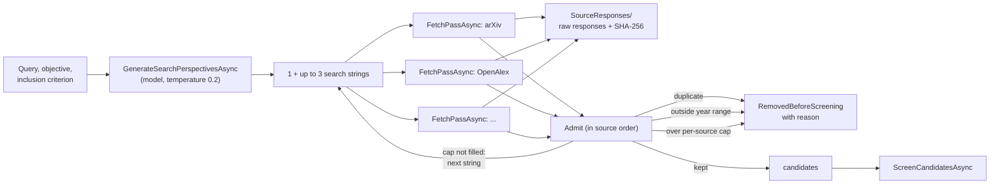
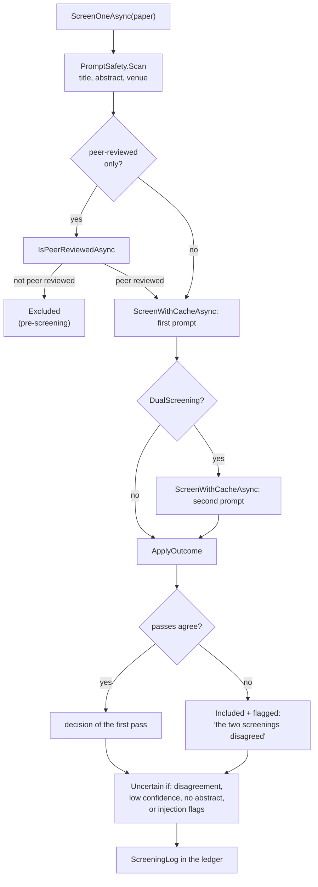

# 3. Search and screening

This page covers the first half of a run: turning a question into a list of screened records. The code is in `PrismaReviewEngine.Search.cs`, with the search strings in `PrismaReviewEngine.SearchStrings.cs` and citation chaining in `PrismaReviewEngine.Chaining.cs`, and in `PrismaReviewEngine.Screening.cs`, with the prompts in `PrismaReviewEngine.ScreeningPrompt.cs` and the human review in `PrismaReviewEngine.ScreeningReview.cs`, with one class per bibliographic source.

## From question to candidates

**Search strings.** `GenerateSearchPerspectivesAsync` asks the model for up to three alternative phrasings (a terminology variant, a narrower sub-topic, a methodology framing), in the spirit of STORM's multi-perspective questioning. If the call fails, the run carries on with the original query alone. The strings are appended to `protocol.md` as a dated amendment, which lists them as planned: it is written before the search, so it cannot say which ones ran. `ProtocolHash` is the first 16 characters of the SHA-256 of `protocol.md` as first written (`ProtocolSha256`), the value the methods text gives, so the title page of `main.tex` ("Protocol fingerprint (SHA-256)"), the report page and the methods show one fingerprint a reader can check (#573). Only when `protocol.md` could not be written is it a hash of the query, criteria, strings, sources and cap.

The reviewer can also see and edit the strings before the run. "Preview search strings" on the form calls `PreviewSearchStringsAsync`, which makes the same model call with the key the run would use (a page gets five previews). The reviewer can change, remove or add strings, at most four besides the query, and they are sent as `ReviewRequest.SearchStrings`. `ReviewInputGuard` cleans them like every other field (normalised, at most 200 characters each, instruction-like phrases flagged, repeats of the query dropped). A run with `SearchStrings` set does not ask the model at all: it searches the query followed by those strings, sets `ReviewState.SearchStringsReviewed`, and the protocol amendment and the methods text (PRISMA item 7) say that the reviewer approved them. An empty list means the query alone.

**Saturation.** After the search, `SearchSaturation.Compute` goes through the strings in the order they were run and counts, for each, the records no earlier string had found (by identifier, DOI or normalised title, as in duplicate removal). The result is kept as `ReviewState.SearchStringYields`. `SearchSaturation.Hint` turns it into one sentence for the dashboard funnel: when the last string adds at most a tenth of what it retrieved, the search is called close to saturation; otherwise another phrasing or citation chaining may still find studies. A string that was never run because every source had already filled its cap is shown with a dash and named. The methods text gives the same numbers. This is a hint about the phrasings, not about databases that were not searched.

**Querying sources.** The search strings run in rounds (`SearchAndScreenAsync`, `FetchPassAsync`). Each round asks every source that has not yet filled its cap (`MaxResultsPerSource`) with the same string, all sources at the same time, for at most the cap divided by the number of strings. The answers of a round are admitted in source order before the next round starts, so a source stops taking strings once records that go on to screening fill its cap. A duplicate or a record outside the year range does not use up the cap: in run 289a0d3e Crossref's only two records were one of each, the old per-source count stopped there, and the last two strings never ran (#562). Every response is looked up in the `ReviewCache` first (key: source, string and cap; kept 24 hours); a response that is actually used is saved as it was received in `SourceResponses/`, and its SHA-256 goes into the `PlatformSearchLog`. A source that fails is logged as "Faulted" with a sanitised message and the run goes on without it. The search logs and the candidates are written to the ledger by source, then by string.

The methods text (`MethodsSectionWriter.SearchStrategy`) is written from `SearchStringYields`, so it names what ran: which extra strings were run against every source, which against only some because the others had filled their cap, and which were not run at all, followed by how many new records each string that ran added.

**Admitting records.** The results of each round are processed in a fixed order, source by source. `Admit` puts every identified record into exactly one bucket: duplicate (same source id, DOI or normalised title as a record seen earlier), outside the year range (records with no year are kept), over the per-source cap, or candidate. Each removal is written to `RemovedBeforeScreening` with its reason, which is what makes the PRISMA flow diagram add up and lets the Review Output page show "Duplicates: show". Because the cap is checked last, it counts only the records that go on to screening: a source can show more records identified in the flow diagram than its cap. The methods text says so, so the two do not seem to disagree (issue #150).

## The sources

Every source implements `IAcademicSource` (`IAcademicSource.cs`): a `SourceName`, `FetchPapersAsync(query, maxResults)` returning `List<AcademicPaper>`, and `LastRawResponses`, the raw bodies of the last call.

| Class | Key needed | Notes |
|---|---|---|
| `ArxivSource` | no | Atom XML API. All requests in the app go one at a time through a static gate, 3 s apart, through `OpenSourceHttp`'s retries, because arXiv answers bursts with 503. The DOI is the published version's (`<arxiv:doi>`) when the authors gave one, and otherwise the arXiv DOI (`10.48550/arXiv.<id>`) |
| `OpenAlexSource` | expected | Also implements `ICitationGraph`, used for citation chaining; abstracts are rebuilt from OpenAlex's inverted index. Sends `OpenSources:OpenAlexApiKey` as an `Authorization` header; without a key most requests are refused once the small keyless budget is used up |
| `SemanticScholarSource` | optional | All requests in the app go one at a time through a static gate, 1 s apart with a key and 3 s without, because the API rate-limits hard |
| `CrossrefSource` | no | Abstracts arrive as JATS XML and are stripped to text |
| `ElsevierSource` | yes | Scopus / ScienceDirect. The search's STANDARD view names only the first author, as "Liu J."; the record's author list then ends with `ApaCitationBuilder.EtAl`, so the reference reads "Liu, J., et al." (Scopus does not say how many authors there are, so a paper with one author is marked the same way). The COMPLETE view's `author` list is used whole when an answer has it. The year is that of `prism:coverDate`, unless that issue date lies after the day of the search (an article in press): then it is the year in the Elsevier DOI ("10.1016/j.ress.2026.113770"), or "in press" with no year when there is none (issue #470) |
| `IeeeXploreSource` | yes | IEEE Xplore API |

Every source keeps the raw answer of its last search in `LastRawResponses`, which the run saves to `SourceResponses/` with its SHA-256. Scopus and IEEE Xplore did not until issue #469, so their records in older runs cannot be traced to an answer; a cached systematic search with records but no raw answer is now run again, and a multivocal paper names any database whose answers were not kept instead of saying all were. The two keyed sources remove their key from an answer before it is kept, should a database ever echo it.

The open sources share `OpenSourceHttp` (`OpenSourceHttp.cs`): one `HttpClient` with a `User-Agent` that names the project, and up to five attempts on rate limits and server errors, waiting 3, 6, 12 and 24 seconds (or what the server's `Retry-After` asks for, up to 30 seconds). A server that asks for a longer wait, as OpenAlex does once its daily budget is used up, is not asked again: the call fails at once with the wait in its message, instead of spending two minutes on attempts that are refused again. OpenAlex and Crossref also get the contact e-mail from `OpenSources:ContactEmail`, which puts the app in their faster "polite" pool. `SourceCatalog.cs` holds the list of sources the dashboard offers and which kind of key each needs.

## Screening one record

`ScreenCandidatesAsync` screens several records at a time (`Llm:FastParallelism` when a fast model is set, else `Llm:QualityParallelism`), but applies the outcomes to the ledger strictly in candidate order, saving the ledger after each one. That is why the dashboard counts move one record at a time even though the calls overlap.

`ScreenPaperAsync` is the single place where the screening prompt is built; the command-line evaluation tool uses the same method, so it measures exactly what a run does. The paper's title, authors, date, venue and abstract are passed inside `PromptSafety.Wrap` markers, with an instruction that text inside them is data, never instructions. The **second** screener is a different prompt, not a repeat: it works through the exclusion criterion first and then looks for positive evidence for inclusion. Both run at temperature 0 and return JSON that `ScreeningAnswer.Validate` checks (decision exactly "Included" or "Excluded", non-empty reasoning, confidence high, medium or low, and for an exclusion an optional `exclusionReason`).

**Each part of the inclusion criterion (#564).** In run 289a0d3e the criterion asked for "some form of evaluation", and two records were let in on a proposed framework and on an abstract that "suggests" an evaluation. The systematic screening prompt now has a step from `CriterionParts.Procedure`: split the inclusion criterion into its parts, copy each word for word, and say for each whether the record shows it ("yes" only with a quote from the title or abstract, "no", or "unclear"); a proposal or plan is not an evaluation. The answer carries them as `criteriaParts`. `CriterionParts.Problem` sends an answer back when a part is not in the criterion or when an Included record misses a part. `CriterionParts.Apply` then decides in code: a "yes" whose quote is not found in the title or abstract (`CitationSupportChecker.QuoteOccursIn`) becomes "unclear" with a note, and a record the screener kept is excluded when a part is not shown, as "inclusion criteria not met" (a "no") or "too little information" (an "unclear"), with the reason put before the screener's reasoning. Both screeners' parts are on file in `ScreeningLog.CriteriaParts` and `SecondCriteriaParts`. An answer without parts (an older model or cache entry) stays valid and is decided as before. The multivocal screening does not use this step. The prompt changed, so `ScreeningPromptVersion` is `screening-v7`.

**Alternatives in the criterion (#670).** In run 8942b961 the criterion was "Studies that describe or evaluate an agent framework or orchestration loop, with some form of evaluation", and the screener gave "or orchestration loop" as a part of its own. Every part was then required, so code excluded records the screener had kept because no quote showed an orchestration loop. `CriterionParts.Requirements` now groups the parts into requirements before the decision. The rule is deliberately simple and does not parse Boolean logic. A part that starts with "or" or "and/or" is an alternative to the part before it. Two parts that are the two sides of one "X or Y" (or "X and/or Y") phrase of the inclusion criterion, compared on letters and digits only, are alternatives of each other, so "agent framework" and "orchestration loop" form one requirement. Every other part is a requirement of its own, and "and" never makes an alternative. A requirement is met when any of its parts is "yes" with a quote found in the title or abstract, and `Apply` excludes a record the screener kept only when a whole requirement is unmet; the "(Excluded in code: ...)" reasoning names only those requirements, with their alternatives joined by "or". Each alternative's note says it was checked as an alternative, for example "Checked as an alternative to \"agent framework\"; one alternative is enough." `Problem` uses the same grouping, so an Included answer may say "no" to one alternative when another of the same requirement is "yes". The prompt has a step from `CriterionParts.AlternativesRule` that tells the screener the same, so `ScreeningPromptVersion` (now kept beside the prompt in `PrismaReviewEngine.ScreeningPrompt.cs`) is `screening-v8`, and decisions cached under the old rule are not reused.

**Exclusion reasons.** When the model excludes a record it names the main reason as one of four groups in `ExclusionReasons`: off topic, inclusion criteria not met, matches an exclusion criterion, or too little information. The group is stored as `ScreeningLog.ExclusionReason`; the peer-review filter sets "not peer reviewed", and a reviewer who changes a decision to Excluded sets "excluded by the reviewer". An answer without a reason is still valid and counts as "reason not recorded", so older cached answers and runs keep working. `ExclusionReasons.Count` groups the excluded records for the dashboard funnel, the PRISMA flow diagram in `main.tex` lists the groups under "Did not meet criteria", and `ExclusionReasons.Sentence` adds them to the selection text of the report (PRISMA 2020 item 16a). The model's free-text reasoning stays in the ledger for every record. Adding the reason changed the prompt, so `ScreeningPromptVersion` is now `screening-v5`.

**Caching.** `ScreenWithCacheAsync` looks up each decision in the cache under a key built from `ScreeningPromptVersion`, a SHA-256 of the prompt's fixed text (`ScreeningTemplateSha256`), which prompt (first or second), the model, both criteria and the record's metadata. A decision is only reused when all of those are identical, and it is marked `FromCache` in the ledger. The fingerprint is the prompt written with placeholders in place of the record and the criteria (`PromptTemplate`), with and without an abstract, so an edit to the prompt or to the steps the multivocal review shares (`ScreeningProcedure`, `ScreeningAnswerFormat`) changes the key on its own; before #547 only a raised version did, and a forgotten one reused decisions up to 90 days old. The multivocal screening's key holds its own fingerprint the same way. Still bump `ScreeningPromptVersion` when you change a screening prompt, since the version is what the ledger records: `PromptTemplateVersionTests` pins each version to its fingerprint and fails when the text changes alone (see [page 7](07-extending-and-testing.md)).

**The multivocal review's screening** (`MultivocalScreener`) uses the same steps and answer format, and labels its two calls with the same stages, `screening` and `screening-second`, so with `Llm:FastModel` set they go to the fast model as the systematic review's do, inside the runner and outside it (see [page 8](08-setup-and-configuration.md)). Its cache key and the `Model` in `multivocal-screening.json` name the model that answers each stage, so a decision of the main model is never reused as the fast model's. A new multivocal plan looks at the top 20 hits of each search string (`MultivocalPlan.DefaultTopHits`); the paper looks at 100, and the reviewer can raise it on the form, but every hit is screened, many of them twice, so a smaller start keeps a run cheap without changing the method. The same number bounds each string under the saturation rule, which searches the strings in order up to that many hits each until one adds no new source, so the form shows the field for both rules (`MultivocalPlan.UsesTopHits`), the protocol states it for both, and the ledger records the rule as applied, with its number (#486: before, saturation took a cap of 20 that the form hid and the protocol left out). Only evidence exhaustion ignores it. The built-in example plan is kept small as well: two grey search strings, three grey searches (Stack Exchange, GitHub and OpenAlex grey literature) and, for a multivocal plan, only the academic databases that need no key (OpenAlex, Semantic Scholar and arXiv). A search the guidelines name but the tool has not built, backlink snowballing for now, is shown on the form as "not available yet" and cannot be ticked; `MultivocalPlan.Normalized` leaves it out of any plan and `Problems` names it, so no protocol promises it (#474). A plan saved before this keeps it, and its search records it as skipped, not built.

**Targeted second screenings in the multivocal review** (`MultivocalSecondScreening`, approved on 23 November 2026 to cut the cost). The systematic review screens every record twice; the multivocal review screens every source once and a second time only where it matters, following the rapid-review practice of single screening with a verified sample. A source gets a second, independent screening (`screening-second`) when the first screening (a) included it, (b) was unsure (low or medium confidence, no confidence given, or no summary to judge by), or (c) `PromptSafety.Scan` found a strong flag, a phrase aimed at the model (a weak mention such as "system prompt" stays on file but is not enough, #472), and (d) when it falls in its pool's random audit sample. The sample is 20% of each pool, rounded up, and at least 10 sources, so a pool of ten or fewer is screened twice whole. It is drawn from every source the first screening decided, whatever it decided: a sample of exclusions alone would give the first screening one answer only, and Cohen's κ would be 0 or undefined by construction. Its extra cost is therefore the share of the first screening's other exclusions that falls in it. The draw ranks the sources of a pool by the SHA-256 of `seed|address`, lowest first, with the first eight characters of the run's id as the seed, so anyone can draw it again.

| What | Where it is on file | How it is reported |
|---|---|---|
| Why a source was screened again | `SecondReason` (`included`, `uncertain`, `flagged`) and `AuditSample` on each source in `multivocal-screening.json` | Counted by reason; the targeted agreement as "X of Y agreed", never in κ |
| The draw | `AuditSeed`, `AuditShare`, `AuditMinimum` in the same file; the rule and the seed in the protocol | The method names the seed and the rule |
| Agreement | `Kappa`, `KappaGrey`, `KappaFormal`, over the audit sample only | κ with the sample size, per pool and for both; both screenings are the same model at temperature 0, so κ measures its stability, not agreement between people |

A disagreement keeps the source and flags it, as before; a failed call, first or second, leaves the source "Error". The prompts are unchanged, but their versions were raised (`grey-screening-v2`, `formal-screening-v2`), so no answer cached under the rule of two screenings each is reused. The method, the protocol, the flow diagram ("Screened: n, of which twice: m"), the funnel on the run view, the abstract's facts, the guidelines table (G10) and the statement on AI use all take their counts from `MultivocalSecondScreening.Count` through `MultivocalScreeningText`. A run screened before the rule has no `AuditSeed` and keeps its old words: every source screened twice, κ over all of them.

**Flagged decisions in the multivocal method** (#473). A decision is flagged (`Uncertain`) when the two screenings disagreed, the source's text looked like instructions to the model, the model was unsure or its call failed. The method (`MultivocalScreeningText.Flagged`) says how many were flagged and why, each counted once by its first reason in that order, how many decisions the reviewer looked at and changed, and how many flagged decisions nobody looked at, with the exclusions among them apart, since an unseen flagged exclusion stands as the model made it. In the real run 50e9a8e3 the paper said only "The reviewer looked at 0 decisions"; it now says that 97 were flagged and 31 of them are exclusions nobody looked at. The run metrics count the flagged decisions in `UncertainDecisions`, as the systematic review does, and the ones left unseen in `FlaggedNotLookedAt`, which a systematic line leaves out.

**Stricter first screening and broad criteria in the multivocal review.** A real run with the example plan included 282 of 431 sources (65%): grey 152 of 223, academic 130 of 208. The multivocal first screening therefore has its own steps (`MultivocalScreener.FirstProcedure`): it looks for positive evidence that the source's main subject meets the inclusion criterion, a passing mention is not enough, and it includes only with that evidence and no exclusion that applies. A record with no summary whose title gives no positive evidence is excluded for too little information with low confidence; low confidence gives it a second screening and marks it uncertain, so the reviewer sees it, and if the second screener includes it the disagreement keeps it, as before. The second screener and the answer format stay the shared ones, and the systematic review's steps (`ScreeningProcedure`) and `screening-v6` are unchanged. The versions are `grey-screening-v3` and `formal-screening-v3`. The example plan's criteria are narrow: a source's main subject must be how an LLM agent's context is built, selected or managed, and passing mentions, generic retrieval or vector-database tutorials, release notes, changelogs and repositories whose README explains no practice are excluded. On the last planning step `MultivocalCriteriaCheck` warns, in code and without blocking, when the inclusion criterion is mostly a list of alternatives (five or more commas, semicolons, slashes or "or", with five words or fewer between them on average), when it holds a catch-all phrase such as "any source", "or a tool" or "practical experience", and when the exclusion criterion is empty or under eight words. During the screening `MultivocalPilotCheck` looks at the first 30 first-screening decisions of each pool in ledger order; when more than half are includes it writes a warning to `Warnings` in `multivocal-screening.json`, and the Progress tab shows it. The run is never stopped and no model call is added.

**Applying the outcome.** `ApplyOutcome` turns the one or two answers into a `ScreeningLog`. When the two passes disagree, the record is included and flagged, as in human dual screening: excluding it would hide the disagreement. Confidence is the lower of the two. A record without an abstract is always "low" and its reasoning says so, because the model has only the title to go on. The prompt for such a record shows "(none: this record has no abstract)" and tells the model to judge on the title and venue only. A reason or summary that still describes an abstract ("The abstract suggests a simulation study") is sent back once by `ScreeningAnswer.ValidateWithoutAbstract`; saying that there is none passes. If the model does it again, the answer is kept and its reason starts with a warning that this part was not read from the record (issue #132). This is `screening-v6`. A decision is marked **uncertain** when the passes disagreed, confidence is low, or `PromptSafety.Scan` found instruction-like text such as "ignore previous instructions". Uncertain decisions are the ones shown first in the human review. If the model call itself fails, the record is logged as "Error: not screened" and counted, never silently dropped. When all records are screened, `FinishDualScreeningStats` computes Cohen's kappa between the two passes with `ScreeningConfusion` (`ScreeningEvaluation.cs`).

**Kappa next to high agreement.** Cohen's kappa takes away the agreement expected by chance. When nearly every record gets the same decision, almost all agreement is expected, so kappa can be 0.00 while the screenings agree on 3 of 4 records. A reader takes that for a mistake, so `MethodsSectionWriter.KappaNote` adds one sentence that says why whenever kappa is under 0.2 and at least 70% of the records agree (issue #122); the methods text and the flow figure on the report page both show it. The methods text names the model through `MethodsSectionWriter.ModelInBrackets`, which puts a name that already has brackets, such as "mistral-small-latest (Mistral API)", into one pair: "(mistral-small-latest, Mistral API, temperature 0)" (issue #120).

**What the agreement measures.** Kappa alone misleads, so the methods text follows it with the raw agreement, the prevalence- and bias-adjusted kappa (PABAK, 2 × raw agreement − 1) and n: "Raw agreement was 95% (19 of 20), PABAK = 0.90, n = 20." (`Agreement.Sentence` in `ScreeningEvaluation.cs`; the note under the evidence map uses `Agreement.Figures`, the same figures with kappa in one line). It then says plainly that the two screenings are two prompts of the same model, so their agreement measures how robust the decisions are to the prompt, not inter-rater reliability between independent reviewers (`Agreement.SameModelSentence`). The thematic synthesis reports its second coding the same way, in the methods text and under the evidence map, and its Thomas and Harden sentence says that it developed descriptive themes only and no analytical themes.

## Citation chaining

`ChainCitationsAsync` runs one round of backward and forward snowballing. The seeds are the records included from the database search that have a DOI. For each seed, `OpenAlexSource.GetCitationNeighboursAsync` returns up to `OpenSources:ChainingPerPaper` references and citing papers, looked up several seeds at a time (typed local function `LookUp`, throttled like screening). The results go through the same `Admit` and `ScreenCandidatesAsync` as the database search, with origin "citation chaining", so they are de-duplicated against everything seen before and screened the same way. Their raw responses are saved as `SourceResponses/chain-NN-*.json`, and the PRISMA flow reports them as "identified via other methods".

**Seed studies.** Before ordinary chaining, `ChainFromSeedsAsync` (`PrismaReviewEngine.SeedChaining.cs`) builds out further from the most-cited included studies. The rule is in `CitationSeeds` (`Search/CitationSeeds.cs`), shared by every kind of review, and no model takes part. Each source keeps its citation count on the record (`AcademicPaper.CitedByCount`, copied to `ScreeningLog.CitedByCount`): OpenAlex `cited_by_count`, Semantic Scholar `citationCount` and Crossref `is-referenced-by-count`; arXiv gives none and the Elsevier and IEEE Xplore adapters do not read one yet, so their records stay null. `CitationSeeds.Select` ranks the included database records that have a DOI, a count and a year by citations per year, the count divided by the years from publication to the year of the run with the publication year counting as one, so a study from last year can beat a classic. Ties go to more citations, then the newer study, then the record id. The top `OpenSources:SeedStudies` become seeds. Seeds come only from records already included at screening, so a highly cited paper that is off topic is never built out from. `BuildOutAsync` then asks OpenAlex, one seed at a time, for a pool of up to 100 referenced works and the 100 most cited citing works (`GetCitationPoolAsync`, one request per direction), ranks each pool the same way in code, and keeps the top `OpenSources:SeedChainingPerDirection` of each. The neighbours go through `Admit` and `ScreenCandidatesAsync` with origin "seed chaining". Ordinary chaining then runs for every other included record with a DOI, so a seed is not chained twice; a seed whose look-up failed is chained the ordinary way.

Everything is on file. `ReviewState.SeedChaining` holds the rule's numbers (the reference year, how many seeds and neighbours, how many included records had no count) and every seed with its count, citations per year, rank and what it gave; `ReviewStats.IdentifiedViaSeedChaining` counts what the seeds found, inside `IdentifiedViaCitations`. Raw answers are saved as `SourceResponses/seed-NN-*.json` with their SHA-256, under the source name "OpenAlex (seed chaining)". The flow diagram splits "other methods" into the seeds and the other included studies (`PrismaFlowDiagram.OtherMethods`), `MethodsSectionWriter.SeedChaining` writes the method sentences, the protocol names the seed rule, the AI-use statement says the seeds were chosen in code, and `SeedStudiesTable` adds a table of the seeds to the appendix of main.tex. The screening check shows each record's citation count. With citation chaining off, or `OpenSources:SeedStudies` at 0, nothing of this happens and a run is as before.

The multivocal review's formal pool uses the same rule and the same build-out (`MultivocalScreening.Seeds.cs`). It has no ordinary chaining, so the seed step runs whenever a plan uses the formal pool and the server gives the screener a citation graph and `OpenSources:SeedStudies` above 0 (`Program.cs`). After the found sources are screened, `ChainFromSeedsAsync` ranks the included academic sources, builds out from the top ones through OpenAlex and puts what they find in the ledger as formal sources found by "seed chaining: seed N", with the same duplicate checks as the formal search (id, DOI, title, address); a record not kept goes to `FormalRemoved` under "OpenAlex (seed chaining)". The new sources are screened as one more batch (`ScreenBatchAsync`), with the targeted second screening and an audit sample of their own, and no pilot warning. The ledger keeps `SeedChaining` and one `SeedSearches` entry per seed with its raw answers' files and SHA-256. `PoolCounts.ViaSeeds` counts what the seeds found inside the academic column of the funnel and the academic arm of the flow diagram; `MultivocalFormalText.SeedBlocks` writes the method paragraph and the table of seeds; the protocol (`MultivocalPlanner.SeedStudies`) and the statement on AI use name the step; and the sources list shows each academic source's citation count and whether a seed found it. A seed whose look-up failed is noted on file; nothing is found from it. A screening started again after a stop finds `SeedChaining` on file and does not build out a second time.

## Human review of the screening

With the "Let me check the screening decisions" option, the run stops after screening. `AwaitScreeningReviewAsync` saves the ledger with the stage `AwaitingScreeningReview` first and only then opens a gate in the `RunCoordinator`, so anyone who sees the gate open also finds the ledger saying the run is waiting. The dashboard shows `ScreeningReviewPanel.razor`, which lists uncertain decisions first. The user's choices come back through `SubmitScreeningReview` as `ScreeningOverride` records, and `ApplyScreeningReview` changes the decisions and PRISMA counters and records `HumanReviewed` and `HumanOverrides`. The run does not hold a slot while it waits, so a review left open overnight does not block other users.
