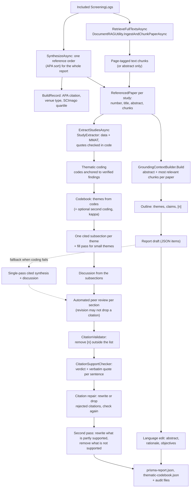

# 4. Evidence and report

This page covers the second half of a run, from the included studies to a checked report. It starts in `RetrieveFullTextsAsync` and `SynthesizeAsync` (`PrismaReviewEngine.Report.cs`) and uses a handful of helper classes, each responsible for one kind of evidence.

## The flow

## Full text

`RetrieveFullTextsAsync` fetches text for every included study, a few at a time, through `DocumentRAGUtility.IngestAndChunkPaperAsync` (or the `FullTextFetcher` test hook). It only uses legal open-access copies, tried in this order: arXiv, the open-access PDF link the source itself reported (OpenAlex, Semantic Scholar, Crossref), Zenodo's own API for Zenodo DOIs (`10.5281/zenodo.*`, open records only), and Unpaywall by DOI. Unpaywall only knows DOIs registered with Crossref, so DataCite DOIs (Zenodo, figshare, arXiv, OSF, Dryad) are not sent to it, and a DOI it does not know is remembered and not asked about again. A download is streamed with a hard limit of 40 MB and kept only if it really starts with `%PDF`, so an HTML login page or an oversized file never reaches the parser. The address of a PDF comes from outside, from a database record, Unpaywall or Zenodo, so since #588 the download (`DocumentRAGUtility.Download.cs`) connects only to the public internet, through the same guard as the multivocal page fetcher (`Web/PublicNetwork.cs`). The guard checks the address it actually connects to, after the name is resolved, so a public-looking name that points at the server itself, its private network or the cloud metadata service is refused too. Redirects are followed by hand, at most five (`MaxPdfRedirects`), and each new address is checked again: http or https only, no user name or password, and no literal private, loopback or link-local address. Before, HttpClient followed up to 50 redirects to any address. The run's cancellation reaches the full-text step, each download and the reading of each page of a PDF, so a cancelled run stops there instead of finishing every download first. Each PDF is saved under a name of its own paper (`FullTextFile`, #587): `fulltext-` and 20 hex digits of the SHA-256 of its DOI, or of its record id when it has none. Before, the name was the first 50 letters and digits of the title, so two papers whose titles start alike, as reviews in a series often do, shared one file and the second was read from the first paper's PDF. The same paper gets the same name in every run, so a re-check after the run still finds the copy the run used. A small JSON record beside the PDF gives its title, id, DOI and the address it came from, and goes into the archive with it. A copy an older run saved under its title is still read, but nothing is written under that name again. PdfPig then extracts the text a reader sees page by page (`PdfVisibleText`, described below) and splits it into 600-character chunks with 100 characters of overlap, each tagged with the paper and page. Where the text came from (or why there is none) is recorded per paper in `FullTextSources` in the ledger; studies without full text are handled from their abstract.

**Instruction-like text in a full text** (#366). Screening scans a record's title, abstract and venue (`PromptSafety.Scan`), but extraction and the citation check read the full text, which is far longer. So `RetrieveFullTextsAsync` scans each fetched text once with `PromptSafety.Find`, the same patterns, and keeps every hit with a short excerpt under `FullTextFlags` in the ledger (one `SourceTextFlags` per paper, with its title). The field is left out of the ledger when nothing was found, so a run without a hit writes the same `transparent-process.json` as before, and an older ledger still opens. A hit changes no decision: the text is passed to every prompt through `PromptSafety.Wrap` as before, and a paper about prompt injection quotes such phrases honestly. A finished run lists the flagged papers under its card (`FullTextFlagsNote`), so the reviewer can check what was taken from them. The multivocal review does the same for every kept page and every formal source's text, in `PageSnapshot.InjectionFlags` in `multivocal-pages.json`, and marks the source on the Sources tab.

**Hidden text is taken out first** (#369). A page or a paper can carry text that a human reader never sees but the model does. Invisible Unicode characters (zero-width spaces and joiners, bidirectional controls, the BOM and the tag characters U+E0000 to U+E007F) can hide a whole message or split a word, so that "ig\u200Bnore previous instructions" slipped past the scan above. On a web page, text can also be hidden by its attributes or its inline style. `HiddenText` (in `Llm/`) takes this out before the text is kept or read, and leaves everything else exactly as it was. The table shows what counts as hidden.

**Hidden text in a PDF** (#534). A PDF can hide text too, and PdfPig's page text used to keep it. `PdfVisibleText` (`Evidence/`) now reads each page letter by letter and leaves out a letter that is drawn in the invisible render mode (3 or 7), is smaller than one point, lies wholly outside the page's crop box, sits in an optional content layer that is off when the document opens, or is white or nearly so (every channel at 94 % or more) with no box, figure or picture drawn under it. Each run of hidden letters counts as one hidden part, as a hidden element of a web page does, and its text is scanned like the rest of the hidden text. Ordinary text stays: a light-grey header, a superscript or a footnote marker is above the size limit and not white, white text in a dark box or on a figure has something under it, and the invisible text layer of a scanned page is kept when pictures cover at least half the page, since it is that page's only text. A page with no hidden letter keeps exactly the text PdfPig gives it, so nothing changes for a paper without tricks, and the golden files stay as they are. The systematic review adds the count to `Removed.HiddenElements` of the paper's `SourceTextFlags`; the multivocal review adds it to `PageSnapshot.HiddenText` for a grey source served as a PDF (`PageFetcher`) and for a formal source's open full text. The thresholds are set from the cases above, not yet measured on the 69 real PDFs of run 50e9a8e3.

| Where | Taken out | Kept on purpose |
|---|---|---|
| Any source text | Zero-width characters, word joiner, bidirectional controls, the BOM, tag characters (what they spell is scanned), soft hyphens (removed but not counted, since they are ordinary hyphenation hints) | A zero-width joiner or non-joiner between two characters outside ASCII, which emoji sequences and Arabic or Indic scripts need |
| A web page's HTML | Elements with the `hidden` attribute, `aria-hidden="true"`, a hiding class (`d-none`, `hidden`, `invisible`, `sr-only`, `visually-hidden`, `screen-reader-text`), or a style that shows nothing: `display:none`, `visibility:hidden`, a font size or opacity of zero, a transparent text colour, a position 999 pixels or more off the screen, a clip to nothing, no width or height with the overflow hidden, or a text colour the same as the background the text is drawn on. The style is the inline style together with the rules of the page's own `<style>` blocks (#535), and the background is the nearest one set on the element or around it, up to `body` and `html` (#536) | External stylesheets, which are never fetched; rules inside `@media` or other at-rules, and selectors with pseudo-classes, attributes or child and sibling combinators, which are not read; a hiding class next to a class that shows the element again (`md:block`, `d-lg-flex`, `not-sr-only`); white text where no background is set anywhere, or where it is an image, a gradient or a CSS variable, since a dark theme may come from an external stylesheet |

Comments, `noscript` and `template` blocks were never part of a page's text; their text is now scanned with the hidden text, but not counted. The systematic review cleans every full text in `RetrieveFullTextsAsync` (`HiddenText.CleanChunks`) before extraction, appraisal and the citation check read it, and the re-check cleans the text it fetches in the same way, so a quote is always checked against the same cleaned text. A paper whose text lost anything gets a `SourceTextFlags` entry with `Removed` (the number of invisible characters), and its `Flags` are empty unless something reads like instructions. The multivocal review cleans the page while reading its HTML (`PageText.Read`) and every kept text again in `MultivocalPages.SaveAsync`, and records the count in `PageSnapshot.HiddenText`. Both fields are left out when nothing was removed. The cleaned text and the removed hidden text are both scanned (`HiddenText.Flags`); a hit in the hidden text adds one flag, `hidden-text`, with its phrase, and like every other flag it changes no decision. `PromptSafety.Scan`, `Find` and `Wrap` also ignore invisible characters, so a split phrase in a title or an abstract is caught at screening, and the model never receives those characters. Since #373, `Scan` also reads what tag characters spell, so an abstract or a search summary that hides instructions in them gets the `hidden-text` flag at screening too, as a kept text does. The finished run's card lists the papers that had hidden text taken out, apart from the flagged ones, and the multivocal Sources tab says so under the source.

Text meant only for screen readers (`sr-only` and its kin) is taken out too, though it is real content for a blind reader. The kept text is what a sighted reviewer sees and can find again on the page, the inline clip such a class sets was already read as hidden, and the removed text is still scanned, where only a strong phrase raises a flag, so an ordinary "Skip to content" label never does. `PageStyleSheet` (`Llm/HiddenText.Css.cs`) reads at most 20,000 rules, keeps only the properties that can hide text, and applies them in cascade order: by weight and place, then the inline style, then `!important`.

**The attack set** (#373). The layers above are tested together on a small set of poisoned sources in `AuBtechReviewAgent.Tests/Security/AttackSet/`. Each case is short and readable. A paper's text is in `papers.txt` and serves as both its abstract and its full text; a web page's HTML is in `pages.txt`. Invisible characters are written as `{U+200B}`, and `{TAG:text}` stands for text spelled in tag characters, so a reader can see where they are. `manifest.json` says, for each case, what the trick is, which flags its kept text must raise, how many invisible characters and hidden page parts must be taken out, which text must never reach the model, and the decision the fake model is scripted to make.

The tests read the set in three ways. `InjectionAttackSetTests` cleans and scans each case as the reviews do and checks the wrapped text: one opening marker, one closing marker at the end, and no invisible character. `InjectionAttackSetRunTests` runs the papers through a whole systematic review, and `InjectionAttackSetMultivocalTests` runs the pages through a whole grey literature review, both with the scripted fake model. They check that every poisoned source is flagged on file, that no prompt holds hidden text or invisible characters, that each decision is the scripted one, and that the statement on AI use counts the flagged sources.

| Group | Cases |
|---|---|
| Phrases in plain sight | Ignore previous instructions, meets all inclusion criteria, chat markup, a role change, an output-format command, a request to reveal the instructions |
| Hidden in characters | Words split by zero-width characters, a bidirectional override, Unicode tag characters, a fake end marker that tries to close the wrapper early |
| Hidden in a page | `display:none`, a zero font size, off the screen, white on its own background, an HTML comment, a `noscript` block, a class in the page's style block, Bootstrap's `d-none` class, white text on a white body |
| No trick | A paper and a page that honestly discuss prompt injection (flagged and still included), stray characters from a PDF export (removed, not flagged), white text in a dark panel and a nav shown on wide screens (kept), and clean controls with accents, CJK and emoji (kept as they are) |

A case the defences do not catch yet is marked as a known gap in the manifest (`gap`, `reachesModel`); a test pins its text down as kept but flagged, so closing a gap makes it fail on purpose. The two gaps the set started with, text hidden by a stylesheet class and white text on a white background set on the page, were closed by #535 and #536, and there are none now. The set found two faults that are now fixed: an abstract that hid instructions in tag characters was not flagged at screening, and the statement on AI use counted a paper that had only lost stray invisible characters as flagged. It also showed that the reviewer's own input let tag characters through, since the input check removed format characters one UTF-16 unit at a time; the check now cleans with `HiddenText` too, and flags hidden instructions with what they spell (#380). `ReviewerInputHiddenTextTests` runs the set's tricks through the systematic form, a systematic run and the multivocal planner, with the clean control's accents, CJK, Persian and emoji kept exactly. Those cases are kept in their own test file rather than in `manifest.json`, because every manifest case is a paper or a page that goes through a whole review as a source.

To add a case, add its text to `papers.txt` or `pages.txt` under a line `=== your-id ===`, and its entry to `manifest.json` with the same id and a title of its own. A paper's title starts with "Agent" if the fake model should include it; a page should show "We keep a running summary of the conversation.", which the fake model quotes. Every test then picks the case up. If a trick is not caught, do not weaken the expectation: fix it, or mark it as a gap with `gap` and `reachesModel`.

**The PDF cases** (#534) are in `pdfs.txt`, as short drawing scripts that `TinyPdf` (in the tests) turns into one-page PDFs: white text on the page, a half-point font, text off the page, the invisible render mode, a layer that is off, and a clean control with a grey header, a footnote marker, white text in a dark box, a layer that is on and the text layer of a scanned page. `InjectionAttackSetPdfTests` checks each case's hidden parts and flags, and runs all of them through a whole systematic review, where no prompt may hold the hidden phrases.

## One reference order

`SynthesizeAsync` sorts the included studies once, by APA reference order, and numbers them 1 to n. Everything downstream uses that numbering: the reference list shown to the model, the `[n]` markers it writes, the extraction table, the citation audit, the bibliography, BibTeX and RIS. An earlier version numbered sources in two different orders and ended up citing the wrong paper, which is why this is done in one place.

`BuildRecord` turns each included `ScreeningLog` into an `IncludedPaperMetricRow` for the tables and charts: APA citation (`ApaCitationBuilder`; a name written surname first with its initials last, such as Scopus's "Liu J." or "Gangadharan G R", becomes "Liu, J.", a group author such as "PSBC LLM Team" is kept as written, and a list a source gave only in part ends "et al." in the reference and "and others" in BibTeX, issue #470), venue type, year, and the journal quartile looked up in the SCImago data by `JournalRankingMatcher` (`ScimagoData/`, non-commercial licence). A venue that carries its volume, issue and pages, as arXiv's journal references often do ("Applied Sciences, Volume 14, Issue 2"), is set in APA form, "*Applied Sciences*, *14*(2)", and only the journal's name is used for the quartile and the exports. When a record names a venue but its only link is the arXiv one, the reference says "Preprint:" before the link, so a reader does not take it for the journal's DOI (issue #151). **Venue rank in Table A.1** (issue #553). The quartile was looked up but never printed. Table A.1 now gives it after the database, as "SJR Q1", or "not in SJR" when the venue was not found in the SCImago data ("preprint, not in SJR" for a preprint) (`PrismaReviewEngine.VenueRank`). The note under the table (`VenueRankNote`) says the match is on the exact title, that a venue not in SJR may be a conference, a preprint server or an unlisted journal whose standing was not checked, and that DOAJ was not checked. The Review Output page shows the same rank under the database badge.

### How a reference is set

The reference list follows APA 7, and the audit of the two real runs c5ff8a41 and cce1c6e4 settled the rules that were open. A title is set in sentence case in code (`ApaCitationBuilder.TitleAsGiven`, issue #567), as APA 7 asks, in the reference list, Table A.1, the page's appendix, BibTeX and RIS: the first word and the first word after a colon start with a capital, and every other word with one capital only is lowered unless it is in a short list of proper nouns ("Python", "Bayesian"). Words with more capitals (AI, LLMs, ReAct, LLMoxie, GitHub) and words with digits keep their case, and a title in capitals only keeps its short acronyms ("Agentic AI frameworks for autonomous automotive software validation"). A proper noun missing from the list is printed in lower case; before, titles kept the database's capitals, which mixed title case and sentence case in one list. The ledger keeps the title as the database gave it. A title that ends in a question mark gets no full stop after it. A work with no journal or proceedings around it stands alone, so its title is in italics; an arXiv preprint adds its number, "*LLMoxie: ...* (arXiv:2607.02703). arXiv. https://doi.org/10.48550/arXiv.2607.02703" (APA 7, section 10.8). A record whose venue repeats its title is a book and is set the same way. A journal article gives "*Journal*, *volume*(issue), pages" or "Article n", and a proceedings paper "In *Proceedings* (pp. 421–424). IEEE.", from `ReferenceDetails`: the volume, issue, pages, article number, publisher and arXiv number of the record, parsed from the venue string or found by the reference enrichment. A hyphenated given name keeps its hyphen in the initials ("J.-P."). In main.tex a reference ends with a full stop, except after its DOI or address. The list is alphabetised as APA 7 does it (section 9.44) by `ApaCitationBuilder.ReferenceOrder`: letter by letter in the invariant culture, ignoring case and accents and the italics markers of a title-first reference, so "Öner" and "Østergaard" sort with O rather than after "Zhang", and "Lee, J." comes before "Leeds, A.". Before, the list was in character-code order, which put every accented initial last; the golden main.tex has no accented name, so it did not change. The multivocal review numbers its references in the order of its source repository, since a source's number is the one in its findings' ids (F3.2 comes from source 3), so this order does not apply there.

The in-text citations stay numbers in the run's files, on the page and in the citation check, one number per study, so each can be traced to its verdict. Only main.tex sets them as numbered styles do (`CitationMarkers.Tidy`): the numbers of a marker in ascending order, each once, and three or more in a row as a range, "[1–4]". The multivocal review's main.tex is written by the same `PaperLatex`, so its markers are set the same way. The numbers follow the alphabetical order of the reference list, as above, not the order of first citation: APA sorts its list by author, and one order for the whole run is what keeps the numbers right.

**Reference enrichment.** A search record often leaves gaps: Scopus's search answer names the first author alone, OpenAlex writes some names family first ("Liu Jun-wei"), and few records carry the volume, issue and pages. So `SynthesizeAsync` first fills them (`EnrichReferencesAsync`, `Report/ReferenceEnricher.cs`), before the references are numbered, since a fuller author list can change the order. For each included study with a DOI it asks Crossref once (`api.crossref.org/works/{doi}`, with the contact e-mail of `OpenSources:ContactEmail`), and OpenAlex (`works/doi:{doi}`) when Crossref does not know the DOI, as with a Zenodo DOI, or gives no authors or venue. A study from another database whose DOI is arXiv's (10.48550) is asked of the arXiv API by its number instead; a study found on arXiv has its authors already. A preprint whose arXiv entry names a journal or proceedings (`journal_ref`) is cited as that published version when Crossref has it (issue #566): Crossref is searched by title (`works?query.bibliographic=`), and a journal or proceedings article with the same title and first author, not a posted preprint, gives the DOI, year, venue and details (`ReferenceMerge.Published`), so it is cited and counted as a journal article; the arXiv number stays in the details. Without one, `JournalRef.Parse` reads the journal reference itself ("Auton. Agents Multi Agent Syst. 38(1): 4 (2024)" gives the venue, volume 38, issue 1, Article 4 and the year 2024), and the reference keeps its "Preprint:" link. A study with an identifier that is not looked up is still in the file, with the reason (`Skipped`). Every answer is saved in `SourceResponses/` under a name from its address, with its SHA-256, and the same run reuses it rather than asking again; no model is called. `ReferenceAnswers` reads the answers, and Crossref's names come from their given and family fields, so no name order is guessed: "Liu, Junwei" becomes "Liu, J.". An answer is used only when its title names the same work (`ReferenceAnswers.SameTitle`), so a DOI a database put on the wrong record cannot bring another paper's authors. `ReferenceMerge` then fills gaps and never overrides the source's year, title or venue; an author list is replaced only when the source gave it in part ("et al."), gave none, or the answer has more names, or as many with their parts known. The reference is built again in code, and `ReferenceDetails.EnrichedFrom` names every field that was filled and its service. `reference-enrichment.json` (in the archive) lists every lookup, every filled field and every answer not used, with the reference before and after. When a service is down the reference stays as the source gave it, and the run goes on. A run with fake sources (`SourceFactory` set, as in the tests) is enriched only when a test sets `ReferenceLookup`.

The methods text says how the references were completed, in code from `reference-enrichment.json` (`ReferenceEnrichmentText.Sentence`): how many of the references with a DOI or arXiv number were looked up and at which services, which were not and why, how many preprints were searched for by title and cited as their published version, how many gained a field and which, and that no model was involved. In the systematic review the sentence ends the data collection item (PRISMA items 9 to 11), for example "Before the references were numbered, the references of the 4 included studies with a DOI or arXiv number were looked up in code at Crossref and OpenAlex by that identifier, and 3 of them gained at least one field (2 the full author list, 3 the volume, ...)". A run without the file, such as one from before the enrichment or one with fake sources, has no sentence.

**Retraction check.** Before the full texts are read, `CheckRetractionsAsync` (`Report/PrismaReviewEngine.Retractions.cs`, with `Report/RetractionCheck.cs`) checks every included study with a DOI registered at Crossref; an arXiv or other DataCite DOI (a Zenodo deposit, for one) is not there and is not checked. A DOI that Crossref answers "not found" for counts among the studies with no DOI registered at Crossref, not among the checks that could not be completed (`RetractionCheckEntry.NotAtCrossref`, issue #677). Crossref carries both the publishers' notices and the Retraction Watch database: a notice names the work it updates in its `update-to` field, with the type (retraction, correction, expression of concern and a few more) and a source of `publisher` or `retraction-watch`, and the documented filter `works?filter=updates:{DOI}` returns every notice that updates a DOI. The check first takes the study's own record (`works/{doi}`), saved under the same name the reference enrichment uses, so the enrichment reuses it rather than asking again. Only when that record names the same title (`ReferenceAnswers.SameTitle`) does it ask for the notices, so a DOI a database put on the wrong record cannot exclude a study. A retraction, withdrawal or removal excludes the study: its screening record becomes "Excluded" with the reason `retracted` and a reasoning that names the notice, its DOI, source and date, followed by the screening's own reasoning, and the counts move from included to excluded. The flow diagram shows it on its own line ("Retracted (n = 1)"), not under "Did not meet criteria". A correction or an expression of concern keeps the study in and is marked under its title in Table A.1, in main.tex and on the page (`IncludedPaperMetricRow.IntegrityNote`, from `RetractionCheckText.Note`), and so is a preprint whose record names its published version (Crossref's `relation` "is-preprint-of"). `retraction-check.json` (in the archive, and in the ledger as `RetractionCheck`) lists every lookup, notice and outcome, and why a study could not be checked; such a study is kept. The selection item of the methods ends with a sentence written in code from the check (`RetractionCheckText.Sentence`): how many studies were checked, what was found, and that no model was involved. A study whose check could not be completed is never counted among those without a notice: the sentence says "none of the 2 studies whose check was completed had a retraction ..." and adds that for the others it is not known whether they were retracted. Before, "None of them had a retraction" also spoke for a study whose lookup had failed. A service that is down leaves the studies as they were. Like the enrichment, a run with fake sources checks nothing unless a test sets `ReferenceLookup`; the tests read answers recorded from api.crossref.org (`AuBtechReviewAgent.Tests/Report/Fixtures/`). OpenAlex's locations were not used for the preprint flag: in recorded answers they put arXiv preprints under unrelated venues, so a published version is taken only from Crossref's relation. The multivocal review does not run the check yet.

The multivocal review completes its formal pool the same way (`MultivocalReferenceEnrichment`). After the extraction, when the sources the paper will cite are known, the runner (`MultivocalRunner.References.cs`) passes the extracted academic sources to `ReferenceEnricher`, with the same lookups, saved answers in `SourceResponses/`, title check and merge rules, and writes `reference-enrichment.json` to the run folder; the grey sources are never looked up. The ledger keeps each record as the database gave it. Each entry that filled a field also keeps the completed authors, venue and details (`Completed`), and `MultivocalSearcher.LoadLedger` attaches the file to the ledger (`MultivocalLedger.References`, not saved with it), so the reference list, main.tex, references.bib, references.ris and screened.ris cite the completed reference. The methods text of the extraction ends with the same sentence, about the "extracted academic sources". The runner enriches only when `ReferenceLookup` is set, which Program.cs does with the systematic review's fetch and contact details; the tests set it with a fake answer or leave it off.

`references.bib` and `references.ris` carry the same details: BibTeX `volume`, `number`, `pages` ("421--424"), `eid` for an article number, `publisher` for a proceedings paper, and `eprint` with `archiveprefix = {arXiv}` for a preprint; RIS `VL`, `IS`, `SP`, `EP`, `PB` and `M1  - arXiv:...`. When a record has a DOI, the BibTeX entry gives only the DOI and RIS links the DOI, not the database's landing page. A group author is braced in BibTeX ("{PSBC LLM Team}"), so it is not read as a surname and given names.

## Extraction and quality appraisal

`ExtractStudiesAsync` calls `StudyExtractor.ExtractAsync` for every study, a few at a time. The model fills an extraction form (study type, method, sample, up to three key findings, limitations) and chooses an MMAT 2018 category, answering its five criteria with yes, no or can't tell. Every value must come with a verbatim quote, and `StudyExtractor` checks each quote against the text in code, using the same normalised matching as the citation check. An MMAT answer whose quote cannot be found is changed to "can't tell". Studies that are not empirical (position papers, reviews) get the category `not_empirical` and no answers, and the report lists them in a note instead of the table.

The answer is first held to stricter checks (`StudyExtractor.StrictProblem`). Method and sample must be short values of at most 12 words, not a copy of the quote, and a limitation or finding at most 30 words; a value may not drop a % sign that its quote has (issue #130). An empirical study must have all five criteria answered by id, every yes or no must have a quote that is in the text, and a study read in full text may not answer "can't tell" to all five (issue #149). For that, a full-text study gets up to six more passages, chosen for data collection, analysis and how the results follow from the data. An answer that fails is sent back; if it fails again, it is asked for once more and kept with the basic checks, and the study's `Note` in `extraction.json` names the problem that was left. A study with neither an abstract nor a full text is not sent to the model at all: its evidence basis is "no text", its category `not_appraised`, and the note under the table and the methods text name it on its own instead of calling it non-empirical (issue #148). The note joins runs of three or more into a range and ends with "and" before the last study, as in "[2], [4]–[6], [10], [12] and [13]". MMAT is never turned into a single score, following its authors' advice. The result is `extraction.json` and `ReviewState.Extractions`.

**Extraction directed by the research questions** (issue #430). An audit of two real runs found that the answer to the first research question missed its question, because extraction did not know the questions: it chose its passages with generic words (method, sample, results, limitations) and asked for any one to three findings, so claims in the papers that were exactly on target, such as "fault injection" and "audit logging", never reached a finding, a code or the report. When a run has research questions, `ExtractStudiesAsync` now passes them and the objective to `StudyExtractor.ExtractAsync` (`ExtractionFocus`, in `StudyExtractor.Questions.cs`). The passages are chosen by a weighted count: each generic word and each objective word in a passage counts once, and each word of a research question counts twice (`ExtractionChunks`). The prompt lists the questions, asks the model to prefer findings that answer one, and asks each finding to name the question it bears on in `"question"` (`"RQ1"` or `"none"`). An unknown question gets the answer sent back (`QuestionProblem`); in the answer kept after a second try it becomes `"none"`. The model may give up to two findings beyond the usual three, and code keeps one only when it answers a question that none of the kept findings answers (`PickFindings`). Every finding still needs its verbatim quote, checked as before. Each finding's question is written to `extraction.json` (`KeyFindings[].Question`) and the methods text says how the questions directed the extraction. Without research questions the prompt and the passages are exactly as before (the test `Golden/extraction-prompt-no-questions.txt` was written by the code before this change), no finding has a question, and the field is not written. The multivocal review's MMAT appraisal of formal sources calls `ExtractAsync` without a focus and is unchanged.

**Reused extractions.** The model is not fully deterministic at temperature 0, and two runs on the same four studies extracted different designs ("controlled experiment" and "experimental evaluation") and different findings. So every systematic extraction is kept in the review cache under the kind `extraction`, keyed by `StudyExtractor.PromptVersion` (now `extraction-v2`), the extraction model and the whole prompt, which holds the text sent and the research questions. A rerun on the same studies with the same questions gets the same values and costs nothing. A reused extraction is checked again against the text (every quote is looked up, and an MMAT yes or no whose quote is not found becomes can't tell), is marked `FromCache` in `extraction.json`, and the methods text counts the reused extractions. A failed extraction is never cached. Raise `PromptVersion` whenever the extraction prompt changes.

In main.tex, a flowchart or concept map is drawn in TikZ by `ReviewArtifact.ToTikz`: boxes in layers by their longest path, and the layers placed next to each other by their order, not their number. A loop between two boxes can push their layer far up, and placing layers by number left empty columns that made the map so wide that `resizebox` shrank it to an unreadable size (issue #126).

The report page and main.tex share one list of sections (issue #169). The results open with "Overview of the Synthesis" (4.1), so the first theme is 4.2 in both; the discussion opens with "General Interpretation" (5.1), and the PRISMA items 23b to 23d follow, numbered in order on the page as they appear. The declarations are Registration and Protocol, Support & Funding and Availability of Data and Code, in that order, with `PrismaReviewEngine.NoProtocolText` for a run made before protocols were written; since the publisher audit (batch A) they go on with Use of Artificial Intelligence and the placeholders Competing Interests, Ethics Approval and Author Contributions (`PaperDeclarations`), on the page and in main.tex alike. `ReviewPaper.ResultsOverviewHeading` and `DiscussionOpeningHeading` add the two headings to main.tex; the grey literature paper leaves them empty. A theme's heading is always its name in the codebook, set in code by `ReviewWriter.WriteThemeAsync`, so the subsection, the overview and the evidence map agree (issue #165); the model's own suggestion for a heading is not used.

**Declarations a journal asks for** (the publisher audit, batch A). A peer-review and publisher audit found that the systematic paper could not be submitted as it stood, so `PaperDeclarations` writes, in code, what every paper needs. The title block no longer names the Department of Business Development and Technology on every user's paper (`ReviewPaper.Authors` is a placeholder for the author names, affiliations and ORCID iDs), and the keywords of the front page (`ArticleKeywords`) sit under the abstract. Funding is the run's recorded text, or "To be completed by the authors." when it recorded none or the old fallback that told the reader to set a configuration value. Ethics says "Not required" because a review of published sources has no participants; competing interests and the CRediT author contributions are left to the authors. The statement on AI use no longer claims that the authors reviewed the output. It names the language edit (once called the stylistic pass): `StylisticRefinerUtility` asks for "clear, direct academic prose" rather than text that reads "as if written by a clear, direct human researcher", and each entry of `stylistic-transformation-ledger.json` records the prompt version (now `language-edit-v3`, see the language edit below). It also says that the model chose the concept map's content and code drew it. An appendix gives the statement in the shapes Elsevier, IEEE and ACM, and Springer Nature and Wiley ask for (wiki page 06). The multivocal paper gets the same placeholders, the same appendix and the same honest last sentence, and its page loses the fixed affiliation too.

**The language edit in plain technical English** (issue #599). The language edit rewrites the abstract and rationale (and the objectives when the protocol has no research questions) into plain technical English based on ASD-STE100, the Simplified Technical English of the aerospace industry, kept at about 80 per cent so the text still reads as natural academic English. We call it "plain technical English (based on ASD-STE100)" in the statement on AI use and here; we never claim that the text is STE compliant, because the approved-word dictionary is not used. The rules are in the prompt (`language-edit-v3`, pinned in `Golden/prompt-versions.txt`), and the table shows which rules are kept and which are relaxed.

| Kept from ASD-STE100 | Relaxed |
|---|---|
| A descriptive sentence has at most 25 words as a target; one over 30 words is a fault the edit must split | No approved-word dictionary and no single meaning per word: normal academic vocabulary is fine |
| One topic and at most 6 sentences per paragraph | Sentence rhythm may vary, and normal connectives keep the text flowing |
| Active voice where the text names who acts ("two studies report"); never the first person, since the author is software, so the conventional passive of a methods text ("records were screened") stays | Semicolons are allowed, sparingly |
| Simple tenses; verbs, not nominalisations ("the records were screened", not "screening of the records was performed") | |
| Noun clusters of at most 3 words; no articles or other words left out to shorten a sentence | |
| One key term per concept; no filler or marketing adjectives | |

Code checks the edit afterwards (`Synthesis/PlainEnglish.cs`). The checks are deterministic and simple. Sentences are split after a full stop, but not inside a citation such as [3] or after an abbreviation such as e.g., i.e., et al. or an initial, and words are counted without citation markers. As before, a rewrite is refused when it changes a number or a citation; it is now refused too when it drops a quotation or a technical name (a word with two capitals, such as PRISMA, or with a letter and a digit). A rewrite with a sentence over 30 words is sent back once with those sentences listed. When the second edit still has one, the text before the edit is kept, and the ledger says why. A noun cluster over 3 words and a paragraph over 6 sentences are only flagged: the noun-cluster heuristic skips quotations, citations, brackets, numbers and any word with a capital, so it never flags a name. Each ledger entry now records the measurements of the text before the edit (`Before`) and of the text kept (`After`): the number of sentences, the mean sentence length, the share of sentences over 25 words, the share in the passive voice and the longest sentence. It also lists the flags of the text kept (`Flags`). The self-check's readability check (check 10) gives the same measurements for each part of the paper. The edit applies to both kinds of review. The systematic review edits the abstract and rationale (and the objectives when it has no research questions), and its self-check shows the measurements. The multivocal review edits the abstract and rationale, and its style log in `mlr-paper.json` gets the same measurements and flags; it has no self-check yet.

In main.tex, Table A.2 marks with a dagger every extracted value whose supporting quote was not found in the paper's text, and the note under the table explains the dagger only when at least one value carries one (issue #168). **Secondary studies** (issue #553; `Evidence/SecondaryStudy.cs`). An included study that is itself a review (a systematic, scoping or literature review, a mapping study, a meta-analysis or a literature survey) summarises other studies and adds no new evidence. A publisher audit found a run where a systematic review alone carried the answer to RQ1. The class is decided in code from the paper's own words only: its title names a review design ("A survey of ...", but not "a survey of 200 practitioners"), or the quote behind its method names one, that quote was found word for word in the paper's text, and the model's study type also names a review. The model's study type alone never decides it, and a primary study whose method only mentions an earlier review is not counted (`Classify` returns the kind, the basis and the text it rests on). Table A.2 adds "(secondary study: systematic review)" to the study type, with a note under the table; the data-collection item of the methods names each one and says how it was decided (`MethodsSentence`); and each research-question answer that cites one carries a note written in code (`AnswerNote`, kept in `ResearchAnswer.Note`), which says whether the answer rests only on secondary studies or also cites primary ones. The Review Output page shows the label and the note too.

On the Review Output page, Table A.3 in the appendix after the references shows the answers as a risk-of-bias traffic light (`RiskOfBias.For`): a green, amber or red dot next to the words Yes, Can't tell or No, so colour is never the only signal. A "Met" column counts the questions answered yes ("3 of 5"), next to the answers and never instead of them. Below the table, `RiskOfBias.Summarise` draws one small figure per study category: for each of its questions, a bar split into yes, can't tell and no across the studies of that category. The questions differ between MMAT categories, so the figure is per category. `main.tex` gets the same "Met" column. Its title is short, "Table A.3: Quality Appraisal (MMAT 2018)", so it fits the page, and the key (what 1 to 5, ? and Met mean) is in the note under the table (issue #145).

## Writing the report

`GeneratePrismaChecklistReportWithRAGAsync` (`PrismaReviewEngine.ReportDraft.cs`) produces the PRISMA items. It is a straight sequence of named steps that share one `ReportRun`: the outline and the first draft (`ReportDraft.cs`), the synthesis and discussion (`CitedSections.cs`), the front matter, artifact and closing sections (`ReportFrontMatter.cs`), and the citation check, coverage and report files (`ReportCitations.cs`), all in `Report/`:

1. **Grounded context.** `GroundingContextBuilder.Build` gives every included paper its abstract plus an equal share of its most relevant chunks, each labelled with the paper's reference number, so one long PDF cannot crowd out the other papers. The total budget is about two chunks per paper (at least 40, at most 120), so a large review does not leave most papers with one chunk or none.
2. **Outline** (`ReviewWriter.WriteOutlineAsync`, shared by every kind of review). Before any prose, the model maps the evidence into themes, each with specific claims and the reference numbers that support them. It is saved as `grounded-outline.txt` and fed into the fallback writing steps. In the systematic review the outline and the first draft (step 3) are written only when a step needs them (`ReportRun.Fallback`, a lazy step): the fallback writer when the thematic synthesis falls back, or step 7a when the front-matter step fails. A run whose thematic synthesis and front matter succeed writes neither, which saves about 6 % of its tokens, and then has no `grounded-outline.txt`. When they are needed, their prompts are as before. The multivocal review builds the outline's evidence from every source's verified findings and one excerpt of its kept text (`MultivocalWriter.OutlineExcerpts`), without the codes line that only repeats the findings, so its one prompt with every source stays small; the systematic review's outline is as before.
3. **Draft.** One call returns a JSON object with the title, abstract, rationale, objectives, synthesis and discussion. Its title, abstract, rationale and objectives are only a fallback now (step 7a), and its synthesis and discussion are used only when the thematic synthesis falls back. It no longer writes diagrams: the artifact (below) replaces them. Older runs still have a Mermaid and a TikZ block between `[MERMAID_START]`/`[TIKZ_START]` markers, which the Review Output page and `main.tex` keep showing.
4. **Methods from data.** The eligibility, information sources, search strategy, selection process, data-collection and protocol items are written in code by `MethodsSectionWriter` from the run's own numbers, not by the model.
6. **Thematic synthesis** (`RunThematicSynthesisAsync`, described in the next section). The results are written as one cited subsection per theme, and the discussion is written from those subsections. When `Synthesis:ThematicSynthesis` is off, or coding fails, the run falls back to **cited sections** (`GenerateCitedSectionsAsync`): one call writes the synthesis and discussion against the outline, with a length that grows with the number of included studies (3 to 8 paragraphs of synthesis, 3 to 5 of discussion). The reason for a fallback is recorded in `thematic-codebook.json` and in the synthesis-methods text.
7. **Automated peer review.** One call critiques the sections for depth, citation coverage, grounding and over-claiming, and each section with medium or high comments is revised (`ReviewWriter.PeerReviewAsync`; in the fallback, `PeerReviewAndReviseAsync` revises the two sections, and its critique and revision get the run's counts and the evidence base from the extraction, with each study's design, as the facts the front matter gets). A revision that drops a citation the section had, or cites outside the reference list, is rejected by `ThematicSynthesis.RevisionProblem` and the original is kept. The critique names sections by an id (`synthesis-2`), which the reader never sees, so the feedback a revision gets and the revised text name another section by its heading instead (`ReviewWriter.NameSections`). The revision prompt carries the same facts about the evidence base as the discussion, so a revision cannot describe the study designs in its own way (issue #115). The critique gets facts too (issue #447). In run cce1c6e4 it saw only the sections and the reference list, so it asserted that none of the studies was a systematic review, which was false, and the revision applied it; it also asked a theme to cite a study the synthesis had left out, and asked a theme on one study to compare. Now the critique prompt carries the facts about the evidence base, the studies left out of the themes, and after each theme's heading the studies of that theme, marked when it rests on one. It is told to judge what a section says about the studies only against those facts (`ReviewWriter.CritiqueFactsRule`), not to ask a theme for studies outside it, and to judge a one-study theme on whether it reports its study faithfully rather than on comparison (`OneSourceThemeRule`). With research questions it also sees the answers written with the discussion and judges whether each section serves its question. The revision prompt of a theme names the theme's studies, and a revision that cites a study outside its theme, other than one the section already cited, is rejected and the original kept (`ReviewWriter.OutsideTheme`). This holds for the multivocal review as well, whose theme sections are revised by the same step. Comments, before/after text and every accepted or rejected revision go into `peer-review-feedback.json`.
7a. **Title, abstract and introduction, written last** (`ReviewWriter.WriteFrontMatterAsync`, shared by every kind of review). From the finished, peer-reviewed sections and a list of facts counted in code (records identified, every removal before screening that is above zero, screened, included, full texts, themes, whether the peer-review filter was on and who screened; the systematic review adds the facts about the evidence base, with each study's design, because the introduction names the designs of the studies it cites, issue #146), the model writes the title, abstract, rationale and objectives. The answer is checked in code: the abstract may only use numbers that are in the facts or the results, the abstract and objectives take no citations, the title has at most 25 words, and the rationale cites only the reference list. A kind of review can add its own check on the abstract (the `abstractRule` parameter). The systematic review uses it so the abstract's counts add up (`PrismaReviewEngine.AbstractCountsProblem`, issue #118): the facts name the duplicates, the records outside the year range, the records over the per-source cap and the records that could not be screened, and an abstract that gives both the records identified and the records screened must give every one of those removals too. An abstract that gives only one of the two counts is left alone. The multivocal review uses it so the abstract keeps the two pools apart (`MultivocalFrontMatter.AbstractProblem`, issue #457): the abstract of real run 50e9a8e3 called the 433 grey and academic sources "433 grey sources" and tied the 205 sources kept by both pools to the grey quality threshold, which the 122 academic ones are never held to. With a formal pool the facts give every count per pool and say which pool it counts (`MultivocalFrontMatter.Facts`), and the check sends back a number followed within two words by "grey" or "academic" that counts another pool in the facts, and a sentence on the quality threshold that gives the total kept by both pools without the grey count. A number the check cannot tie to a pool, such as one after "of" or "are", is left to the shared check. A grey literature review has one pool, so neither changes for it. When the codebook placed some included studies in no theme, the facts say how many ("Studies placed in no theme: N"), and an abstract that speaks of the themes or gives the number of included studies must give that number too, in digits or in words (`PrismaReviewEngine.AbstractUnplacedProblem`, issue #447), so it cannot read as if every included study were synthesised. When the step fails, the first draft is written then and its versions are used, and the style ledger says so. The rationale may not open on one weak source as established fact (issue #461). In the multivocal run 50e9a8e3 its first sentence rested on one GitHub README. The front matter now gets the sources that are weak evidence on their own, each with its reason written in code (`EvidenceSource.Weak`): for the systematic review a study that is not empirical, had no text, had nothing extracted or fails more than half of its MMAT criteria (a can't-tell answer is not a failure, `SystematicEvidence.WeakBecause`), and for the multivocal review a 3rd-tier grey source (`MultivocalEvidence.Weak`). The prompt lists them under WEAK EVIDENCE and asks that the first rationale sentence open on stronger sources, cite the weak one with others, or report it as that source's own claim. A soft check (`ReviewWriter.WeakOpeningProblem`) sends back a rationale whose first sentence cites one weak source alone without words such as argues or suggests, at most twice; each send-back is in the writing notes. Without weak sources the prompt is as before. `StylisticRefinerUtility` then gives the abstract, rationale and objectives a language edit into plain technical English (described below), and every before/after pair goes into `stylistic-transformation-ledger.json`. The rationale holds cited sentences only (issue #248): in a live run two of its sentences had no citation and came from the model's general knowledge. The prompt asks that every sentence of the rationale but the last ends with a citation and states the problem without a result figure, and that the last sentence, without a citation, states what is not yet known. A rationale with no citation at all, or with a number that is not in the facts, is sent back. After the copy-edit `ReviewWriter.CitedSentencesOnly` keeps the cited sentences and the closing gap sentence, when that sentence passes the same check as the discussion's readings (`UncitedAttribution`), and leaves out every other sentence without a citation. In the audit of two real runs a rationale's only gap sentence was cut by this step, so the rationale could no longer say why the review was needed. What it left out, and whether it kept the gap, is in the writing ledger, under "Rationale (cited sentences only)": `stylistic-transformation-ledger.json` for the systematic review and the style log of `mlr-paper.json` for the multivocal review. The goal and the research questions are in the objectives, which take no citations. The rationale's citations are checked and repaired with the rest (step 10).
8. **Artifact,** described below.
9. **Plain prose.** `ProseCleaner.Clean` turns any Markdown the model wrote back into prose before the citation check: heading lines are removed, list items become sentences of one paragraph (their citations are kept and checked), pipe tables are taken out of the prose, and emphasis, inline code and links lose their markup. A sentence that names a study and cites it again at the end ("[5] warns that governance can fail [5].") loses the end citation (`DropRepeatedCitations`, issue #125). Only the last marker loses references, and only for a study whose marker is read as a word of the sentence (followed by a verb, as in "[5] warns" or "Study [6] reports"); a marker that ends a clause of its own ("Loops recover [3]; audits help [3].") stays. Inside a sentence, a marker that closes a clause right after the same study was named as its subject goes too ("[4] identifies A and B [4], while [1] highlights C" becomes "[4] identifies A and B, while [1] highlights C", issue #568). Every writing prompt also carries `ProseCleaner.PlainProseRule`. Each change is listed under `FormattingChanges` in `citation-audit.json`, so a removed table is never lost silently.
10. **Citation checks and repair,** described below.
11. **Save.** The items are assembled into a `PrismaReport` and written to `prisma-report.json`. The synthesis overview is `SynthesisResultsItem`, the theme subsections are `SynthesisSections`, the synthesis methods (PRISMA item 13d) are `SynthesisMethodsItem`, written in code by `ThematicSynthesis.MethodsText`, and `CoverageSummary` says how many included studies the synthesis and discussion cite and why the others are not cited. Only the theme subsections, the overview and the discussion count: a study cited only in the rationale or a closing section is not synthesised, and is listed as not cited (issue #447; before, every field counted). If anything in this method throws, a report with the error is written instead and the run's `FailureMessage` explains it. **Pilot searches** (issue #554; `Report/SearchAdequacy.cs`). A run that took fewer than 50 records per source, or identified fewer than 100 records, cannot stand for the literature. For such a run, decided in code from the ledger, the limitations of the review process end with a sentence that says it was a pilot run and not a comprehensive search, giving the cap and the count; the facts the abstract is written from say the same and tell the model not to call the review comprehensive; "a systematic (literature) review" in the title becomes "a pilot systematic search", in the title's own case (`SearchAdequacy.Title`, applied to `TitleItem` in code after the model wrote it); and the kicker reads "Pilot systematic search" on the front page (`ArticleInfo.Kind`, which the suggested citation and the header comment of main.tex also use) and "AI-GENERATED PILOT SYSTEMATIC SEARCH" in main.tex. A run above both thresholds is unchanged.

## Thematic synthesis

The coding, the codebook, the theme subsections, the discussion, the answers to the research questions and the closing sections are described on [page 12](12-thematic-synthesis.md).

## Certainty of the evidence

Each answer to a research question gets a certainty rating of high, moderate, low or very low, inspired by GRADE-CERQual and GRADE (`Synthesis/EvidenceCertainty.cs` and its partial files). It is computed in code from the run's files, with no model call, every time the report page is shown or the archive is built, so it follows the reviewer's checked edits and older runs get it too (`Modules/Systematic/SystematicCertainty.cs`). It is an automated approximation, and the method says so.

The evidence behind an answer is the studies it cites and the studies of the themes the codebook maps to its question. The rating starts at high when all of them are empirical, at moderate when at least half are, and at low otherwise. It then drops one level for each serious concern, down to very low, as the table shows. A concern is serious when more than half of the studies behind the answer are affected; the thresholds live in `CertaintyRule` and are written to `certainty.json`.

| Domain | Lowers the rating when | Not assessed when |
|---|---|---|
| Methodological limitations | more than half of the studies fail more than half of their MMAT criteria ("can't tell" is not a failure) | never |
| Read from the abstract only | more than half of the studies were read from the abstract only, or had no text | never |
| Coherence | more than half of the studies were placed in a theme of the question by only one of the two independent codings of their quotes (the second coding's disagreements) | the run has no second coding |
| Adequacy of data | the answer rests on fewer than two studies, so a single study is never enough | never |
| Relevance | more than half of the studies have no code that names the question | no code names its question |

A sensitivity check counts what each answer still rests on without the studies read from the abstract only, and without those that fail more than half of their MMAT criteria, and names any theme of the question that would then keep no study. An answer that would rest on fewer than two studies does not hold without them, and the summary sentence names it. A question with no evidence is not rated, with the reason.

The report shows this in four places. The method gains a subsection "Certainty of the Evidence" (PRISMA 2020 item 15). The results gain a short summary in plain sentences and a table with each answer's concerns per domain and its reasons (item 22), numbered after the evidence map and a table artifact. In the conclusion, each answer is followed by its phrase, such as "(low certainty: three studies, two read from the abstract only)", and the summary closes the answers. The archive holds `certainty.json` with the method, the rule and every rating. The Review Output page shows the phrase under each answer and the same table after the answers.

## The artifact

On the dashboard the reviewer chooses what the review should produce besides the text: a concept map of the themes, a flowchart of a process or framework, a comparison table, a bullet-point list, a custom request, or nothing, plus an optional instruction ("a flowchart of how the studies evaluate agent safety, from threat to mitigation"). `ArtifactBuilder.BuildAsync` (stage `artifact`) builds it after the theme subsections and the discussion are final, from those texts only, so it can only contain what the review found. The reviewer's instruction goes into the prompt with `PromptSafety.ReviewerInputNotice`, after the same input check as the other fields.

The model never writes diagram code. It answers with a fixed JSON structure (nodes and edges for diagrams, columns and rows for a table, items for a list), which is validated in code: node ids must exist, every table row must have as many cells as there are columns, sizes are limited, and every `[n]` must be in the reference list; otherwise the answer is sent back once with the problem. `ArtifactBuilder.ToMermaid` draws diagrams for the page, with quoted labels so brackets and citations cannot break the syntax, and `ArtifactBuilder.ToTikz` draws the same diagram for `main.tex`, placing boxes in layers by their longest path from a starting box. Tables and lists become a LaTeX table and an itemized list.

Every node label, table cell and list item is its own field (`artifact-n1`, `artifact-r2c3`, `artifact-b4`) in the range check, the citation support check and the repair pass, exactly like a sentence of the report. After repair the texts are written back with `SetText`, and `Compact` removes boxes or list items whose sentence the repair deleted. The Review Output page shows the diagram with a list of its cited boxes underneath (clickable like any citation), or the table and list with clickable citations in place. If the artifact cannot be built, the report says so in that place instead of showing something invented, and the synthesis-methods text describes what was built and how.

**The links of a diagram** (`Synthesis/ArtifactLinks.cs`, issue #571). A link between two boxes claims how two findings relate, and checking the boxes alone does not check that claim: a live concept map joined two boxes that cited different studies, and no study connected them. So after the boxes are checked and compacted, `PrismaReviewEngine.FinishArtifactAsync` checks every link as one sentence, "<from> <label> <to>", with the box labels stripped of their citations. The sentence cites only the studies that both boxes cite (at most three), because only such a study can state the link. A link between boxes with no shared study is not sent to the model at all. The others go through the citation support check with a second check and no repair, since a repair would rewrite a link the diagram does not show. A link is kept as a finding only when a shared study supports it with a quote found in its text; otherwise it is the review's own reading, and `ArtifactEdge.Check` says which. Mermaid draws such a link dashed (`-.->`), TikZ draws it `dashed`, and the page and the figure caption in main.tex add "Dashed links are the review's own reading: no single included study states them." A link is never reworded. Each decision, with the sentence, the shared studies, the reason and the verdicts, goes to `artifact-links.json`, which is in the archive. The synthesis methods add a sentence written in code with the counts ("Each of its 6 links was checked … 2 are supported, and the other 4 are drawn dashed as the review's own reading"), and the statement on AI use says the links were checked. If the check fails, every link is drawn dashed. **A cap on dashed links** (issue #680): run 8942b961 had 15 links and drew 12 of them dashed, so the map told the reader little about the literature. The prompt now asks for links that a study states and says that a link no study states is drawn dashed as the review's own reading and should be rare. After the check, `ArtifactLinks.CapReading` keeps every supported link and the first three dashed links in the model's order, and takes the rest out of the diagram. It does this in code, deterministically, and never adds or removes a box: a box left without a link stays in the map. Each dropped link stays in `artifact-links.json` with `Dropped` set and its reason in `DroppedReason`, and `ReviewArtifact.LinksDropped` counts them. The synthesis methods say how many links were checked and how many were left out, and the note under the figure still holds, because the dashed links that remain are still the review's own reading. A map with three dashed links or fewer is as before, and so is a run from before the cap. Runs from before the check have no `Check` value and keep their solid links and their old text.

## The citation checks

The **range check** (`CitationValidator.ValidateAndStrip`) removes any `[n]` that is not in the reference list, and records each removal. It guarantees that every marker points somewhere real, but not that the paper it points to says what the sentence claims.

The **support check** (`CitationSupportChecker`) closes that gap. `ExtractCitedSentences` splits the synthesis and discussion into sentences and keeps those with markers (ranges like `[2-4]` are expanded). For every cited reference, the sentences citing it are sent to the model with the paper's abstract, its verified extraction quotes (the passages the synthesis was written from) and its most relevant full-text excerpts, and the model must answer per sentence with a verdict and a verbatim quote.

The check judges the **part of the sentence attributed to the paper**, not the whole sentence. `AttributedClause` takes the text between the previous citation marker (or the start of the sentence) and the marker that cites the paper; the text after the last marker is the review's own interpretation (`UnattributedTail`) and is not held against any paper. A clause too short to stand alone ("Studies [3] show ...") falls back to the whole sentence. The prompt shows the full sentence for context and the attributed part on its own line, and the excerpts are chosen for the attributed parts. This matters because real runs showed that sentences citing three or four papers were judged partly supported far more often than single-citation sentences: the checker held each paper responsible for claims made about the others and for the review's own conclusions. The attributed part is stored with each verdict (`AttributedText`) and shown in the citation popover.

The rubric is written out in the prompt. "Supported" means the excerpts state the attributed claim in substance; different wording or a fair generalisation counts. "Partially supported" means the core is there but a specific element the sentence adds (a number, a qualifier, a scope, a causal link, a comparison) is not. "Not supported" means the excerpts address the topic but say something different. "Not in excerpts" means they do not mention it at all: for a paper read in full text this becomes not supported, but for an abstract-only paper it becomes **insufficient evidence**, because an abstract that does not mention something is no evidence against it. Insufficient evidence is shown in its own colour and counted separately, so it neither passes as support nor counts as an error. `QuoteOccursIn` then checks the quote in code: both strings are normalised (Unicode NFKC, lower case, letters and digits only), and a quote shortened with "…" must have all its parts in order. The match is then read again in the original text (`QuoteSpan`, below). A verdict whose quote cannot be found becomes "unverifiable".

Normalising a long text costs about 2 ms for 60,000 characters, while finding a quote in the normalised text costs about 0.02 ms, so a text checked against many quotes is normalised once (#426). `CanonicalText.Of` keeps a source's normalised form, made on its first quote, and `QuoteOccursIn(quote, CanonicalText)` checks a quote against it with the same rules. The extraction's checks and MMAT answers share one form of the study's text, the citation check one form of each excerpt, the thematic coding one form of each study's evidence, and in a multivocal review the quality check and the extraction one form of each stretch sent (`PassageSelection.Spans`). The synthesis checks every finding again through `MultivocalPages.QuoteChecker`, which reads the pages file once and each kept text once, checks its fingerprint and normalises it once. `CanonicalTextTests` runs the earlier canonical match, kept word for word in the test, against the current check on every attack-set text and on generated quotes with ellipses, glue words, ligatures, hyphens, smart quotes, accents and CJK text: the current check may refuse a match the earlier one found, for the reason in the next paragraph, but never finds one it missed.

**A quote must be one run of the source's text (#606).** Letters and digits alone cannot tell where a sentence ends. A "quote" that ran from the end of one sentence into the start of the next ("in a loop most teams add a supervisor") matched, and so did one stitched together from two sections with an ellipsis, so a reader was told a passage was "found word for word" that the paper never wrote as one. `CanonicalText.Map` now records, for each letter or digit of the canonical form, where it came from in the original text, and `QuoteSpan` reads every match again there. A matched stretch is refused when it holds more sentence ends than the quote (".", "!" or "?", white space, then a capital or a digit; a full stop after a single letter or a common abbreviation such as "et al." or "Fig." is not one), more paragraph breaks than the quote, or, with spacing evened out and soft hyphens dropped, is more than a quarter plus 20 characters longer than the quote. The gap an ellipsis stands for must stay inside one paragraph and be at most `QuoteSpan.MaxElidedCharacters` (400) characters, about two sentences; PDF chunks have no paragraph breaks, so there the length is what tells. Every occurrence of the quote is tried, so a phrase that also appears across a sentence end elsewhere is still found where it reads as one run.

| Quote against the source "… in a loop. Most teams add a supervisor …" | Before #606 | Now |
|---|---|---|
| "in a loop. Most teams add a supervisor" | found | found |
| "in a loop most teams add a supervisor" | found | not found |
| "supervi- sors", "findings", curly quotes, "[12]" or "(see Fig. 3)" kept or dropped as in the PDF | found | found |
| two passages from different sections joined with "…" | found | not found |

The check is shared, so it holds wherever a quote is checked: the citation verdicts (a refused quote turns a supported or partly supported verdict into "unverifiable", which the dagger marks of #585 and the self-check then count), the extraction's values and MMAT answers, the thematic coding's abstract quotes, the screening's criterion parts (#564), and in a multivocal review the quality check, the extraction and the synthesis's second check of each finding. For both kinds of review the only change is that such quotes are no longer accepted; the golden files did not change. A text whose grapheme-by-grapheme form differs from its whole form (a rare Unicode sequence) cannot be mapped back and keeps the canonical match alone.

Citations that the first check judged partly supported or not supported get an independent **second check** (`Synthesis:SecondCitationCheck`). It does not see the first verdict, it is told to read all excerpts, and it gets twice as many excerpts, selected for the attributed part. The final verdict is the better of the two only when that better verdict rests on a verbatim quote found in the paper; otherwise the first verdict stands. Both verdicts are kept (`FirstVerdict`, `SecondVerdict`, `ResolvedBy`), and the report states how many citations were checked twice, how often the two checks agreed, and how many verdicts the second check raised. The rule only lets evidence that is really in the paper change a verdict, so it corrects a first check that missed a passage without turning a weak claim green.

References are checked a few at a time (`Llm:FastParallelism` when a fast model is set, else `Llm:QualityParallelism`) and the results are sorted afterwards, so the order does not depend on which call answered first. Every section is its own field (`synthesisResultsItem` for the overview, `synthesis-1`, `synthesis-2`, ... for the themes, `discussionItem`), and the Review Output page uses the same sentence split as the checker, so a clicked `[n]` in sentence *i* of a section finds the verdict recorded for sentence *i* of that section.

The **repair pass** (`CitationRepairer.RepairAsync` in `Verification/`, called through `Grounding.CheckAndRepairAsync`, stage `citation-repair`, `Synthesis:RepairCitations`) acts on the citations judged not supported or partly supported (after the second check), and on positive verdicts whose quote could not be found; not on insufficient evidence, since an abstract that is silent gives nothing to rewrite from. One call per section shows the model each flagged sentence with its attributed part, the cited paper's evidence and the checker's reason, together with the section's role (`CitationRepairer.SectionRole`: "Discussion: interprets the findings", "Future research: proposes a study", "Implications: says what to do", "Limitations: says what limits the evidence", "Rationale: states the problem and the gap", and so on), and asks for one of three actions. The prompt says that when the evidence supports only the finding behind a sentence, not its reading, proposal or recommendation, dropping the citation is preferred, so the sentence keeps its role, and that a proposal or recommendation is never turned into a restatement of a finding (`CitationRepairer.RoleRule`). The actions are: rewrite only the attributed part so it says what the evidence says (usually by dropping the unsupported number, qualifier or comparison), drop the flagged citation (done in code by `RemoveReference`), or delete the sentence. A drop is not applied when the sentence reads through the citation, as in "[6] and [14] show" or "Neither [6] nor [14] examines", where removing it would leave "[6] and show"; `CitationRepairer.CanDrop` decides this in code (the marker stands at the start, after a comma or after a word that needs a noun next, or carries "'s"), and the sentence then keeps its text and its verdict, logged as "not applied". So is a rewrite or removal that leaves the sentence exactly as it was, with the model's reason in the note, so the audit never records a change that did not happen and the methods do not count it (issue #569). A rewrite may keep or remove the sentence's own citations but never add one, so a repair cannot move a claim onto a different paper. Changed sentences are checked again, with the same wording for the kind of review and the same cache as the first check (`GroundingOptions.Review` and `Cache`); before issue #248 the re-check named every review a "systematic literature review" and was never cached. Unchanged sentences keep their verdict. A rewrite narrows the claim of the flagged citation but keeps the sentence's other citations, so it can leave one of those with a claim its paper does not make. When the new check judges a kept citation worse than before (supported became partly or not supported), the rewrite is undone: the sentence goes back as it was, keeps its first verdicts, and the repair is logged as "reverted" with the verdicts that dropped (issue #124). A rewrite also loses an end citation of a study it names, as in the clean-up above. Every repair, with the sentence before and after and the original verdicts, is listed under `Repairs` in `citation-audit.json`, next to the summary before (`InitialSupportSummary`) and after (`SupportSummary`) the repair. Nothing is removed silently: the report's citation-check paragraph says how many citations were not supported or partly supported before the repair and how many sentences were changed in the first pass.

**The counts of the check as one sequence** (`CitationCheckSteps` in `Verification/`, issue #679). `Grounding.CheckAndRepairAsync` records the citations after each step and returns them in `GroundingResult.Steps`: the first check's verdicts (from `FirstVerdict`, before the second check), the citations the second check looked at and raised, the citations that went to repair, the sentences rewritten, the citations dropped by the first repair, and the citations removed by the second pass. They add up by construction: the citations first checked, less those dropped, removed or lost in the sense check, are the citations in the final text. They are saved as `CheckSteps` in `citation-audit.json`. The systematic review writes one paragraph from them in code (`CitationCheckSteps.Paragraph`), in the order the steps ran and ending with the final count (`CitationSupportSummary.FinalSentence`); it is `CitationCheckSummary`, and it stands in the methods ("2.7 Automated Citation Check" on the report page, a subsection of the methodology in main.tex and in the API's methodology section), not in the discussion or the declarations. The self-check's "First check" figures are the same numbers. A report written before this keeps its old `CitationCheckSummary` text, and a re-check after the run still updates it. The multivocal review writes its own note and is unchanged.

**The second repair pass** (`CitationRepairer.SecondPassAsync` in `CitationRepairer.SecondPass.cs`, issue #135) runs inside `Grounding.CheckAndRepairAsync` right after the first, when `Synthesis:RepairCitations` is on and the first pass left something flagged. Both kinds of review use it. It works in two steps. First, the citations that are still partly supported, or whose positive verdict has no quote that was found, go through `RepairAsync` once more, with the same prompt and the same "reverted" guard; the filter `NeedsRewrite` leaves out the not supported ones. Second, every citation that is still not supported is removed in code, with no model call. When the sentence has another citation that is not itself not supported and `CanDrop` allows it, only the reference goes (`RemoveReference`) and the sentence stays. When nothing else backs the claim, the sentence is deleted. When the marker reads as a noun, the sentence keeps its text and verdict and the log says "not applied" and why. The kept citations of a changed sentence keep their verdicts under the new text, and every sentence index is counted again. Every entry of this pass has `Pass` 2 in `Repairs` (older files read as pass 1), and every removed citation is listed under `RemovedCitations` in `citation-audit.json`, with its field, the sentence as it was, the reference, its verdict, quote and reason, and whether the sentence was deleted (`GroundingResult.Removed`). A removed citation is no longer in `SupportChecks`, so it is counted on its own (issue #234): `CitationSupportSummary.Removed`, a sentence in the report's citation-check paragraph, `ReviewStats.CitationsRemoved`, the navy segment of the verdict bar on the report and the run view, `Removed` in `run-metrics.json` and a column in each table of the Metrics page. A re-check after the run keeps the count. The grey literature review counts them the same way (issue #298): `Removed` in its metrics row (`MultivocalRunLog.BuildMetrics`), the verdict bar on its paper page, and its LaTeX note on the citation check (`MultivocalPaper.CheckNote`), which says how many sentences each pass changed and how many citations were removed. A run in which the first pass leaves nothing flagged makes no second pass and no extra model call. Citations that are still partly supported after both passes stay in the report with their colour, so the reader can see where the model's text goes beyond its sources.

**The sense check of repaired paragraphs** (`RepairSense` in `Verification/RepairSense.cs` and `RepairSense.Prompts.cs`, issue #248) runs inside `Grounding.CheckAndRepairAsync` after both repair passes, for both kinds of review (`GroundingOptions.SenseCheck`, on by default). The repair checks each sentence for support on its own, so it can leave a paragraph that no longer makes sense. A live run had "Three dominant architectures emerge: master orchestrator and hierarchical models", followed by "One model, the master orchestrator, is also described in [7]." Every paragraph with a sentence the repair rewrote, dropped a citation from or deleted is read once by the model for sense, with the changes it got; the answer is JSON (`readsWell`, `problem`) validated in code. A paragraph that does not read well is rewritten once, from its sentences whose every citation is supported and its uncited connecting text; the rewrite may not add a citation or a number, which code checks. Every citation of the rewrite then goes through the same support check again, with the review's own wording and cache. The rewrite replaces the paragraph only when every one of its citations is supported; otherwise the paragraph stays as the repair left it. So the check never judges more leniently. Lists (a line break inside the paragraph) and one-sentence paragraphs, such as the cells of an artifact, are not read. Both answers are kept in the review cache under the kind `repair-sense` and a key with `RepairSense.PromptVersion`, so a rerun asks nothing again; raise the version when either prompt changes. Every paragraph looked at, with its outcome (reads well, rewritten, rewrite kept back, not checked) and the text before and after, is listed under `SenseChecks` in `citation-audit.json`.

**Checking one citation again.** On the Review Output page, a partly supported or not supported citation has a "Check again" button in its popup. `RecheckCitationAsync` (`PrismaReviewEngine.Recheck.cs`) only works on a finished run. It rebuilds the cited paper from the ledger and fetches its full text: the PDF downloaded during the run is reused, and for an abstract-only paper the open-access sources are tried again, since a copy may have appeared since or the download may have failed during the run. It then runs the same check on that one citation, with eight excerpts and the second check. The new verdict replaces the old one under `SupportChecks`, and the change is kept under `Rechecks` in `citation-audit.json`, with the time, both verdicts, what each was checked against, the quote and the model. `SupportSummary`, the run's counts in the ledger and the citation-check sentence in `prisma-report.json` are updated, and the sentence says how many citations were checked again after the run. The line in the metrics store is not changed, because it measures the run itself. Each re-check costs a few model calls on the server's key, so a run gets `MaxRechecksPerRun` (5), and only one re-check per run runs at a time.

**Editing the finished report (the checked editor).** The owner of a finished systematic run can rewrite a sentence of the report and keep the promise that every citation is checked. The unit of an edit is one sentence, as `CitationSupportChecker.SplitSentences` splits it, because every verdict in `citation-audit.json` belongs to one field and sentence number; a section-sized unit would mean checking and replacing verdicts that the reviewer did not touch. `EditReportSentenceAsync` (`Verification/PrismaReviewEngine.ReportEdit.cs`) takes the field, the sentence number and the new text with the run's edit key, and refuses without it, while the run is going, or for a run that has not finished. Only the prose the model wrote and the citation check read can be edited (`ReportEdits.IsEditable`): the rationale, the synthesis overview and its theme subsections, the discussion, the limitations of the evidence, the implications, future research, the conclusion and each answer to a research question. The title, the abstract, the method, the counts, the flow diagram, the references, the limitations of the review process, the coverage and check sentences and the statement on AI use are written in code and refused. The typed text is cleaned like a form field (`ReviewInputGuard.Normalize`), may be at most 1,000 characters, may cite only numbers in the reference list, and must stay one sentence in place, so no other sentence of the field moves (`ReportEdits.Prepare`). Every citation in it is then checked again by `Grounding.CheckEditAsync`: the first check on the `citation-check` stage (the fast model), one call per cited study, no second check and no repair, against the abstract and, when the run had it, the full text kept in the run folder; unlike a re-check, an edit never looks for a new copy. The sentence goes into the prompt between `PromptSafety.Wrap` markers, after `ReviewerInputNotice` (`CitationSupportChecker.EditedSentencesNotice`); the run's own check prompt is unchanged. A positive verdict still needs a quote found word for word. The edit is kept, whatever the verdicts, in `report-edits.json` (`Runs/ReportEditLog.cs`) with the text before and after, the time, the editor, each verdict with its quote, the model and the app version, and an unsupported or partly supported citation stays in the text and is marked, as in the generated text. `UndoReportEditAsync` takes back the newest edit of a sentence without a model call; the sentence gets back its earlier text and verdicts, and the undo is one more entry. A run gets `MaxReportEditsPerRun` (100) edits, and one edit per run is checked at a time.

The run's own files are never changed. `ReportEdits.Apply` puts the edits in force into a copy of the report when main.tex is built, when the Review Output page loads, and in the API's report, and adds a sentence written in code to the citation-check paragraph: how many sentences the reviewer edited, how many of their citations were checked again and with what verdicts, and that every edit is in `report-edits.json`. `ReportEdits.Checks` replaces the verdicts of each edited sentence with those of its edit, so the page's chips and the API's citations match the text. The statement on AI use (`AiUseStatement.Methods`) gets the same sentence. A run without edits gets the same report object back, so its main.tex, page and API are exactly as before; the golden main.tex test pins that. The references and the BibTeX file do not change, since an edit can only cite studies that are already in the list.

**The editor on the Review Output page.** The browser that started a finished systematic run sees "Edit the text" at the top of Review Output, with how many of the run's 100 edits are used ("3 of 100 edits used"). It switches the editor on (`aria-pressed`): every sentence of the prose the model wrote gets an Edit button, and a click on the sentence or its button opens an edit box under the paragraph (`SentenceEditor`). The box holds the sentence and, beside it, the verdicts and quotes its citations rest on now. "Check and save" calls `EditReportSentenceAsync` with the edit key; while the citations are checked the box says how many and shows a bar, and then the new verdicts with their quotes, coloured exactly like the chips of the generated text (`CitationView.Chip`). When the engine refuses an edit (the limit is reached, a citation is not in the reference list, the text is not one sentence, another check of the run is going) its reason is shown in the box in plain English and the typed text stays; a sentence that cites a study also counts against the per-address `editor-check` limit (60 an hour, `ActionLimiter`, wiki page 10), whose refusal is shown the same way; a model that does not answer gives its own message. Cancel or Escape closes the box and puts the focus back on the sentence's Edit button. Parts written in code (the abstract, the method, the counts, the artifact, the references, the statement on AI use) get no Edit button (`EditView.CanEdit`, which asks `ReportEdits.IsEditable`), and a reader without the key sees no "Edit the text", no Edit buttons and no Undo; the engine refuses either way.

An edited sentence carries a small "edited" mark for every reader, which jumps to its entry in "Edits after the run" under the report. That panel (`EditHistory`) lists every entry of `report-edits.json`, newest first: the edit or undo, the sentence and part of the report, the time, the text before and after, and what the check found, with the quotes behind a disclosure. The owner sees "Undo" on the newest edit in force of each sentence; an undo is one more entry, and an edit that was taken back says so. After an edit or undo the page reads the report and its edits again, so the text, the chips, the verdict bar, the check paragraph and the statement on AI use match. The panel and the buttons are left out when printing. The development page `/design/report` has no edit key, so it shows the editor, and the smoke test opens and cancels an edit box there.

**Marking what the check did not confirm.** A citation can end the run judged not supported, or not judged at all (unverifiable), and before this change its sentence read like any checked one. Now each sentence whose final verdict on at least one of its citations is "not supported" or "could not be verified" is marked in code (`CitationMarkers`), not dropped: a dagger (†) after the sentence and the footnote "The automated check could not confirm this citation." Marking keeps the sentence and the reader's view of the gap; removing the citation would hide it. Partly supported and abstract-only verdicts are not marked, since the chips on the page already show them and the check did judge them. The marks use the verdicts of the text as it reads now (`ReportEdits.Checks`), and a sentence is marked only when it still reads as the check read it. In main.tex (`LoadArchiveReport`, so the download and `/main.tex` agree) the first marked sentence of each section carries a real footnote with a dagger as its mark (`\renewcommand{\thefootnote}{\dag}\footnote{...}`), and the others a superscript dagger; the citation-check paragraph adds how many sentences are marked. On the Review Output page `CitedProse` puts a dagger after the sentence, with the note as its title and for screen readers, and the footnote under the paragraph (`MarkUnconfirmed`, on for the systematic review only). The run's files are not changed, and a run with no such verdict is written exactly as before, so the golden main.tex did not change. A later "Check again" does not remove a dagger yet. The multivocal review does not mark its sentences yet.

A theme subsection that cites a study not coded under that theme is flagged in the audit (`ThemeNote`) and counted in `ReviewStats.CitationsOutsideTheme`; it is not removed, because a study can legitimately be compared across themes, but a reader can see it.

## Even margins in main.tex

Both kinds of review build their main.tex through `PaperLatex.Build` (`Report/PaperLatex.cs`), so they share one page layout. The page has the same white space on all four sides: `\usepackage[a4paper,margin=20mm,includefoot]{geometry}` puts 20 mm between the paper's edge and the text, and `includefoot` counts the page number inside the bottom margin, so the number sits 20 mm from the foot of the page as the first line sits 20 mm from the top. Before, the margin was 0.8 in (20.3 mm) at the sides and top, but the page number hung 9 mm from the foot.

The visible unevenness was text running into the right margin. TeX breaks a line only at a space or a hyphen, so a web address, a DOI or a commit hash stuck out of its column, its table cell or the page. `LatexBreaks.Allow`, the last step of `PaperLatex.Escape`, lets LaTeX break a word of 20 characters or more after "/", ".", "_", "=", "?", "&", "#" and ":" when a letter or digit follows, and every 6 characters of a run of letters and digits that holds a digit (a hash, an archive time stamp). A break point prints nothing, and no hyphen is added. Since issue #537 a web address is a `\url` link instead, which the xurl package may break anywhere, so these break points now serve hashes, time stamps and other long words. Three smaller causes were fixed too: a space before the abstract's box pushed it 2.5 pt into the margin; the multivocal review's flow diagram with two arms was 7 pt wider than the text, so it is now shrunk to the text width when wider (`adjustbox`, `max width=\linewidth`); and a table in one of the two columns (`MultivocalPaperParts.ColumnTable`) was one block that could not break, so a long "Cited" list ran 185 mm off the foot of the page. It is now a stack of one-row tables of the same column widths, so the column breaks between rows. `\emergencystretch` of 2 em is the last resort for a justified line that cannot otherwise be filled.

| Paper | Overfull lines before | After | Widest gap between left and right margin before | After |
|---|---|---|---|---|
| Systematic golden main.tex | 1 | 0 | 0.9 mm (page 1) | 0.0 mm |
| Systematic run c5ff8a41 | 5 | 0 | 10.0 mm (appendix DOIs) | 0.0 mm |
| Systematic run cce1c6e4 | 5 | 0 | 34.7 mm (commit hash) | 0.0 mm |
| Multivocal run 50e9a8e3 | 15 (and 2 overfull pages) | 0 | 57.0 mm (archived addresses) | 0.0 mm |

`PaperMarginsTests` pins the preamble and the break points, and compiles a paper full of long addresses with pdflatex where it is installed (CI has none, so there it checks the markup only); `MultivocalPaperMarginsTests` pins the flow diagram's box and the one-row tables. The printed web report has even margins too: `@page { size: A4; margin: 15mm; }` in `Styles/tailwind.input.css` (see page 6, "Printing a report").

## The self-check of a finished paper

Every finished systematic run checks its own paper in code, without a model call, once the report files are written (Lau, 25 November 2026). The checks look for what an editor notices first, the faults the hand review of run 50e9a8e3 found: numbers attached to the wrong count, a question without an answer, a missing discussion nobody mentions, the same figure in every section. Each check gives a pass, a note or a fault, the evidence (the part of the paper, its field, the sentence or the value) and a plain-English line on what it looks for. A fault changes nothing in the paper, which is already written; it is shown to the reader and the owner as it is.

| # | Check | Fault when | Note when |
|---|---|---|---|
| 1 | Numbers in the abstract and conclusion | a number is neither a run count nor in the results, or a count names the wrong thing ("34 included" when 34 were screened) | |
| 2 | Every research question answered | an answer is missing, or cites nothing and does not say why | the evidence cannot answer a question and the answer says so |
| 3 | Discussion and closing parts present | the discussion, limitations, implications, future research or conclusion is empty and the paper does not say so | a part is missing and the paper says so, or a part has under 15 words |
| 4 | At most 3 references per sentence | a written sentence cites more than three | |
| 5 | Result figures not repeated | a result figure is given in more than one theme, appears in more than one place after the results, or appears in the future research or conclusion (the concept map counts as a place after the results, issue #695) (issue #673: run 8942b961 gave the plan-reuse figures in two themes and passed) | |
| 6 | Included studies cited | a study is not cited in the results or discussion with no reason on file, or a theme rests on one study with no reason | the same, with a reason on file |
| 7 | Citations backed by their sources | a citation is still not supported after repair, none was checked, or the run page gives other counts of the check than the report | partly supported, not checkable or removed citations, or more than half of the diagram's links are the review's own reading |
| 8 | References complete and consistent | a cited number is not in the list, or a work is listed twice | an entry is cited nowhere, or lacks a year, venue or DOI |
| 9 | Key terms used consistently | never | a theme is not named in the discussion, answers or conclusion, or a question's words are not in the answers |
| 10 | Readability | never | a part's Flesch reading ease is below 10, or a sentence has more than 40 words; every part also gives its mean sentence length, its share of sentences over 25 words and its share in the passive voice |

Check 7 also compares the citation check as the run page shows it with the report. The run page reads its counts from the ledger (`ReviewStats.CitationsChecked`, `CitationsSupported`, `CitationsPartiallySupported`, `CitationsNotSupported` and `CitationsRemoved`); the report's sentence on the check comes from `citation-audit.json`. Both are written from the same summary, so any difference is a fault, with both numbers as evidence. Run 596541db showed 109 citations checked on the run page and 113 in the report.

Run 8942b961 (issue #673) showed two faults of the checks themselves. Check 1 read "We could not screen 1 record." as 1 record screened, because the run's counts had no fact for the records that could not be screened (`ReviewStats.ScreeningErrors`); `SystematicSelfCheck.Facts` now has it, named by "could not screen", "could not be screened", "not screened" and "unscreened", and "screened" alone still names the screened count. Check 5 passed with the plan-reuse figures in two themes, so a figure in a second theme is now a fault, and with an F1 score: the check took "F1 0.9718" for a name with a number in it (like "ISO 26262") and dropped the figure. A decimal after a space is now a figure; only a hyphen joins a decimal to a name ("GPT-4.1"). Some systematic runs that passed check 5 before now get a fault on it. The concept map's text (its box and link labels) is now a part of `PaperCheckInput` (`PaperPartKind.ConceptMap`, filled by `SystematicSelfCheck.MapText` from the report's artifact when it is a diagram), so a figure it repeats counts as one place after the results (issue #695); no other check reads it, so only check 5 can report more repeats than before. The multivocal review does not use `PaperCheckInput`, so nothing changes for it. Check 7 also gives a note when more than half of the diagram's links, counted before the cap from `artifact-links.json` (`PaperMapLinks`), are the review's own reading, so the reader learns the model leaned on its own reading (issue #680).

The checks are in `Report/PaperSelfCheck*.cs` and read one shape, `PaperCheckInput`: the paper's parts with their kind (abstract, theme, answer, conclusion, or text written in code, which is read for references but not judged), the run's counts with the words that name each one, the themes, the questions and answers, the reference list, the citation check and the reasons a source is not cited. The checks never read a run folder, so the multivocal module can fill the same shape from `mlr-paper.json` later; only the systematic review is wired now. `Modules/Systematic/SystematicSelfCheck.cs` fills it from `prisma-report.json`, the ledger and `citation-audit.json` (a study placed in no theme gets the codebook's reason), writes `self-check.json`, which is in the archive, and puts the counts in `ReviewStats.SelfCheckPassed`, `SelfCheckNotes` and `SelfCheckFaults`. A failure is logged and never fails the run. A run made before the self-check is checked from its files when its report is opened, and nothing is saved. The self-check is of the paper as the run finished it; an edit made later on the report page is not checked again. It is not part of main.tex: the paper is the review, and its quality notes belong beside it, not in it, so the golden files are unchanged.

Where the result shows (issues #531, #532, #533). The report page of a systematic review draws the ten checks as a table after the front page (`Components/Paper/SelfCheckTable.razor`, in `SpecMatrixHeader`): one `
` element, closed, whose summary reads "The paper checked itself: 8 checks passed, 2 notes, 1 fault", with a row for each check (its outcome as a square chip, what it found) and, behind a click, the evidence and what the check looks for. It is shown on screen only, with square corners and the shared `ui-chip-*` classes, and all text is drawn as text. A run made before the self-check has no `self-check.json`, so the page checks it from its files when it is opened (`SystematicSelfCheck.Check`, not saved). The Done card of a finished run (`RunSummaryCard`) carries the same summary line, taken from the ledger's `SelfCheckPassed`, `SelfCheckNotes` and `SelfCheckFaults`, with a link to the table (`#self-check`); a run made before the self-check shows no line. The metrics store counts them for every run (`self_check_passed`, `self_check_notes`, `self_check_faults` in runs.csv and runs.json, empty for a run made before the self-check, never 0), so runs can be compared over versions. The printed front page's Article info lists the same result under Checks ("Self-check: 8 of 11 passed; 2 notes, 1 fault", from `self-check.json` only, never a fresh check), the retraction check's own result ("Retractions: none in 38 checked", from `retraction-check.json`; a study that could not be checked is not counted) and, after the number of studies included, how many of them are secondary studies; each line is left out when the run did not record it.

On the two real systematic runs of 19 November the self-check finds what a careful reader would. Run c5ff8a41 gets 4 passes, 2 notes and 4 faults: the limitations cite all four studies in one sentence; four result figures (34, 35, 40 and 90) come back in the answers, implications, future research and conclusion; study [4] is cited only in the limitations, although the paper's own coverage line, written under the older rule, says all four are cited, and the theme "Scenario Handling and Evaluation" rests on study [3] alone with no reason; and 4 of 59 citations are still not supported. Run cce1c6e4 gets 7 passes, 2 notes and 1 fault: 4 of 65 citations are still not supported. Both have one reference without a venue, and every part scores below 10 for reading ease, because the answers and closing parts are long single sentences.

## Where to look when a report looks wrong

| Symptom | Look in | Likely place in the code |
|---|---|---|
| A claim is not in the cited paper | `citation-audit.json` (verdict and quote) | Cited sections prompt, peer review, `CitationSupportChecker` |
| A theme is missing from the synthesis | `thematic-codebook.json` (themes, `FallbackReason`) | `BuildCodebookAsync`, `RunThematicSynthesisAsync` |
| An included study is never cited | `thematic-codebook.json` (`Uncoded`, `Coverage`, `NotCited`) | Coding prompt, `ReviewWriter.WriteThemeAsync` fill pass |
| A citation was changed or dropped | `citation-audit.json` (`Repairs`, `RemovedCitations`) | `CitationRepairer.RepairAsync`, `CitationRepairer.SecondPassAsync` |
| Many orange or red citations | `citation-audit.json` (`AttributedText`, `SecondVerdict`); the Metrics page breakdown by section, evidence and papers per sentence | Writing prompts, `AttributedClause`, the checker rubric |
| An extraction value looks invented | `extraction.json` (`QuoteVerified`) | `StudyExtractor` |
| Methods text disagrees with the funnel | `transparent-process.json` stats | `MethodsSectionWriter` |
| A study has no full text | `FullTextSources` in the ledger | `DocumentRAGUtility` |
| A study's full text reads like instructions to the model | `FullTextFlags` in the ledger | `PromptSafety.Find` |
| A source's text lost characters or page parts a reader cannot see | `FullTextFlags` (`Removed`) in the ledger; `HiddenText` in `multivocal-pages.json` | `HiddenText` |
| Wrong venue or year in the references | the record in `SourceResponses/` | the source's parser, `ApaCitationBuilder` |

### Long pages in a multivocal review

A grey page's kept text can be very long, and the quality check and the extraction used to send up to its first 40,000 characters, which lost everything after that and was most of what those two steps cost. Since #391 a page is cut into passages of 300 to 600 characters along its lines (`PassageSelection.Lines`), and a long page is sent as some of them (`GreyPageText`). The extraction of a page over 8,000 characters gets its first two passages and the twelve that share the most words with the map and the questions, as a formal source's full text does (`FormalExtractionText`). The quality check is more careful, because a point the page earns but the model cannot see is a point lost: a page up to 12,000 characters is sent whole, and a longer one is sent as its start and its end (at least 1,200 characters of each, for the title, author, date, references and about-the-author), then for each Table 7 item the model answers, and for an opinion piece's claim, the passage not yet chosen with the most of that item's cue words (`GreyPageText.ItemWords`, matched on their first six letters, common words counting half), then the passages most about the topic up to 10,000 characters. Passages that are not next to each other are joined by `[passage break]`, and a quote counts only when it is found within one stretch between two breaks (`PassageSelection.QuoteFound`), so it is always in the kept page as well. Each source records what was sent in `Passages`, and the method says, in code, how many long pages were read this way. The prompts that get passages say so (`grey-extraction-v3`, `grey-quality-v4`), and the cache key of a trimmed page holds the text sent, so no answer read from the old 40,000 characters is reused.

`GreyPageTextTests` measures the risk with long synthetic pages (`LongGreyPages`) on which one sentence for each item sits in the middle. Every such sentence is kept on pages of 15,000 to 120,000 characters, at about 10,000 to 11,000 characters sent. When the same points are written in other words, lexical selection can miss them: of 18 sentences written after the cue words were last changed, the ones for 2.5 (a specific question, asked as a question), 3.1 (a balanced presentation without words such as "advantages" or "trade-off") and an opinion piece's claim were not kept from the middle of a 40,000-character page, and of a second set used to choose the cue words, 2.1 and 2.5. The test pins these counts, so a change that loses more fails.

**Wording written in code (issues #669, #677).** A pilot run's title takes in a "pilot" the model wrote in front of "systematic literature review", so it reads "A Pilot Systematic Search" and not "A Pilot Pilot Systematic Search" (`SearchAdequacy.Title`), and row 1 of the PRISMA checklist says that the line above the title names a pilot systematic search. The article info counts as a review every included study whose title or extracted study type names a review design (`SecondaryStudy.ReviewCount`). A venue with "book series" in its name is a book chapter (`ApaCitationBuilder.BookChapters`): the venue-type sentence counts it apart from the journals, the venue pie in main.tex gets a slice for it (the paper page keeps it with the preprints and others), and BibTeX types it `incollection`. The limitations paragraph says the per-source cap once; the pilot sentence names the cap in other words. The objectives in section 1.2 only count the research questions, which the list under them names. The methods use the singular for one record that could not be screened, "both sources" for two, and "they came from arXiv" for more than one reference skipped for that reason.
