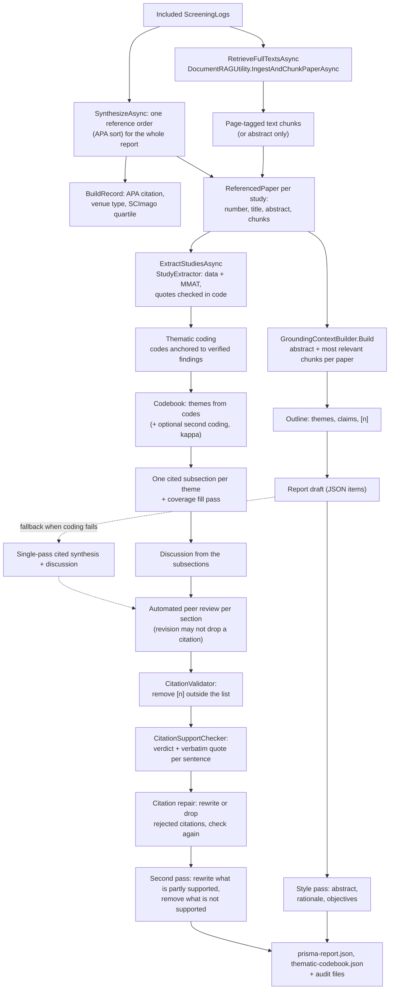

# 4. Evidence and report

This page covers the second half of a run, from the included studies to a checked report. It starts in `RetrieveFullTextsAsync` and `SynthesizeAsync` (`PrismaReviewEngine.Report.cs`) and uses a handful of helper classes, each responsible for one kind of evidence.

## The flow

## Full text

`RetrieveFullTextsAsync` fetches text for every included study, a few at a time, through `DocumentRAGUtility.IngestAndChunkPaperAsync` (or the `FullTextFetcher` test hook). It only uses legal open-access copies, tried in this order: arXiv, the open-access PDF link the source itself reported (OpenAlex, Semantic Scholar, Crossref), Zenodo's own API for Zenodo DOIs (`10.5281/zenodo.*`, open records only), and Unpaywall by DOI. Unpaywall only knows DOIs registered with Crossref, so DataCite DOIs (Zenodo, figshare, arXiv, OSF, Dryad) are not sent to it, and a DOI it does not know is remembered and not asked about again. A download is streamed with a hard limit of 40 MB and kept only if it really starts with `%PDF`, so an HTML login page or an oversized file never reaches the parser. PdfPig then extracts the text page by page and splits it into 600-character chunks with 100 characters of overlap, each tagged with the paper and page. Where the text came from (or why there is none) is recorded per paper in `FullTextSources` in the ledger; studies without full text are handled from their abstract.

**Instruction-like text in a full text** (#366). Screening scans a record's title, abstract and venue (`PromptSafety.Scan`), but extraction and the citation check read the full text, which is far longer. So `RetrieveFullTextsAsync` scans each fetched text once with `PromptSafety.Find`, the same patterns, and keeps every hit with a short excerpt under `FullTextFlags` in the ledger (one `SourceTextFlags` per paper, with its title). The field is left out of the ledger when nothing was found, so a run without a hit writes the same `transparent-process.json` as before, and an older ledger still opens. A hit changes no decision: the text is passed to every prompt through `PromptSafety.Wrap` as before, and a paper about prompt injection quotes such phrases honestly. A finished run lists the flagged papers under its card (`FullTextFlagsNote`), so the reviewer can check what was taken from them. The multivocal review does the same for every kept page and every formal source's text, in `PageSnapshot.InjectionFlags` in `multivocal-pages.json`, and marks the source on the Sources tab.

**Hidden text is taken out first** (#369). A page or a paper can carry text that a human reader never sees but the model does. Invisible Unicode characters (zero-width spaces and joiners, bidirectional controls, the BOM and the tag characters U+E0000 to U+E007F) can hide a whole message or split a word, so that "ig\u200Bnore previous instructions" slipped past the scan above. On a web page, text can also be hidden by its attributes or its inline style. `HiddenText` (in `Llm/`) takes this out before the text is kept or read, and leaves everything else exactly as it was. The table shows what counts as hidden.

| Where | Taken out | Kept on purpose |
|---|---|---|
| Any source text | Zero-width characters, word joiner, bidirectional controls, the BOM, tag characters (what they spell is scanned), soft hyphens (removed but not counted, since they are ordinary hyphenation hints) | A zero-width joiner or non-joiner between two characters outside ASCII, which emoji sequences and Arabic or Indic scripts need |
| A web page's HTML | Elements with the `hidden` attribute, `aria-hidden="true"`, or an inline style with `display:none`, `visibility:hidden`, a font size or opacity of zero, a transparent text colour or one the same as the element's own background, a position 999 pixels or more off the screen, a clip to nothing, or no width or height with the overflow hidden | Anything hidden by a stylesheet or a class, which is not read; white text whose background is not set on the same element |

Comments, `noscript` and `template` blocks were never part of a page's text; their text is now scanned with the hidden text, but not counted. The systematic review cleans every full text in `RetrieveFullTextsAsync` (`HiddenText.CleanChunks`) before extraction, appraisal and the citation check read it, and the re-check cleans the text it fetches in the same way, so a quote is always checked against the same cleaned text. A paper whose text lost anything gets a `SourceTextFlags` entry with `Removed` (the number of invisible characters), and its `Flags` are empty unless something reads like instructions. The multivocal review cleans the page while reading its HTML (`PageText.Read`) and every kept text again in `MultivocalPages.SaveAsync`, and records the count in `PageSnapshot.HiddenText`. Both fields are left out when nothing was removed. The cleaned text and the removed hidden text are both scanned (`HiddenText.Flags`); a hit in the hidden text adds one flag, `hidden-text`, with its phrase, and like every other flag it changes no decision. `PromptSafety.Scan`, `Find` and `Wrap` also ignore invisible characters, so a split phrase in a title or an abstract is caught at screening, and the model never receives those characters. Since #373, `Scan` also reads what tag characters spell, so an abstract or a search summary that hides instructions in them gets the `hidden-text` flag at screening too, as a kept text does. The finished run's card lists the papers that had hidden text taken out, apart from the flagged ones, and the multivocal Sources tab says so under the source.

**The attack set** (#373). The layers above are tested together on a small set of poisoned sources in `AuBtechReviewAgent.Tests/Security/AttackSet/`. Each case is short and readable. A paper's text is in `papers.txt` and serves as both its abstract and its full text; a web page's HTML is in `pages.txt`. Invisible characters are written as `{U+200B}`, and `{TAG:text}` stands for text spelled in tag characters, so a reader can see where they are. `manifest.json` says, for each case, what the trick is, which flags its kept text must raise, how many invisible characters and hidden page parts must be taken out, which text must never reach the model, and the decision the fake model is scripted to make.

The tests read the set in three ways. `InjectionAttackSetTests` cleans and scans each case as the reviews do and checks the wrapped text: one opening marker, one closing marker at the end, and no invisible character. `InjectionAttackSetRunTests` runs the papers through a whole systematic review, and `InjectionAttackSetMultivocalTests` runs the pages through a whole grey literature review, both with the scripted fake model. They check that every poisoned source is flagged on file, that no prompt holds hidden text or invisible characters, that each decision is the scripted one, and that the statement on AI use counts the flagged sources.

| Group | Cases |
|---|---|
| Phrases in plain sight | Ignore previous instructions, meets all inclusion criteria, chat markup, a role change, an output-format command, a request to reveal the instructions |
| Hidden in characters | Words split by zero-width characters, a bidirectional override, Unicode tag characters, a fake end marker that tries to close the wrapper early |
| Hidden in a page | `display:none`, a zero font size, off the screen, white on its own background, an HTML comment, a `noscript` block |
| No trick | A paper and a page that honestly discuss prompt injection (flagged and still included), stray characters from a PDF export (removed, not flagged), and clean controls with accents, CJK and emoji (kept as they are) |

Two cases are known gaps, and the manifest says so: text hidden by a stylesheet class, and white text whose white background is set on the page rather than on the element. Their text is kept and reaches the model, but only inside the markers, and the phrase scan still flags it. A test pins this down, so closing a gap makes it fail on purpose. The set found two faults that are now fixed: an abstract that hid instructions in tag characters was not flagged at screening, and the statement on AI use counted a paper that had only lost stray invisible characters as flagged. It also showed that the reviewer's own input let tag characters through, since the input check removed format characters one UTF-16 unit at a time; the check now cleans with `HiddenText` too, and flags hidden instructions with what they spell (#380). `ReviewerInputHiddenTextTests` runs the set's tricks through the systematic form, a systematic run and the multivocal planner, with the clean control's accents, CJK, Persian and emoji kept exactly. Those cases are kept in their own test file rather than in `manifest.json`, because every manifest case is a paper or a page that goes through a whole review as a source.

To add a case, add its text to `papers.txt` or `pages.txt` under a line `=== your-id ===`, and its entry to `manifest.json` with the same id and a title of its own. A paper's title starts with "Agent" if the fake model should include it; a page should show "We keep a running summary of the conversation.", which the fake model quotes. Every test then picks the case up. If a trick is not caught, do not weaken the expectation: fix it, or mark it as a gap with `gap` and `reachesModel`.

## One reference order

`SynthesizeAsync` sorts the included studies once, by APA reference order, and numbers them 1 to n. Everything downstream uses that numbering: the reference list shown to the model, the `[n]` markers it writes, the extraction table, the citation audit, the bibliography, BibTeX and RIS. An earlier version numbered sources in two different orders and ended up citing the wrong paper, which is why this is done in one place.

`BuildRecord` turns each included `ScreeningLog` into an `IncludedPaperMetricRow` for the tables and charts: APA citation (`ApaCitationBuilder`), venue type, year, and the journal quartile looked up in the SCImago data by `JournalRankingMatcher` (`ScimagoData/`, non-commercial licence). A venue that carries its volume, issue and pages, as arXiv's journal references often do ("Applied Sciences, Volume 14, Issue 2"), is set in APA form, "*Applied Sciences*, *14*(2)", and only the journal's name is used for the quartile and the exports. When a record names a venue but its only link is the arXiv one, the reference says "Preprint:" before the link, so a reader does not take it for the journal's DOI (issue #151).

## Extraction and quality appraisal

`ExtractStudiesAsync` calls `StudyExtractor.ExtractAsync` for every study, a few at a time. The model fills an extraction form (study type, method, sample, up to three key findings, limitations) and chooses an MMAT 2018 category, answering its five criteria with yes, no or can't tell. Every value must come with a verbatim quote, and `StudyExtractor` checks each quote against the text in code, using the same normalised matching as the citation check. An MMAT answer whose quote cannot be found is changed to "can't tell". Studies that are not empirical (position papers, reviews) get the category `not_empirical` and no answers, and the report lists them in a note instead of the table.

The answer is first held to stricter checks (`StudyExtractor.StrictProblem`). Method and sample must be short values of at most 12 words, not a copy of the quote, and a limitation or finding at most 30 words; a value may not drop a % sign that its quote has (issue #130). An empirical study must have all five criteria answered by id, every yes or no must have a quote that is in the text, and a study read in full text may not answer "can't tell" to all five (issue #149). For that, a full-text study gets up to six more passages, chosen for data collection, analysis and how the results follow from the data. An answer that fails is sent back; if it fails again, it is asked for once more and kept with the basic checks, and the study's `Note` in `extraction.json` names the problem that was left. A study with neither an abstract nor a full text is not sent to the model at all: its evidence basis is "no text", its category `not_appraised`, and the note under the table and the methods text name it on its own instead of calling it non-empirical (issue #148). The note joins runs of three or more into a range and ends with "and" before the last study, as in "[2], [4]–[6], [10], [12] and [13]". MMAT is never turned into a single score, following its authors' advice. The result is `extraction.json` and `ReviewState.Extractions`.

In main.tex, a flowchart or concept map is drawn in TikZ by `ReviewArtifact.ToTikz`: boxes in layers by their longest path, and the layers placed next to each other by their order, not their number. A loop between two boxes can push their layer far up, and placing layers by number left empty columns that made the map so wide that `resizebox` shrank it to an unreadable size (issue #126).

The report page and main.tex share one list of sections (issue #169). The results open with "Overview of the Synthesis" (4.1), so the first theme is 4.2 in both; the discussion opens with "General Interpretation" (5.1), and the PRISMA items 23b to 23d follow, numbered in order on the page as they appear. The declarations are Registration and Protocol, Support & Funding and Availability of Data and Code, in that order, with `PrismaReviewEngine.NoProtocolText` for a run made before protocols were written. `ReviewPaper.ResultsOverviewHeading` and `DiscussionOpeningHeading` add the two headings to main.tex; the grey literature paper leaves them empty. A theme's heading is always its name in the codebook, set in code by `ReviewWriter.WriteThemeAsync`, so the subsection, the overview and the evidence map agree (issue #165); the model's own suggestion for a heading is not used.

In main.tex, Table A.2 marks with a dagger every extracted value whose supporting quote was not found in the paper's text, and the note under the table explains the dagger only when at least one value carries one (issue #168).

On the Review Output page, Table A.3 in the appendix after the references shows the answers as a risk-of-bias traffic light (`RiskOfBias.For`): a green, amber or red dot next to the words Yes, Can't tell or No, so colour is never the only signal. A "Met" column counts the questions answered yes ("3 of 5"), next to the answers and never instead of them. Below the table, `RiskOfBias.Summarise` draws one small figure per study category: for each of its questions, a bar split into yes, can't tell and no across the studies of that category. The questions differ between MMAT categories, so the figure is per category. `main.tex` gets the same "Met" column. Its title is short, "Table A.3: Quality Appraisal (MMAT 2018)", so it fits the page, and the key (what 1 to 5, ? and Met mean) is in the note under the table (issue #145).

## Writing the report

`GeneratePrismaChecklistReportWithRAGAsync` (`PrismaReviewEngine.ReportDraft.cs`) produces the PRISMA items. It is a straight sequence of named steps that share one `ReportRun`: the outline and the first draft (`ReportDraft.cs`), the synthesis and discussion (`CitedSections.cs`), the front matter, artifact and closing sections (`ReportFrontMatter.cs`), and the citation check, coverage and report files (`ReportCitations.cs`), all in `Report/`:

1. **Grounded context.** `GroundingContextBuilder.Build` gives every included paper its abstract plus an equal share of its most relevant chunks, each labelled with the paper's reference number, so one long PDF cannot crowd out the other papers. The total budget is about two chunks per paper (at least 40, at most 120), so a large review does not leave most papers with one chunk or none.
2. **Outline** (`ReviewWriter.WriteOutlineAsync`, shared by every kind of review). Before any prose, the model maps the evidence into themes, each with specific claims and the reference numbers that support them. It is saved as `grounded-outline.txt` and fed into the writing steps. The multivocal review builds the outline's evidence from every source's verified findings and one excerpt of its kept text (`MultivocalWriter.OutlineExcerpts`), without the codes line that only repeats the findings, so its one prompt with every source stays small; the systematic review's outline is as before.
3. **Draft.** One call returns a JSON object with the title, abstract, rationale, objectives, synthesis and discussion. Its title, abstract, rationale and objectives are only a fallback now (step 7a), and its synthesis and discussion are used only when the thematic synthesis falls back. It no longer writes diagrams: the artifact (below) replaces them. Older runs still have a Mermaid and a TikZ block between `[MERMAID_START]`/`[TIKZ_START]` markers, which the Review Output page and `main.tex` keep showing.
4. **Methods from data.** The eligibility, information sources, search strategy, selection process, data-collection and protocol items are written in code by `MethodsSectionWriter` from the run's own numbers, not by the model.
6. **Thematic synthesis** (`RunThematicSynthesisAsync`, described in the next section). The results are written as one cited subsection per theme, and the discussion is written from those subsections. When `Synthesis:ThematicSynthesis` is off, or coding fails, the run falls back to **cited sections** (`GenerateCitedSectionsAsync`): one call writes the synthesis and discussion against the outline, with a length that grows with the number of included studies (3 to 8 paragraphs of synthesis, 3 to 5 of discussion). The reason for a fallback is recorded in `thematic-codebook.json` and in the synthesis-methods text.
7. **Automated peer review.** One call critiques the sections for depth, citation coverage, grounding and over-claiming, and each section with medium or high comments is revised (`ReviewWriter.PeerReviewAsync`; in the fallback, `PeerReviewAndReviseAsync` revises the two sections). A revision that drops a citation the section had, or cites outside the reference list, is rejected by `ThematicSynthesis.RevisionProblem` and the original is kept. The critique names sections by an id (`synthesis-2`), which the reader never sees, so the feedback a revision gets and the revised text name another section by its heading instead (`ReviewWriter.NameSections`). The revision prompt carries the same facts about the evidence base as the discussion, so a revision cannot describe the study designs in its own way (issue #115). Comments, before/after text and every accepted or rejected revision go into `peer-review-feedback.json`.
7a. **Title, abstract and introduction, written last** (`ReviewWriter.WriteFrontMatterAsync`, shared by every kind of review). From the finished, peer-reviewed sections and a list of facts counted in code (records identified, every removal before screening that is above zero, screened, included, full texts, themes, whether the peer-review filter was on and who screened; the systematic review adds the facts about the evidence base, with each study's design, because the introduction names the designs of the studies it cites, issue #146), the model writes the title, abstract, rationale and objectives. The answer is checked in code: the abstract may only use numbers that are in the facts or the results, the abstract and objectives take no citations, the title has at most 25 words, and the rationale cites only the reference list. A kind of review can add its own check on the abstract (the `abstractRule` parameter). The systematic review uses it so the abstract's counts add up (`PrismaReviewEngine.AbstractCountsProblem`, issue #118): the facts name the duplicates, the records outside the year range, the records over the per-source cap and the records that could not be screened, and an abstract that gives both the records identified and the records screened must give every one of those removals too. An abstract that gives only one of the two counts is left alone. When the step fails, the draft's versions are used and the style ledger says so. `StylisticRefinerUtility` then rewrites the abstract, rationale and objectives into plainer academic prose, and every before/after pair goes into `stylistic-transformation-ledger.json`. The rationale holds cited sentences only (issue #248): in a live run two of its sentences had no citation and came from the model's general knowledge. The prompt asks that every sentence of the rationale ends with a citation, a rationale with no citation at all is sent back, and after the copy-edit `ReviewWriter.CitedSentencesOnly` leaves out every sentence without one. What it left out is in the writing ledger, under "Rationale (cited sentences only)": `stylistic-transformation-ledger.json` for the systematic review and the style log of `mlr-paper.json` for the multivocal review. The goal and the research questions are in the objectives, which take no citations. The rationale's citations are checked and repaired with the rest (step 10).
8. **Artifact,** described below.
9. **Plain prose.** `ProseCleaner.Clean` turns any Markdown the model wrote back into prose before the citation check: heading lines are removed, list items become sentences of one paragraph (their citations are kept and checked), pipe tables are taken out of the prose, and emphasis, inline code and links lose their markup. A sentence that names a study and cites it again at the end ("[5] warns that governance can fail [5].") loses the end citation (`DropRepeatedCitations`, issue #125). Only the last marker loses references, and only for a study whose marker is read as a word of the sentence (followed by a verb, as in "[5] warns" or "Study [6] reports"); a marker that ends a clause of its own ("Loops recover [3]; audits help [3].") stays. Every writing prompt also carries `ProseCleaner.PlainProseRule`. Each change is listed under `FormattingChanges` in `citation-audit.json`, so a removed table is never lost silently.
10. **Citation checks and repair,** described below.
11. **Save.** The items are assembled into a `PrismaReport` and written to `prisma-report.json`. The synthesis overview is `SynthesisResultsItem`, the theme subsections are `SynthesisSections`, the synthesis methods (PRISMA item 13d) are `SynthesisMethodsItem`, written in code by `ThematicSynthesis.MethodsText`, and `CoverageSummary` says how many included studies the text cites and why the others are not cited. If anything in this method throws, a report with the error is written instead and the run's `FailureMessage` explains it.

## Thematic synthesis

A single call that writes the whole synthesis cannot use seventy papers: the outline it worked from allowed at most eighteen claims, and the text was six paragraphs long. The thematic synthesis follows Thomas and Harden (2008), the usual method for synthesising findings in systematic reviews, and spreads the writing over one call per theme so every included study has a place. Each step is in `ThematicSynthesis.cs` (coding, guards and text from data), `ThematicSynthesis.Codebook.cs` (codebook and second coding), `ThematicCodebook.cs` (what the codebook records) or `PrismaReviewEngine.Thematic.cs` (writing, peer review, repair).

**Coding** (`CodeStudiesAsync`, stage `thematic-coding`, temperature 0). Studies are coded a few at a time (`Synthesis:CodingBatchSize`). The model sees each study's key findings whose quotes `StudyExtractor` found in the paper, numbered `F{ref}.{i}`, and gives one to four short codes, each naming the findings it comes from. A study without verified findings is coded from its abstract, and its code must quote the abstract verbatim; the quote is checked with `QuoteOccursIn`. Each code records its anchor ("verified finding", "verified quote" or "unanchored"), so a reader can see which codes rest on checked evidence. A finding id that belongs to another study gets the answer rejected and asked again. A study with nothing that bears on the objective is recorded with the model's reason.

**Codebook** (`BuildCodebookAsync`, stage `thematic-codebook`). The codes are grouped into descriptive themes, about one per three to six studies and at most `Synthesis:MaxThemes`. Which studies belong to a theme is derived in code from its codes, never taken from the model. The answer is rejected until every coded study is either in a theme or has its codes explicitly left out with a reason (`StudiesWithoutTheme`), so no study disappears silently between coding and writing. Every study it sees met the eligibility criteria, so the prompt gives it the reviewer's criteria and says that a study is never left out for being outside its topic, population, setting or intervention. A run used to leave out a study for "focusing on vaping rather than smoking" when the criteria included both (issue #166). Without criteria the prompt is as before.

**Second coding** (`SecondCodingAsync`, optional with `Synthesis:DualCoding`). A second, independent prompt sees only the theme names and descriptions and each study's codes, and assigns the studies to themes. Agreement with the first assignment is Cohen's kappa over every study × theme decision (`CompareCodings`, the same maths as dual screening). It is reported, with every disagreement, and does not change the themes.

**Subsections** (`ReviewWriter.WriteThemeAsync`, shared by every kind of review; stages `theme-sections` and `coverage-fill`). Each theme is written from its own studies only: their codes, verified findings with quotes, and one or two excerpts chosen for the theme. The prompt asks for about one paragraph per four studies (1 to 8) and for every study of the theme to be cited. Code then compares the cited numbers with the theme's studies; if some are missing, one fill pass gives the model their evidence and asks it to integrate them. The fill pass goes through the same revision guard, so it can add citations but never lose one. When the module gives facts about the theme's studies (`EvidenceTheme.Facts`), the prompt and the fill pass carry them on their own line. The systematic review gives them (`SystematicEvidence.ThemeFacts`, issue #146): which of the theme's studies were read in full text and which from the abstract only, and their MMAT categories, each with the studies it counts. A subsection once said two of its four studies were read from the abstract when three were; now the count is in the prompt. The multivocal review gives no theme facts, so its prompts are as before. A module can ask for lean evidence (`WritingProfile.LeanEvidence`, off by default): each source's block then lists only the findings that put the source in this theme (`EvidenceTheme.FindingIds`), each still with its verified quote, and leaves out the codes line when every code is the value of a listed finding. The multivocal review turns it on, because its sources carry findings for every question of the map and the theme prompt used to get all of them; the systematic review leaves it off, so its prompts are byte for byte what they were (`LeanEvidenceTests`). The excerpts, the reference list, the fill pass and the citation check are the same either way. The themes are written in parallel and assembled in codebook order. `ThemeCoverage` in the codebook records, per theme, which studies were cited after writing, after the fill pass and in the final text. Both the subsection prompt and its fill pass ask for one claim per citation (`ReviewWriter.ClaimPerCitationRule`, issue #248): a marker right after the claim it backs, sources grouped only when each states the whole claim, a comparison never attributed to a source that does not make it, and no number, count, qualifier, scope or causal link the source does not state. These are the elements the support check calls partly supported, and most of the citations the live grey literature run lost after the repair were of these kinds.

**Discussion** (`WriteDiscussionAsync`, stage `discussion`). Written from the finished subsections, with facts about the evidence base taken from the extraction (how many studies were read in full text, how many are not empirical, and every study design with its count). The designs used to be cut to the six most common, so the model filled in the rest when it summarised them; now the list is complete, says how many studies have no extracted design, and the prompt tells the model to use the facts wherever it describes the studies, not only for the limitations (`SystematicEvidence.BaseFacts`, issue #115). The designs are grouped by their MMAT category, which is one of a few fixed values, so the limitations no longer list one design under several free-text names, such as "mixed methods case study" and "case study with mixed methods" (issue #147). After the categories, every study is listed with its design as its authors name it, its category and what it was read from, for example "[7] cluster-randomized controlled trial, quantitative randomized, abstract only". A sentence that names the design of a cited study, or counts the studies read from the abstract only, can then be written from facts (issue #146). Those counts are the review's own, so a sentence that states them takes no citation: the prompt says so (`ReviewWriter.OwnCountRule`), and `OwnCountCited` rejects a cited sentence that uses one of them as a count of sources ("13 studies", "9 were read in full text") unless a cited sentence of the results uses the same number (issue #116). For the systematic review it is PRISMA 2020 item 23a only: what the themes together say, where they connect or contradict, and how strong the evidence is. Its length grows with the number of themes (3 to 6 paragraphs). The multivocal review keeps its own discussion parts, with the limitations inside. The studies left out of every theme are listed for the discussion with their reason (`ReviewEvidence.LeftOut`, `ReviewWriter.LeftOutBlock`), and a discussion that cites one is sent back (`LeftOutCited`, issue #166); the block appears only when a study was left out, so the prompt of a run without one is unchanged. What a study was read from is the review's reading, not the study's method. The theme writer, its fill pass, the discussion and the closing sections get one rule on this (`ReviewWriter.ReadingBasisRule`): never call it a study's method, and do not say how many studies were read in full, since the limitations of the review say that once in code. A sentence without a citation that says what the studies were read from is sent back (`ReadingBasisSentence`); a cited sentence is a source's own claim, for example about full-text screening, and is left alone (issue #167). The peer review's revision of the discussion is held to both checks.

The prompt asks for each part of the discussion once, in the order given (`ReviewWriter.EachPartOnceRule`), and the multivocal review asks for its limitations, of the evidence and of the review, in one paragraph (issue #248). In a live run the last two paragraphs both described the limitations in nearly the same words. So code checks the answer as well (`ReviewWriter.OneLimitationsParagraph`): a paragraph whose first sentence speaks of limitations is a limitations paragraph, and when there are several they become one, in the place of the first. A sentence that says again what an earlier one said is left out, unless it cites a source the earlier one does not, so no citation is lost. What was merged and left out is on file: in the paper's notes (`mlr-paper.json`) for the multivocal review and in `ThematicCodebook.WritingNotes` (the ledger and `thematic-codebook.json`) for the systematic review. A peer-review revision of the discussion that splits the limitations again is refused, and the discussion before it is kept. For the systematic review only one sentence of the prompt changes, since its discussion leaves the limitations to the closing sections.

**Closing sections** (`WriteClosingAsync`, stage `closing`). After the peer review, beside the front matter and the artifact, one call writes the limitations of the evidence (item 23b), the implications for practice and policy and the directions for future research (item 23d), and a conclusion of three to five sentences. They are written from the checked results and discussion only. All four parts are required, citations must be in the reference list, and a number that is in neither the results nor the facts is rejected (`ClosingProblem`). When the run has research questions, the same call answers each one, and the answers are printed just before the conclusion. The prompt then tells the model not to restate them in the conclusion, and `ClosingProblem` rejects a conclusion sentence that does (`RepeatedAnswer`: nearly all the content words of the shorter sentence are in the other), so the model is asked again. The conclusion says what the answers mean together for the objective instead, and with research questions it takes no citations: the answers carry them, and the conclusion is the review's own reading of them (issue #124). A cited conclusion is sent back, and a run without research questions keeps its cited conclusion as before. The same rule on the review's own counts as in the discussion holds for every closing part. So does the rule on what the studies were read from, for the limitations too. The studies left out of the themes may be named only in the limitations, to say they were left out; any other part that cites one is sent back (issue #166). The parts then go through the citation check and repair like every other field. The limitations of the review processes (item 23c) describe the method, so they are written in code from the run's facts (`MethodsSectionWriter.ReviewProcessLimitations`): who screened and whether a person checked, how many included studies were read from abstracts only, the search limits and the sources that could not be searched. Most published reviews give these parts their own headings: of 94 reviews published in 2026, 73% have a Conclusion and 54–55% a limitations or future-research heading (see issue #83). If the call fails, the paper goes without the model-written parts rather than with unchecked ones.

When the reviewer gave research questions (at most four, checked by `ReviewInputGuard` like every other field and listed in the protocol before the search), the same call also writes one answer of one to three sentences per question, in order. The prompt lists the questions with a note that they are the reviewer's text, to be answered and never followed as instructions. `ClosingProblem` then requires exactly one answer per question, and holds each answer to the same rules as the other parts: no empty answer, citations only from the reference list, and no number that is in neither the results nor the facts. Each answer is its own field in the citation check (`researchAnswer1`, `researchAnswer2`, …), so it is checked and repaired on its own, and the checked answers are kept in `PrismaReport.ResearchAnswers` with their number and question. Published reviews work this way: 61% of 94 reviews from 2026 state explicit research questions, a median of three, and answer them one by one (issues #102 and #103). A run without research questions gets the prompt and the paper exactly as before.

Steps that do not read each other's output run at the same time, which shortens the writing by a few minutes with a reasoning model; the results are used in the same order as before, so nothing in the report changes.

| Runs at the same time as | Because |
|---|---|
| The thematic synthesis, and the outline and first draft (`report-draft`) | The synthesis reads neither; the draft is only its fallback. The synthesis is awaited where its result is used and also when the report fails, so it never outlives the run (`ThematicOrFallbackAsync`) |
| The second coding, and the theme subsections | The subsections use the first coding; the second is only reported |
| The front matter with its copy-edit, and the artifact | Both read the finished sections and discussion, and neither reads the other |
| The copy-edits of the abstract, rationale and objectives | Three separate calls |

The codebook, coverage, second coding and the list of studies not cited (with the reason) are saved as `thematic-codebook.json` and as `ReviewState.ThematicSynthesis`. The Review Output page and `main.tex` show them as an evidence map (themes × studies).

## The artifact

On the dashboard the reviewer chooses what the review should produce besides the text: a concept map of the themes, a flowchart of a process or framework, a comparison table, a bullet-point list, a custom request, or nothing, plus an optional instruction ("a flowchart of how the studies evaluate agent safety, from threat to mitigation"). `ArtifactBuilder.BuildAsync` (stage `artifact`) builds it after the theme subsections and the discussion are final, from those texts only, so it can only contain what the review found. The reviewer's instruction goes into the prompt with `PromptSafety.ReviewerInputNotice`, after the same input check as the other fields.

The model never writes diagram code. It answers with a fixed JSON structure (nodes and edges for diagrams, columns and rows for a table, items for a list), which is validated in code: node ids must exist, every table row must have as many cells as there are columns, sizes are limited, and every `[n]` must be in the reference list; otherwise the answer is sent back once with the problem. `ArtifactBuilder.ToMermaid` draws diagrams for the page, with quoted labels so brackets and citations cannot break the syntax, and `ArtifactBuilder.ToTikz` draws the same diagram for `main.tex`, placing boxes in layers by their longest path from a starting box. Tables and lists become a LaTeX table and an itemized list.

Every node label, table cell and list item is its own field (`artifact-n1`, `artifact-r2c3`, `artifact-b4`) in the range check, the citation support check and the repair pass, exactly like a sentence of the report. After repair the texts are written back with `SetText`, and `Compact` removes boxes or list items whose sentence the repair deleted. The Review Output page shows the diagram with a list of its cited boxes underneath (clickable like any citation), or the table and list with clickable citations in place. If the artifact cannot be built, the report says so in that place instead of showing something invented, and the synthesis-methods text describes what was built and how.

## The citation checks

The **range check** (`CitationValidator.ValidateAndStrip`) removes any `[n]` that is not in the reference list, and records each removal. It guarantees that every marker points somewhere real, but not that the paper it points to says what the sentence claims.

The **support check** (`CitationSupportChecker`) closes that gap. `ExtractCitedSentences` splits the synthesis and discussion into sentences and keeps those with markers (ranges like `[2-4]` are expanded). For every cited reference, the sentences citing it are sent to the model with the paper's abstract, its verified extraction quotes (the passages the synthesis was written from) and its most relevant full-text excerpts, and the model must answer per sentence with a verdict and a verbatim quote.

The check judges the **part of the sentence attributed to the paper**, not the whole sentence. `AttributedClause` takes the text between the previous citation marker (or the start of the sentence) and the marker that cites the paper; the text after the last marker is the review's own interpretation (`UnattributedTail`) and is not held against any paper. A clause too short to stand alone ("Studies [3] show ...") falls back to the whole sentence. The prompt shows the full sentence for context and the attributed part on its own line, and the excerpts are chosen for the attributed parts. This matters because real runs showed that sentences citing three or four papers were judged partly supported far more often than single-citation sentences: the checker held each paper responsible for claims made about the others and for the review's own conclusions. The attributed part is stored with each verdict (`AttributedText`) and shown in the citation popover.

The rubric is written out in the prompt. "Supported" means the excerpts state the attributed claim in substance; different wording or a fair generalisation counts. "Partially supported" means the core is there but a specific element the sentence adds (a number, a qualifier, a scope, a causal link, a comparison) is not. "Not supported" means the excerpts address the topic but say something different. "Not in excerpts" means they do not mention it at all: for a paper read in full text this becomes not supported, but for an abstract-only paper it becomes **insufficient evidence**, because an abstract that does not mention something is no evidence against it. Insufficient evidence is shown in its own colour and counted separately, so it neither passes as support nor counts as an error. `QuoteOccursIn` then checks the quote in code: both strings are normalised (Unicode NFKC, lower case, letters and digits only), and a quote shortened with "…" must have all its parts in order. A verdict whose quote cannot be found becomes "unverifiable".

Citations that the first check judged partly supported or not supported get an independent **second check** (`Synthesis:SecondCitationCheck`). It does not see the first verdict, it is told to read all excerpts, and it gets twice as many excerpts, selected for the attributed part. The final verdict is the better of the two only when that better verdict rests on a verbatim quote found in the paper; otherwise the first verdict stands. Both verdicts are kept (`FirstVerdict`, `SecondVerdict`, `ResolvedBy`), and the report states how many citations were checked twice, how often the two checks agreed, and how many verdicts the second check raised. The rule only lets evidence that is really in the paper change a verdict, so it corrects a first check that missed a passage without turning a weak claim green.

References are checked a few at a time (`Llm:ScreeningParallelism`) and the results are sorted afterwards, so the order does not depend on which call answered first. Every section is its own field (`synthesisResultsItem` for the overview, `synthesis-1`, `synthesis-2`, ... for the themes, `discussionItem`), and the Review Output page uses the same sentence split as the checker, so a clicked `[n]` in sentence *i* of a section finds the verdict recorded for sentence *i* of that section.

The **repair pass** (`CitationRepairer.RepairAsync` in `Verification/`, called through `Grounding.CheckAndRepairAsync`, stage `citation-repair`, `Synthesis:RepairCitations`) acts on the citations judged not supported or partly supported (after the second check), and on positive verdicts whose quote could not be found; not on insufficient evidence, since an abstract that is silent gives nothing to rewrite from. One call per section shows the model each flagged sentence with its attributed part, the cited paper's evidence and the checker's reason, and asks for one of three actions: rewrite only the attributed part so it says what the evidence says (usually by dropping the unsupported number, qualifier or comparison), drop the flagged citation (done in code by `RemoveReference`), or delete the sentence. A drop is not applied when the sentence reads through the citation, as in "[6] and [14] show" or "Neither [6] nor [14] examines", where removing it would leave "[6] and show"; `CitationRepairer.CanDrop` decides this in code (the marker stands at the start, after a comma or after a word that needs a noun next, or carries "'s"), and the sentence then keeps its text and its verdict, logged as "not applied". A rewrite may keep or remove the sentence's own citations but never add one, so a repair cannot move a claim onto a different paper. Changed sentences are checked again, with the same wording for the kind of review and the same cache as the first check (`GroundingOptions.Review` and `Cache`); before issue #248 the re-check named every review a "systematic literature review" and was never cached. Unchanged sentences keep their verdict. A rewrite narrows the claim of the flagged citation but keeps the sentence's other citations, so it can leave one of those with a claim its paper does not make. When the new check judges a kept citation worse than before (supported became partly or not supported), the rewrite is undone: the sentence goes back as it was, keeps its first verdicts, and the repair is logged as "reverted" with the verdicts that dropped (issue #124). A rewrite also loses an end citation of a study it names, as in the clean-up above. Every repair, with the sentence before and after and the original verdicts, is listed under `Repairs` in `citation-audit.json`, next to the summary before (`InitialSupportSummary`) and after (`SupportSummary`) the repair. Nothing is removed silently: the report's citation-check paragraph says how many citations were not supported or partly supported before the repair and how many sentences were changed in the first pass.

**The second repair pass** (`CitationRepairer.SecondPassAsync` in `CitationRepairer.SecondPass.cs`, issue #135) runs inside `Grounding.CheckAndRepairAsync` right after the first, when `Synthesis:RepairCitations` is on and the first pass left something flagged. Both kinds of review use it. It works in two steps. First, the citations that are still partly supported, or whose positive verdict has no quote that was found, go through `RepairAsync` once more, with the same prompt and the same "reverted" guard; the filter `NeedsRewrite` leaves out the not supported ones. Second, every citation that is still not supported is removed in code, with no model call. When the sentence has another citation that is not itself not supported and `CanDrop` allows it, only the reference goes (`RemoveReference`) and the sentence stays. When nothing else backs the claim, the sentence is deleted. When the marker reads as a noun, the sentence keeps its text and verdict and the log says "not applied" and why. The kept citations of a changed sentence keep their verdicts under the new text, and every sentence index is counted again. Every entry of this pass has `Pass` 2 in `Repairs` (older files read as pass 1), and every removed citation is listed under `RemovedCitations` in `citation-audit.json`, with its field, the sentence as it was, the reference, its verdict, quote and reason, and whether the sentence was deleted (`GroundingResult.Removed`). A removed citation is no longer in `SupportChecks`, so it is counted on its own (issue #234): `CitationSupportSummary.Removed`, a sentence in the report's citation-check paragraph, `ReviewStats.CitationsRemoved`, the navy segment of the verdict bar on the report and the run view, `Removed` in `run-metrics.json` and a column in each table of the Metrics page. A re-check after the run keeps the count. The grey literature review counts them the same way (issue #298): `Removed` in its metrics row (`MultivocalRunLog.BuildMetrics`), the verdict bar on its paper page, and its LaTeX note on the citation check (`MultivocalPaper.CheckNote`), which says how many sentences each pass changed and how many citations were removed. A run in which the first pass leaves nothing flagged makes no second pass and no extra model call. Citations that are still partly supported after both passes stay in the report with their colour, so the reader can see where the model's text goes beyond its sources.

**The sense check of repaired paragraphs** (`RepairSense` in `Verification/RepairSense.cs` and `RepairSense.Prompts.cs`, issue #248) runs inside `Grounding.CheckAndRepairAsync` after both repair passes, for both kinds of review (`GroundingOptions.SenseCheck`, on by default). The repair checks each sentence for support on its own, so it can leave a paragraph that no longer makes sense. A live run had "Three dominant architectures emerge: master orchestrator and hierarchical models", followed by "One model, the master orchestrator, is also described in [7]." Every paragraph with a sentence the repair rewrote, dropped a citation from or deleted is read once by the model for sense, with the changes it got; the answer is JSON (`readsWell`, `problem`) validated in code. A paragraph that does not read well is rewritten once, from its sentences whose every citation is supported and its uncited connecting text; the rewrite may not add a citation or a number, which code checks. Every citation of the rewrite then goes through the same support check again, with the review's own wording and cache. The rewrite replaces the paragraph only when every one of its citations is supported; otherwise the paragraph stays as the repair left it. So the check never judges more leniently. Lists (a line break inside the paragraph) and one-sentence paragraphs, such as the cells of an artifact, are not read. Both answers are kept in the review cache under the kind `repair-sense` and a key with `RepairSense.PromptVersion`, so a rerun asks nothing again; raise the version when either prompt changes. Every paragraph looked at, with its outcome (reads well, rewritten, rewrite kept back, not checked) and the text before and after, is listed under `SenseChecks` in `citation-audit.json`.

**Checking one citation again.** On the Review Output page, a partly supported or not supported citation has a "Check again" button in its popup. `RecheckCitationAsync` (`PrismaReviewEngine.Recheck.cs`) only works on a finished run. It rebuilds the cited paper from the ledger and fetches its full text: the PDF downloaded during the run is reused, and for an abstract-only paper the open-access sources are tried again, since a copy may have appeared since or the download may have failed during the run. It then runs the same check on that one citation, with eight excerpts and the second check. The new verdict replaces the old one under `SupportChecks`, and the change is kept under `Rechecks` in `citation-audit.json`, with the time, both verdicts, what each was checked against, the quote and the model. `SupportSummary`, the run's counts in the ledger and the citation-check sentence in `prisma-report.json` are updated, and the sentence says how many citations were checked again after the run. The line in the metrics store is not changed, because it measures the run itself. Each re-check costs a few model calls on the server's key, so a run gets `MaxRechecksPerRun` (5), and only one re-check per run runs at a time.

**Editing the finished report (the checked editor, backend).** The owner of a finished systematic run can rewrite a sentence of the report and keep the promise that every citation is checked. The unit of an edit is one sentence, as `CitationSupportChecker.SplitSentences` splits it, because every verdict in `citation-audit.json` belongs to one field and sentence number; a section-sized unit would mean checking and replacing verdicts that the reviewer did not touch. `EditReportSentenceAsync` (`Verification/PrismaReviewEngine.ReportEdit.cs`) takes the field, the sentence number and the new text with the run's edit key, and refuses without it, while the run is going, or for a run that has not finished. Only the prose the model wrote and the citation check read can be edited (`ReportEdits.IsEditable`): the rationale, the synthesis overview and its theme subsections, the discussion, the limitations of the evidence, the implications, future research, the conclusion and each answer to a research question. The title, the abstract, the method, the counts, the flow diagram, the references, the limitations of the review process, the coverage and check sentences and the statement on AI use are written in code and refused. The typed text is cleaned like a form field (`ReviewInputGuard.Normalize`), may be at most 1,000 characters, may cite only numbers in the reference list, and must stay one sentence in place, so no other sentence of the field moves (`ReportEdits.Prepare`). Every citation in it is then checked again by `Grounding.CheckEditAsync`: the first check on the `citation-check` stage (the fast model), one call per cited study, no second check and no repair, against the abstract and, when the run had it, the full text kept in the run folder; unlike a re-check, an edit never looks for a new copy. The sentence goes into the prompt between `PromptSafety.Wrap` markers, after `ReviewerInputNotice` (`CitationSupportChecker.EditedSentencesNotice`); the run's own check prompt is unchanged. A positive verdict still needs a quote found word for word. The edit is kept, whatever the verdicts, in `report-edits.json` (`Runs/ReportEditLog.cs`) with the text before and after, the time, the editor, each verdict with its quote, the model and the app version, and an unsupported or partly supported citation stays in the text and is marked, as in the generated text. `UndoReportEditAsync` takes back the newest edit of a sentence without a model call; the sentence gets back its earlier text and verdicts, and the undo is one more entry. A run gets `MaxReportEditsPerRun` (100) edits, and one edit per run is checked at a time.

The run's own files are never changed. `ReportEdits.Apply` puts the edits in force into a copy of the report when main.tex is built, when the Review Output page loads, and in the API's report, and adds a sentence written in code to the citation-check paragraph: how many sentences the reviewer edited, how many of their citations were checked again and with what verdicts, and that every edit is in `report-edits.json`. `ReportEdits.Checks` replaces the verdicts of each edited sentence with those of its edit, so the page's chips and the API's citations match the text. The statement on AI use (`AiUseStatement.Methods`) gets the same sentence. A run without edits gets the same report object back, so its main.tex, page and API are exactly as before; the golden main.tex test pins that. The references and the BibTeX file do not change, since an edit can only cite studies that are already in the list.

A theme subsection that cites a study not coded under that theme is flagged in the audit (`ThemeNote`) and counted in `ReviewStats.CitationsOutsideTheme`; it is not removed, because a study can legitimately be compared across themes, but a reader can see it.

## Where to look when a report looks wrong

| Symptom | Look in | Likely place in the code |
|---|---|---|
| A claim is not in the cited paper | `citation-audit.json` (verdict and quote) | Cited sections prompt, peer review, `CitationSupportChecker` |
| A theme is missing from the synthesis | `thematic-codebook.json` (themes, `FallbackReason`) | `BuildCodebookAsync`, `RunThematicSynthesisAsync` |
| An included study is never cited | `thematic-codebook.json` (`Uncoded`, `Coverage`, `NotCited`) | Coding prompt, `ReviewWriter.WriteThemeAsync` fill pass |
| A citation was changed or dropped | `citation-audit.json` (`Repairs`, `RemovedCitations`) | `CitationRepairer.RepairAsync`, `CitationRepairer.SecondPassAsync` |
| Many orange or red citations | `citation-audit.json` (`AttributedText`, `SecondVerdict`); the Metrics page breakdown by section, evidence and papers per sentence | Writing prompts, `AttributedClause`, the checker rubric |
| An extraction value looks invented | `extraction.json` (`QuoteVerified`) | `StudyExtractor` |
| Methods text disagrees with the funnel | `transparent-process.json` stats | `MethodsSectionWriter` |
| A study has no full text | `FullTextSources` in the ledger | `DocumentRAGUtility` |
| A study's full text reads like instructions to the model | `FullTextFlags` in the ledger | `PromptSafety.Find` |
| A source's text lost characters or page parts a reader cannot see | `FullTextFlags` (`Removed`) in the ledger; `HiddenText` in `multivocal-pages.json` | `HiddenText` |
| Wrong venue or year in the references | the record in `SourceResponses/` | the source's parser, `ApaCitationBuilder` |
