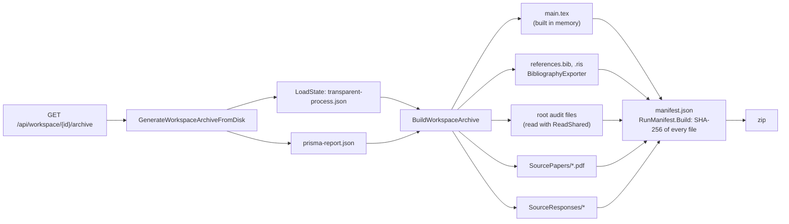

# 5. Ledger, archive and data model

Traceability is the point of the tool, so what it saves matters as much as what it computes. This page describes the files a run leaves behind, the types they are made of, and how the downloadable archive and `main.tex` are built from them.

## The run folder

Every run has a folder `WorkspaceStore/{runId}/`, where the run id is a GUID written as 32 hex digits. The folder path is built in exactly one place, `RunStore.FolderOf`, which also refuses any path that would fall outside the workspace. `RunStore` (in `Runs/`) is shared by every kind of review: it reads the header, checks edit keys, keeps notes and deletes runs.

| File | Written by | When | Contents |
|---|---|---|---|
| `run.json` | `RunHeader.WriteAsync` | first, when the run starts; again when it ends, is marked interrupted or is cancelled | The **header**: run id, module, card, start time, final stage, end time; for a cancelled run also `CancelledUtc` and `CancelReason`. A folder without it is an older systematic run |
| `protocol.md` | `WriteProtocolAsync`, `ProtocolWriter` | before the search; amendment after the search strings are known | Question, research questions, criteria, sources, limits, screening set-up; dated amendments |
| `transparent-process.json` | `SaveStateAsync` (via `PublishAsync`) | after every step | The **ledger**: the whole `ReviewState` |
| `SourceResponses/*.json`, `*.xml` | `SaveRawResponses` | during search and chaining | Each source response exactly as received |
| `*.pdf` | `DocumentRAGUtility` | during synthesis | Open-access full texts used in the run |
| `extraction.json` | `ExtractStudiesAsync` | during synthesis | Data extraction and MMAT answers with quotes |
| `grounded-outline.txt` | report generation | during synthesis | Themes, claims and supporting reference numbers |
| `thematic-codebook.json` | report generation | during synthesis | Codes with their anchors, themes, second coding and kappa, coverage per theme, studies not cited and why |
| `peer-review-feedback.json` | report generation | during synthesis | Reviewer comments; text before and after revision; each section revision and whether the guard kept it |
| `stylistic-transformation-ledger.json` | report generation | during synthesis | Each stylistic rewrite, before and after |
| `reviewer-notes.json` | Review Output page | when the reviewer saves a note | The reviewer's own notes on citations and included studies (`ReviewerNote`), never sent to the model |
| `report-edits.json` | `EditReportSentenceAsync`, `UndoReportEditAsync` | when the reviewer edits or undoes a sentence of the finished report | Every edit in order (`ReportEditLog`): the field and sentence number, the text before and after, who (the edit key's owner) and when, a verdict with its quote for each citation in the new text, the model and the app version; an undo is one more entry. The run's own files are never changed; the page, main.tex and the API put the edits in place when they read the report |
| `owner.json` | dashboard | when the run starts | The SHA-256 of the run's edit key; not part of the archive |
| `citation-audit.json` | report generation | during synthesis | Removed markers; verdict and quote per cited sentence and artifact element; repairs with before/after and their pass; citations removed by the second pass; the sense check of every repaired paragraph (`SenseChecks`); summary before and after repair; studies not cited; Markdown removed from the prose |
| `prisma-report.json` | report generation | at the end | The PRISMA items shown on Review Output |
| `llm-calls.json` | `finally` block of `RunReviewAsync` | at the end | Every model call; run settings |
| `run-metrics.json` | `WriteRunMetricsAsync` | at the end of a completed run | Quality and cost figures of the run (also appended to the metrics store) |

The ledger is written with `SafeFile.WriteAllTextAsync`: a temporary copy is written and moved into place, so a reader never sees half a file. On Windows that move can briefly fail with "Access to the path is denied" while an antivirus scanner or the search indexer holds the previous version, which stopped runs that save many times a second (screening served from the cache). The move is therefore retried a few times, then the file is overwritten in place, and only if that also fails does the run stop.

`main.tex`, `references.bib`, `references.ris`, `screened.ris` and `manifest.json` are not stored in the folder. They are built when someone downloads the archive, from the files above.

Outside the run folders, `App_Data/metrics/runs.jsonl` (`RunMetricsStore`) keeps one line of `RunMetrics` per completed run. It is not removed by the run clean-up, so quality can be compared across months of runs and app versions. It holds no research question (only a hash of it) and no paper text. `ConfigFingerprint` is a hash of the model, the app version and the settings that shape the output; runs with the same fingerprint were produced the same way. The prompt fingerprint in `llm-calls.json` cannot serve for this, because it hashes the prompts with their paper excerpts and so differs between any two reviews.

The effort of a run is counted from its `llm-calls.json` (`RunMetrics.AddCost`, issue #414), for both kinds of review: the calls, retries (attempts after the first), failed calls and the summed call time, and the tokens in (`InputTokens`, with the `CachedInputTokens` the provider served from its cache) and out (`OutputTokens`, with the `ReasoningTokens` the model spent reasoning, which are part of them), in total, by stage (`CostByStage`) and by the model the call was sent to (`CostByModel`). `LlmMinutes` adds up the time of every call, which can exceed `DurationMinutes`, because calls run side by side. A call's usage is stored as JSON text, and the Mistral connector's text is itself a JSON string, so `LlmUsage.Parse` unwraps up to three levels and reads Mistral, OpenAI and .NET names. Before this, the total `Tokens` read 0 for every run with double-encoded usage; lines written then keep their 0, and their new fields are missing, so they read as unknown rather than 0. `ReviewType` says `systematic` or `multivocal`; an older line is read from its settings. `ScreeningKappaBasis` says what the screening κ is computed over: `all records` for a systematic run, and for a multivocal run `audit sample` (screened from 23 November 2026: the seeded random sample of each pool; the targeted second screenings are counted apart, as agreed out of screened again) or `all sources` (an older run, every source screened twice, told apart by its missing `AuditSeed`). A multivocal line also has `GreyPool` and, with academic databases, `FormalPool` (`RunMetrics.Pools.cs`, issue #415), counted by `MultivocalRunLog.Pool` from the same counts as the run view and the flow diagram (`MultivocalPools.For`): found, removed before screening, screened, included, excluded, κ and its basis, screened twice, the audit sample, the targeted second screenings and how many agreed, kept, below the threshold, not assessed, extracted, read on the abstract alone, and for the grey pool its Table 7 sources scored and their mean points, for the formal pool its MMAT appraisals and how many were empirical. `MeanQualityPoints` is now the grey pool's mean only; before, it also counted the academic sources, which have no Table 7 points. The store's lines can be downloaded as CSV and JSON; `docs/metrics-dictionary.md` describes every column.

## The run folder of a multivocal run

A multivocal or grey literature review (`Modules/Multivocal/`) keeps its own files in the same kind of folder, one file per step, each written with `SafeFile` when its step ends. The step's service names the file in a constant, and `MultivocalModule.ArchiveFiles` lists the ones that go into the archive.

| File | Written by | Contents |
|---|---|---|
| `run.json`, `protocol.md`, `multivocal-plan.json` | `MultivocalPlanner` | The header, the protocol with its SHA-256, and the plan it was written from |
| `multivocal-ledger.json`, `SourceResponses/` | `MultivocalSearcher` | Every search with its raw answers, the sources found with the searches that found them, skipped searches and the stopping rule as applied. In a multivocal review with academic databases, each academic search is marked `Formal`, each source found there keeps the database's record as `Paper` (so it is in the formal pool), and `FormalRemoved` lists every academic record not kept: duplicates by id, DOI or title, as in the systematic review, and records with no web address. A grey literature review's ledger has none of these fields |
| `multivocal-screening.json` | `MultivocalScreener` | Both screenings of every source, their agreement (κ) and the reviewer's changes. With a formal pool, each academic source is marked `Formal`, the agreement is also given for each pool (`KappaGrey`, `KappaFormal`) and the academic records' prompt version is `FormalPromptVersion`; a grey literature review's file has none of these fields |
| `multivocal-pages.json`, `PageText/` | `MultivocalPages` | The record of each page snapshot (address after redirects, access date, SHA-256 of the text, Wayback Machine link, or why it was not fetched); the text itself is in `PageText/`. A formal source's text is its open full text (the PDFs stay in `FullText/`, outside the archive) or its abstract, and its record says which (`TextBasis`) and where the full text came from (`FullTextSource`); it has no Wayback Machine link. Phrases that read like instructions are in `InjectionFlags`, and what a reader could not see and was taken out of the text is counted in `HiddenText` (#369); both are left out when empty |
| `multivocal-quality.json` | `MultivocalQualityAssessor` | The checklist points of every included source with their quotes, and the threshold. When a grey page was too long to send whole, its `Passages` says what of it the model was given, for example "25 of 152 passages of the page (9,860 of 61,000 characters)" (`GreyPageText`, #391); it is left out for a page sent whole. A formal source is marked `Formal`, has the systematic review's extraction and MMAT appraisal (`Mmat`) and its `TextBasis` instead of points, and is kept whatever its appraisal (`FormalAppraisalVersion` names the appraisal's version); a grey literature review's file has none of these fields |
| `multivocal-map.json`, `multivocal-extraction.json`, `multivocal-synthesis.json` | mapper, extractor, synthesiser | The systematic map, every value with its quote, the names merged in code and the values left out as the review's own sources (`NameMerges`, `OwnSourceValues`), and the themes with their findings, second placements and the values the support check left out. With a formal pool, an academic source's extraction is marked `Formal` with its `TextBasis`, and, when its full text was too long to send whole, with `Passages`, what of it the model was given (for example "14 of 62 passages of the full text (6,120 of 36,900 characters)"; `FormalExtractionText`); a grey source's extraction has `Passages` too when its page was longer than 8,000 characters (`GreyPageText.ForExtraction`), each finding says its pool (`Literature`) and what its quote was checked against (`EvidenceBasis`: page text, full text or abstract only), each theme counts its grey and formal sources and says what it rests on, its mean quality is over its grey sources only, and each tension says where it lies (`Between`: the state of the art against the state of the practice, or within one); a grey literature review's files have no `Formal`, `TextBasis` or `Between` |
| `references.bib`, `references.ris`, `screened.ris` | `GreyReferences` | Written in code after the synthesis; the paper cites by their numbers. A code repository is cited by the year it was created (`created_at`), and its last push is given as "last updated" in the reference line, the BibTeX note and an RIS `N1` line (issue #249); runs searched before this keep the date they stored With a formal pool, an academic source is cited as the systematic review cites a study (`GreyReferences.Formal.cs`): its APA line from `ApaCitationBuilder` and its BibTeX and RIS records from `BibliographyExporter`, numbered as in the source repository and tagged "formal literature"; one that rests on its abstract alone says so in its line, its BibTeX note and an RIS N1. A grey source's reference is pinned byte for byte by `GreyReferencesPinTests`. Its producer is never a web address (`GreyProducer`, issue #471): it is the producer the search gave; else the account in a GitHub, GitLab, Codeberg or Bitbucket address, or the user of a GitHub Pages site; else the organisation behind a known publisher's site ("www.anthropic.com" is Anthropic, "developers.googleblog.com" Google). Hacker News gives the poster of a "Show HN" story as its producer, as such a post shows the poster's own work; any other link post has none. With no producer, the reference follows APA's rule for a work with no author: "Title. (2025). *site*. address", and the BibTeX and RIS records have no author |
| `mlr-paper.json`, `grounded-outline.txt`, `peer-review-feedback.json`, `citation-audit.json` | `MultivocalWriter` | The written paper, its outline and peer review, and the citation check |
| `multivocal-report.md` | the report page | The report written in code, when opened in the browser that planned the run |
| `llm-calls.json` | `MultivocalRunner` | Every model call, labelled with its step; each start of the run adds its calls after the earlier ones (`MultivocalRunLog`), each call copied whole, its reasoning effort included (#483) |
| `run-metrics.json` | `MultivocalWriter.WriteMetricsAsync` | The run's figures, with the setting `Module = multivocal`, also appended to the metrics store, which returns them apart from the systematic runs |

**One name per tool** (`OpenNameMerger`, issue #249). Sources name tools in their own spelling, so a live run counted "MemGPT" and "Letta (MemGPT)" as two tools. After the extraction and before anything is counted, the extractor merges the names of every open attribute where rules in code match: case, punctuation, spaces, hyphens and underscores are ignored, and "X (Y)" matches both X and Y. Nothing else is merged, so "Agent" and "Agent Skills" stay apart. The spelling most sources use is kept; on a tie the one with fewer hyphens, then the longer. A value that names one of the review's own included sources (its title, or a repository's name without its owner) is moved to the attribute's `OwnSource` list and never counted. Both are written to `multivocal-extraction.json`, shown under the counts on the Map tab, listed in the data appendix's note to the map counts, and summed up in one sentence of the method. Runs extracted before this keep the names they stored.

**The written paper.** `mlr-paper.json` keeps the results in question order. Each result has a kind: `theme` is a section the model wrote from one theme's findings, checked against the kept pages; `code` is an answer counted in code (a question about frequency or existence) or a sentence in code for a question with no theme; `unwritten` is a theme whose section the model could not write, because its answer failed the checks twice. An unwritten theme stays in its place in the paper, with a sentence in code saying so and what the theme rests on, so no theme drops out unseen; it is not sent to the citation check, and the results' opening and the abstract's facts count only the sections that were written. The reason is in `Notes`. Its quotations are in the data appendix, where each theme shows each of its values once before a value is repeated, so a theme that shares a value with another still shows its own.

**The models in the data appendix** (#484). The appendix's line on the language model is written by `MultivocalPaper.ModelsLine` in the words of the statement on AI use: with one model it names that model; when `Llm:FastModel` took the screenings or the citation checks, it says which model answered which and that the main model did every other step. The screenings' model is read from `multivocal-screening.json` and the citation checks' model from `mlr-paper.json`, so before the paper is written the line names only the screenings' model beside the main one.

**The paper's own numbers** (issues #467 and #468, from the review of run 50e9a8e3). The paper is rendered from the run's files each time it is shown, so its counts and its provenance must come from those files. Each arm of the two-pool flow has a box for the sources kept but not extracted ("Could not be extracted"), and the funnel on the run view and the paper page has a row for them, so each column adds up from step to step. The method gives each reason why academic sources could not be appraised once, with how many it holds for. A theme on academic sources only has no outlet tiers and no Table 7 points, so its note says so instead of "a mean quality of the grey sources of 0"; the data appendix and the Themes tab do the same, and the appendix now says "of the grey sources" wherever a theme has academic sources too. The citation card of the paper page counts the citations checked as the line under the title and the check note do, and names the removed ones apart ("1283 citations checked against the sources, and 136 removed"). The declarations name the version of TraceableAI that wrote the paper, not the version of the server that shows it: `mlr-paper.json` records it as `AppVersion`, and a paper written before that takes it from the run's `run-metrics.json` or `llm-calls.json` (`MultivocalWriter.RecordedVersion`); a run that records none says so. A theme note stored in an older `mlr-paper.json` keeps the text it was written with.

**Themes only where the paper shows them** (issue #462). A question about frequency or existence is answered by counting, in code, so the synthesis no longer forms themes for it, and it costs no naming or placement calls. A run synthesised before this has themes for such questions in `multivocal-synthesis.json`; the paper never showed them, so the flow figure, the method, the guideline table, the data appendix, the abstract's facts and the line under the paper's title now count only the themes of the other questions (`MultivocalPaperParts.ShownThemes`), and the agreement of the second placement is reported only for those questions. The Themes tab of the run view still lists every theme on file.

**Page snapshots.** A grey source is cited for what its web page says, so the review keeps the text of each page it reads. `PageFetcher` fetches only pages the run's own searches found; it reads the site's `robots.txt` for the product token `TraceableAI` first (RFC 9309: a missing file allows everything, a server error or an unreadable file allows nothing), waits at least a second between requests to a site or longer for a `Crawl-delay` (a site asking for more than 30 seconds is skipped), refuses sign-in pages, stops at 10 MB and connects only to public addresses. A page must arrive within 90 seconds of its request (`PageFetcher.DefaultDeadline`; the wait for the site's turn does not count), so a server that sends a page a byte at a time cannot hold a run up; such a page is not kept, with that reason. One fetcher serves every run, so a `robots.txt` that was read is kept for 24 hours, but one that could not be read (a server error, no answer or too slow) closes its site for 10 minutes only, after which it is read again; parallel requests to one site share one read. The quality step keeps the pages of all included sources first, up to 16 at a time across sites (each site still paced), and only then asks the model, so a model slot never waits on the network. A source whose page could not be kept is "Not assessed" with the reason on file in `multivocal-quality.json` and on the source's quality card: the robots.txt rule or a failed robots.txt read, a sign-in, the site's answer (such as 404 or 403), more than 10 MB, a type that is not a web page, text or PDF, no readable text, too many redirects, a long Crawl-delay, the deadline, or a network error; a source whose model call failed says so instead. Each run has its own lock on its pages file, so keeping pages in one run never waits on another. The main text (HTML, plain text or PDF) is kept in `PageText/` for the run's lifetime, so the quality checklist, the extraction and the citation check can be repeated against exactly the text that was read, and it is deleted with the run folder by the clean-up after `Runs:RetentionDays`. The archive holds `multivocal-pages.json` but not `PageText/`: the address, the access date, the SHA-256 of the text, the quoted passages and a link to the Wayback Machine's capture nearest the access date (a link built in code; no capture is requested). Anyone with the archive can therefore check a quote against the page as archived, and anyone with the run can check it against the kept text, without the archive redistributing other people's pages. The privacy page says the same in plain words.

**Stack Exchange questions are kept from the API** (#453). Stack Overflow refuses automated page requests with 403, so in the run of 23 November 2026 all 11 included Stack Overflow questions were "Not assessed", although the search had found them through the Stack Exchange API. A source the Stack Exchange search found (`MultivocalPages.StackExchangeQuestion`: its id is `stackexchange:<question id>` and its site is the host it came from) is therefore never fetched as a page. `MultivocalPages.KeepStackExchangeAsync` asks the API for the questions (`/2.3/questions/{ids}?filter=withbody`) and their answers (`/2.3/questions/{ids}/answers?filter=withbody&sort=votes`, paged up to 10 pages), up to 100 questions a request, one site at a time, through `StackExchangeText`. It waits out the API's `backoff` before its next request, sends nothing more once `quota_remaining` reaches 0, and gives up on a backoff longer than five minutes; a refusal, a used-up quota or a deleted question is the snapshot's `NotKept` reason, as a page's would be. The quality step keeps all included questions this way before it fetches any page, and "Keep page text" on a question does the same for one.

The kept text has a fixed layout, so the same API answer always gives the same text and the same SHA-256:

| Line | What it holds |
|---|---|
| `Question: <title>` | the question's title, decoded |
| the question's body | read by `PageText.Read`, like a page, so hidden parts and invisible characters are taken out and counted in `HiddenText`, and scanned for instruction-like phrases |
| `Answer 1 of N (score S, accepted)` | each answer, best voted first (ties by answer id), "accepted" only on the accepted one, then its body read the same way |

The snapshot records the text basis ("Stack Exchange API: question and N answers"), the raw API answers as received in `ApiResponses` (each saved as `PageText/stackexchange-<sha>.json`, with its SHA-256), and in `Attribution` each post's author, author link, post link and licence (CC BY-SA, as the API names it), which the licence asks for. Like a page's text, the raw answers stay in the run folder and are not in the archive; `multivocal-pages.json`, which is, holds their fingerprints and the attribution. The source's address, reference and Wayback link stay the question's page, and the Sources tab says the text came from the API, with its authors. Table 7, the extraction and the quote and citation checks then read the kept text as they read any page. The search takes no API key yet, so the text is fetched without one too (`StackExchangeText` accepts one).

## The data model

```mermaid
classDiagram
    class ReviewRequest {
        Query, Objective, ResearchQuestions
        Inclusion, Exclusion
        MaxResultsPerSource, YearFrom, YearTo
        SelectedSources, UserKeys
        DualScreening, CitationChaining
        HumanScreeningReview, PeerReviewOnly
    }
    class ReviewState {
        ReviewId, Timestamp, SearchQuery
        ProtocolSha256, ProtocolHash
        SearchPerspectives, SelectedSources
        UnavailableSources, FullTextSources
        RunSettings, FailureMessage, CompletedUtc
    }
    class ReviewStats {
        ProcessingStage, QueuePosition
        TotalIdentified, DuplicatesRemoved
        OutsideDateRange, CappedBeyondMaxResults
        Screened, Included, Excluded
        DualScreened, ScreeningDisagreements, ScreeningKappa
        UncertainDecisions, InjectionSuspected
        FullTextRetrieved, CitationsChecked ...
        ThemesIdentified, StudiesCoded
        StudiesCitedInSynthesis, CodingKappa
        CitationsRepaired, CitationsRemoved, CitationsOutsideTheme
    }
    class ThematicCodebook {
        Codes, Themes, Uncoded
        Coverage, SecondCoding, NotCited
        FallbackReason
    }
    class PlatformSearchLog {
        SourceName, QueryUsed, Timestamp
        Status, PapersFound, ErrorMessage
        RawResponseFile, RawResponseSha256, FromCache
    }
    class RemovedRecord {
        PaperId, Title, Source, Reason, DuplicateOf
    }
    class ScreeningLog {
        PaperId, Title, Decision, Reasoning
        SecondDecision, SecondReasoning
        Confidence, Uncertain, InjectionFlags
        Origin, FromCache, HumanReviewed
        ApaCitation, VenueType, Year, Doi, Abstract
    }
    class IncludedPaperMetricRow {
        ReferenceNumber, Title, ApaCitation
        VenueType, Year, Quartile, Category
    }
    class StudyExtraction {
        ReferenceNumber, EvidenceBasis, StudyType
        Method, Sample, KeyFindings, Limitations
        AppraisalCategory, Appraisal
    }
    class PrismaReport {
        TitleItem, AbstractItem, RationaleItem
        EligibilityItem, SourcesItem, SelectionProcessItem
        SynthesisResultsItem, DiscussionItem
        EvidenceLimitationsItem, ReviewLimitationsItem
        ImplicationsItem, FutureResearchItem, ConclusionItem
        ResearchAnswers
        CitationCheckSummary, ProtocolItem ...
    }
    ReviewRequest ..> ReviewState : RunReviewAsync creates
    ReviewState "1" *-- "1" ReviewStats : Stats
    ReviewState "1" *-- "*" PlatformSearchLog : SearchLogs
    ReviewState "1" *-- "*" RemovedRecord : RemovedBeforeScreening
    ReviewState "1" *-- "*" ScreeningLog : Phases.Screening
    ReviewState "1" *-- "*" IncludedPaperMetricRow : SynthesizedRecords
    ReviewState "1" *-- "*" StudyExtraction : Extractions
    ReviewState "1" *-- "0..1" ThematicCodebook : ThematicSynthesis
    ReviewState ..> PrismaReport : written alongside
```

`ReviewState`, `ReviewStats` and `ReviewPhases` live in `ReviewState.cs`, `PrismaReport` with its sections and the peer-review log in `PrismaReport.cs`, and the records, the request and `AcademicPaper` in `ReviewModels.cs`; `StudyExtraction` is in `StudyExtraction.cs`, `CitationSupportResult` in `CitationSupportResult.cs`, and `RunSettingsRecord` with `LlmCallRecord` in `LlmCallRecorder.cs`. `AcademicPaper` is the common shape every source returns (id, title, abstract, date, authors, venue, DOI, URL, PDF link).

A few rules keep the ledger readable years later. Records are **added, never removed**: a duplicate is a `RemovedRecord` with a reason, a failed screening is a `ScreeningLog` with decision "Error". Counts in `ReviewStats` are **derived from the same events** as the lists, which is what lets `PrismaFlowCounts.From(state).IsConsistent` check that the PRISMA flow adds up. And the ledger is **JSON with property names as in the classes**; renaming a property breaks reading older runs, so add new ones instead of renaming.

## The downloadable archive

`BuildWorkspaceArchive` fills the shared paper shape (`Report/ReviewPaper.cs`) with the systematic review's report, method items, figures and tables, has `PaperLatex.Build` write it as `main.tex`, writes the bibliographies and hands them to `RunArchive.Build` (`Report/RunArchive.cs`), the builder every kind of review shares. It adds the run folder's files in the order the module lists them in `ArchiveFiles`, plus any of `RunArchive.CoreFiles` the module did not list, then the source texts and answers. It collects every file as bytes, then writes `manifest.json` with the SHA-256 of each one, the tool and model version, and its own fingerprint, and finally zips everything. `RunManifest.Verify` does the reverse, and the tests use it to prove that an archive has not been changed. `RunManifest.CheckArchive` checks a whole zip, as the `/verify` page does: it lists changed, missing and added files separately and checks the manifest's own fingerprint (`ManifestIsIntact`). Because the upload comes from anyone, it stops at 5,000 files or 400 MB unpacked, counted while unpacking rather than trusted from the zip's directory. Files are read with `RunArchive.ReadShared`, which opens them with `FileShare.ReadWrite`, so a download never fails because a run happens to be writing its ledger at that moment. `ExportReferences` serves the BibTeX and RIS files on their own for the "BibTeX" and "RIS" links.

To check an unpacked archive by hand, recompute a file's fingerprint and compare it with `manifest.json`: `Get-FileHash -Algorithm SHA256 main.tex` on Windows, `sha256sum main.tex` on macOS and Linux. The manifest also records the app version (including the Git commit), the model and the protocol fingerprint.

## How main.tex is built

`main.tex` is assembled line by line in `BuildWorkspaceArchive`. All text coming from the model or from sources passes through `EscapeLatexText` (`PaperLatex.Escape`), which escapes LaTeX special characters and removes trailing spaces only, so every paragraph keeps its closing full stop. Lines of the reference list go through `PaperLatex.EscapeReference` instead, which also drops a trailing full stop, comma or slash, as a bibitem ends without one. A number raised to a number, such as "10^6" or "10^-3" in a quoted finding, is set as a power (`$10^{6}$`); any other caret stays as text. The preamble reads UTF-8 and sets text in the T1 encoding, which the TeX Gyre fonts are made for; before #482 it used the default OT1 encoding, in which "<", ">" and "|" printed as "¡", "¿" and "—". pdflatex stops at any character it has no definition for, as it did on "α-UMi" in a multivocal run (issue #475). `LatexText.Map` therefore passes only the characters the preamble sets (found by compiling the Latin, punctuation, arrow and maths blocks with the OT1 preamble, so it stays on the safe side in T1); it writes Greek letters and common maths symbols as LaTeX (`$\alpha$`, `$\approx$`), gives a letter with an accent OT1 lacks its base letter ("ą" becomes "a", "Þ" "Th"), makes guillemets and low quotes LaTeX quotes, drops emoji and zero-width characters, and writes "?" for any other character, such as Chinese or Cyrillic. Table A.1 names the database in a "Source" column with the same display names as the paper page (`CategoryLabel`: arXiv, Semantic Scholar, Google Scholar).

The tables of the included studies are not in section 3. They come after the references, on a new page under the heading "Appendix", as Table A.1 (included studies), Table A.2 (extracted data) and Table A.3 (MMAT), each with its note under it. The shared `ReviewPaper` holds them in its `AppendixLatex` slot, which `PaperLatex.Build` writes after the bibliography only when it is not empty, so the multivocal review's main.tex has no appendix. Section 3 keeps its text, the flow diagram and the charts, and its text ends with a sentence from `MethodsSectionWriter.AppendixPointer` that names the appendix tables, so the results still lead to the study characteristics and the risk of bias (PRISMA 2020 items 17 and 18). The paper page uses the same sentence and the same order. This changed in issue #139; before it, the tables were Tables 3.1 to 3.3 inside section 3.

The pieces come from different places:

| Part of `main.tex` | Source |
|---|---|
| Title, abstract, rationale, objectives, synthesis overview, one `\subsection` per theme, discussion | `prisma-report.json` (`SynthesisSections` for the themes) |
| Synthesis methods (item 13d), coverage sentence | `prisma-report.json`, written by `ThematicSynthesis.MethodsText` and `CoverageSentence` |
| The artifact: TikZ figure, Table 4.2 or a list | `PrismaReport.Artifact`, `ArtifactLatex`, `ArtifactBuilder.ToTikz` |
| Table 4.1, evidence map of the thematic synthesis | `ReviewState.ThematicSynthesis`, `EvidenceMapTable` |
| Methods sections, protocol and availability statements | `prisma-report.json`, written by `MethodsSectionWriter`; the protocol statement (section 7.1) lists the research questions among what the protocol holds when the run has them |
| "Characteristics of the Included Studies" paragraph | `MethodsSectionWriter.IncludedSet`, then `MethodsSectionWriter.AppendixPointer` |
| Discussion subsections for PRISMA items 23b to 23d, and the Conclusion section | `prisma-report.json`: `EvidenceLimitationsItem`, `ImplicationsItem`, `FutureResearchItem` and `ConclusionItem` from `ReviewWriter.WriteClosingAsync`, checked like the discussion; `ReviewLimitationsItem` (23c) from `MethodsSectionWriter.ReviewProcessLimitations`. Runs made before these existed leave them empty, and the sections are left out |
| "Research Questions", the first subsection of the method, and the answers at the start of the Conclusion ("RQ1. question" in bold, then the answer) | `ReviewState.ResearchQuestions` and `PrismaReport.ResearchAnswers`, built by `ConclusionSection`; a run without research questions has neither |
| PRISMA flow diagram (TikZ) | `PrismaFlowDiagram.ToTikz(PrismaFlowCounts.From(state))` |
| Year bar chart and pie charts | computed from the included records; `LatexPie` |
| Appendix: Tables A.1–A.3 (studies, extraction, MMAT) | `SynthesizedRecords`, `ExtractionTables` |
| Synthesis diagram | the TikZ block the model wrote in the draft |
| Bibliography | the included records, in reference-number order |

Tables and bibliography are sorted by `ReferenceNumber`, so they always match the `[n]` markers in the text.
