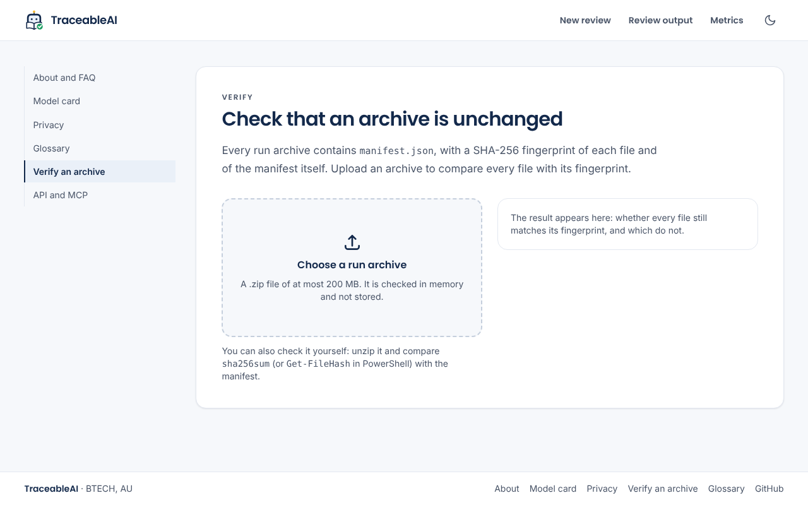
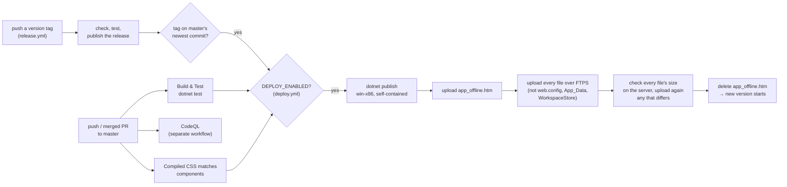

# 6. Web app, operations and deployment

The pipeline on pages 2 to 5 runs inside an ordinary ASP.NET Core web app. This page covers the parts around it: start-up, pages and endpoints, the limits that keep the app affordable and responsive, configuration, security, and how a change reaches the live site.

## Start-up (`Program.cs`)

`Program.cs` reads configuration, creates the shared services, and sets up the request pipeline, in that order.

Before anything else it calls `SiteCulture.Apply()` (`Web/SiteCulture.cs`), which sets the invariant culture for every thread. The live server runs in Danish, and without this a page wrote numbers with a decimal comma ("kappa 0,63") while the paper used a point (issue #134). Pages that write a figure with a fixed format still name `CultureInfo.InvariantCulture` themselves, as the paper's code does.

The configuration sections are bound to option classes: `Quota` → `QuotaOptions`, `Runs` → `RunsOptions`, `Llm` → `LlmOptions`, `Cache` → `CacheOptions`, `OpenSources` → `OpenSourcesOptions`, `Synthesis` → `SynthesisOptions` (thematic synthesis on or off, dual coding, citation repair, second citation check, maximum number of themes, studies per coding call), `Metrics` → `MetricsOptions` (metrics store on or off, its folder), plus `Report:SupportStatement` and the API keys (`MISTRAL_API_KEY`, `ELSEVIER_API_KEY`, `IEEE_API_KEY`). The quota service, cache, run options and review engine are created once and registered as singletons; `UiStateContainer` is scoped, so each browser session gets its own. `SessionCleanupWorker` is registered as a hosted background service. Before the app starts serving, `MarkInterruptedRuns` marks runs that were cut off by the previous shutdown.

The request pipeline then adds, in order: forwarded headers (for a reverse proxy, if one is configured), the security headers on every response, the error page and HSTS outside development, HTTPS redirection, static files, antiforgery, the rate limiter, the run downloads (`Web/WorkspaceDownloads.cs`), and finally the Razor components in interactive-server mode.

## Pages, components and endpoints

| Route or name | File | Purpose |
|---|---|---|
| `/` | `Components/Pages/Landing.razor` | Public landing page on one screen: the hero (Start a review, How it works) and, from 640 px, the looping citation example; in the theme-aware colours, so it takes the dark theme |
| component | `Components/Landing/CitationLoop.razor` | The landing page's example: one sentence of a real report with three citations checked in turn (Supported, Partly supported, Not supported), with a pause button; see "The landing page" below |
| component | `Components/Layout/SiteHeader.razor` | The top bar every page shares: a "Skip to content" link, the bare mark and the name linking to `/`, and New review, Review output and Metrics with the current one marked; a menu button under 640 px. The current place and the run-aware links follow from the address (`SiteHeader.Locate`) unless the page passes `Active`, `DashboardHref` or `OutputHref`. `ShowNav="false"` hides the places, and `ShowThemeToggle` (set by the layouts) shows the theme toggle once `ThemeToggle.Offered` is on |
| component | `Components/Layout/AppLayout.razor` | The frame of the app pages: fixed header, a content area (`<main id="main">`) that alone scrolls, fixed footer; see "The frame and the theme" below |
| component | `Components/Layout/LandingLayout.razor` | The frame of the landing page: header without the places, the page, and the landing footer |
| component | `Components/Layout/ThemeToggle.razor` | The button that switches between the light and dark theme, with `wwwroot/js/theme.js` |
| component | `Components/Layout/BrandMark.razor` | The bare mark: navy on the light theme, light on the dark theme (`Size`, `Alt`) |
| `/design/frame` | `Components/Pages/Design/` | Development only (elsewhere "not found"): `AppLayout` with sample content, so the accessibility job can check the app frame in the dark theme before the app pages take it |
| `/glossary` | `Components/Pages/GlossaryPage.razor` | Plain-language explanations of the terms the app uses (`Glossary.cs`), grouped as Method, Verdicts and Output (`Glossary.GroupOf`), with a search field that filters as you type (`Glossary.Search`) |
| `/about` | `Components/Pages/About.razor` | Who made it, what the verdict colours mean, the limits, questions and answers, how to cite, contact |
| `/privacy` | `Components/Pages/Privacy.razor` | What is stored, for how long and what is sent where, including how a grey literature review fetches web pages and keeps their text for the run's lifetime; the periods come from the running configuration |
| `/model-card` | `Components/Pages/ModelCard.razor` | Which steps the model does and how each is checked in code, for the systematic review and the grey literature review, the known failure modes of each, and measured citation accuracy of the systematic runs from the metrics store |
| `/docs/api` | `Components/Pages/ApiDocs.razor` | How to use the REST API and the MCP server: the first call, following, the report, cancelling, the MCP setup, the errors and the key's promise, with examples checked against the real API; only while `Api:Enabled` is on (`ApiSwitch`), otherwise 404 and left out of the side list (page 9) |
| `/verify` | `Components/Pages/Verify.razor` | Upload a run archive and check every file against `manifest.json` (`RunManifest.CheckArchive`); every listed file is shown as Matches, Changed or Missing (`ArchiveCheck.Files`, issue #245), with the files not in the manifest apart; nothing is stored |
| `GET /health` | `Program.cs`, `SiteHealth.cs` | Whether the app can do its work, as JSON for uptime monitoring (see "Health, database status and logs" below) |
| `GET /.well-known/security.txt` | `Program.cs`, `SiteSeo.SecurityTxt` | Where to report a vulnerability (RFC 9116), with an expiry date computed when served; see `SECURITY.md` |
| `humans.txt` | `wwwroot/humans.txt` | Who built the site and with what |
| component | `Components/Layout/SiteFooter.razor` | One slim line: the name, and About, Model card, Privacy, Verify an archive, Glossary and GitHub (on phones only the name, About, Privacy and GitHub, so it stays one line at 390 px; issue #244). `Landing="true"` gives the landing footer: the department, OSSYM 2026, Metrics, Docs and GitHub |
| component | `Components/Layout/Term.razor` | A term with its explanation on hover and focus: `<Term Key="kappa" />` |
| `/start` | `Components/Pages/Start.razor` | Choose the kind of review: one card per method in `ReviewMethods` (systematic and grey literature reviews available; multivocal, rapid and living reviews coming soon), each naming the reporting standard it follows. An available card opens its own module's pages: the systematic module's cards open the review form (`/review?method=...`), the Grey Literature Review card opens `/mlr?card=grey`; the systematic form and its input check refuse a card of another module (`ReviewMethods.RunsHere`), so a grey literature review is never run by the PRISMA engine. "Start a review" on the landing page opens it. A module in preview (`ReviewModules:Preview`, Development only) shows a "Preview" chip and an "Open the preview" button instead |
| `/mlr`, `/mlr/{id}` | `Modules/Multivocal/Pages/MultivocalStart.razor` | The grey literature review's planning form: five steps in the order of the Garousi et al. guidelines (need and audience, Table 4, research questions with their types, search and quality, protocol). "Start the review" writes the protocol and starts the run, which then goes on its own on the server (`MultivocalRunner`), one step after another and without a click: the grey searches with the plan's search strings, the screening (every source twice, with the systematic review's steps; a source the two screenings disagree on is kept and marked), the quality checklist (Table 7) on the kept page of every included source, the systematic map proposed by the model from the research questions and fixed as proposed, the extraction of every source that passed against the fixed map, the synthesis, the writing of the paper through the shared writing steps (questions about frequency or existence answered in code) and the check of every citation against the kept page of the source it cites. `/mlr/{id}` opens on the Progress tab, laid out like the systematic review's: the overall bar with the elapsed time, the step running with its progress line, the eight steps (search, screening, quality, map, extraction, synthesis, writing, checking) and the source funnel (found, duplicates, screened with κ, excluded and included, passed the quality threshold, extracted, themes); "Notify me when it is ready" asks the browser for a notification when the run ends. Closing the page does not stop the run. The funnel ends with the paper (its theme sections and the questions answered in code) and the verdicts of the citation check. When the citations are checked, the Progress tab shows "Your review is ready" with "Read the paper" (`/mlr-paper/{id}`) and "Data appendix" (`/mlr-report/{id}`); the review settings on the left hold only the plan. A run that stopped, or one synthesised before writing was built, shows "Continue the review" on the Progress tab, which runs it on from where it stopped. After the synthesis the run writes its references in code; on the report page "BibTeX" and "RIS" give the sources the results rest on (`/api/workspace/{id}/references.bib` and `.ris`), numbered as in the source repository, with the access date and the Wayback Machine capture, and "Screened (RIS)" gives every screened source tagged with its decision (`/api/workspace/{id}/screened.ris`). A step that fails stops the run there with the reason, and "Continue the review" (only in the browser that planned the run) runs it again from that step, with decisions already made taken from the cache: the screening, the quality checklist, the extraction, the support check of each source's values and the citation check are kept under their prompt version and model. The "Sources found" tab lists every search, its hits and new sources, the searches skipped, and the sources found, with each screening decision and why, and can show only the included sources, those to look at, the excluded or the duplicates; once scored, each source shows its points and its answers with their quotes, and the tab can show the sources that passed, those below the threshold and those not assessed. "Keep page text" on a source fetches its page once (if robots.txt allows it) and keeps the text with the run; the address, date, SHA-256 and a Wayback Machine link are shown and go into the archive, the text does not. A run that stopped between screening and scoring lets each decision be kept or changed ("Include", "Exclude", "Keep it") with a note, and a source that could not be assessed has "Try again" while the run stands after the quality check; an opinion piece's score shows its claim and the critical questions. The Map tab shows the systematic map's attributes (one research question each, with their values) and the facts code records for every source (kind, grey or formal, site, date, quality points), which the map never asks the model for; after the extraction each source shows its extracted values with their quotes, what it does not state and its coverage, and the Map tab counts how many sources have each value. The Themes tab shows, per research question, the themes with what each rests on (sources, outlet tiers, mean quality, grey literature only or 3rd-tier grey literature only), the tensions between sources, and each theme's findings with their quotes; findings with the map's "Other" value are shown per question as not coded by the map, each question shows how well a second, independent placement of its values agreed with the first (Cohen's κ), and the values the support check left out are listed with their quote and the reason. "Read the report" then opens `/mlr-report/{id}`. `?card=grey` plans a grey literature review, and so does any visit while the Multivocal Literature Review card is off and the module is not in preview; the "Preview" chip shows only while the card the review is planned from is off. Planned from the Multivocal card (in preview only, until block I ends), step 4 also chooses the academic databases of the formal pool from the systematic review's catalogue: the databases that need no key start ticked, and Scopus and IEEE Xplore can be ticked when the server has their key (decision 7; the key never reaches the page or the plan). The formal pool has its own search strings, which the reviewer writes or takes from the model's proposals ("Propose search strings", the systematic review's preview, five times a page); only the strings in the list are searched, and the protocol lists the databases and the strings, marks each string the model proposed and the reviewer used, and names the proposals not used. With no database ticked, or planned from the Grey Literature Review card, the review stays a grey literature review (`MultivocalPlan.UsesFormalPool`), as does every plan made before block I. The search of such a run also searches the academic databases with the formal strings, under the plan's stopping rule (block I-2, `MultivocalSearch.Formal.cs`): the server opens each database with its own keys (`PrismaReviewEngine.CreateServerSource`), a database without a key is listed as not run, and a failing one is recorded while the others still run. The Sources found tab lists the academic searches beside the grey ones, each database marked "(academic)", and its sources as "Academic literature". The screening then screens the academic sources beside the grey ones (block I-3): twice each, with the same criteria, steps and answer format, in a prompt that introduces the record as academic (`formal-screening-v1`); a disagreement keeps the source and flags it, the reviewer's look at the flagged decisions covers both pools, and Cohen's κ is given for each pool and for both. The stage preview marks every step as built, for a grey literature review and for a plan with academic databases alike. The quality step then keeps each included academic source's open full text, found as the systematic review finds it, or its abstract when there is none (decision 8), and appraises it with the systematic review's MMAT (`MultivocalQuality.Formal.cs`, `formal-mmat-v1`), not with Table 7; the threshold applies to grey sources only (block I-4). The map, the extraction and the synthesis then take both pools (block I-5): the map is proposed from grey and academic sources together (an academic source is marked as such in the prompt) and records each academic source's known facts (formal literature, its MMAT appraisal instead of points, and its text basis); an academic source is extracted from its full text or abstract with a prompt that names it as academic (`formal-extraction-v1`), every value with a quote from that text; each finding is labelled grey or formal in code, each theme says in code whether it rests on grey literature, formal literature or both, its mean quality counts the grey sources only, and each tension says in code whether it lies between the state of the art and the state of the practice or within one of them. The Themes tab shows the pools of each theme, each academic finding's text basis and where each tension lies. The run view shows both pools side by side (block I-6, first part): the Progress tab's funnel becomes a table with a grey and an academic column (`MultivocalPoolFunnel`, counted in code by `MultivocalPools`) from the records found, the academic duplicates by DOI or title and records with no web address, through screening with κ for each pool and both, to the sources kept (grey above the Table 7 threshold, academic appraised with MMAT) and extracted, with how many academic sources rest on their abstract alone; the Sources found tab is headed "Grey and academic sources found", can show each pool alone, marks an academic source whose text is its abstract with an "abstract only" chip and says where a full text came from, and shows its MMAT appraisal with each answer's quote in place of the Table 7 score. A grey literature review's run view is unchanged. The run then writes and checks its paper as a grey literature review does, with both pools in it (block I-6). Open because the Grey Literature Review card is on (`ReviewModulesOptions.CanOpen`). A run made by another module, opened at its address, is sent to that module's page (`ReviewModules.ElsewhereFor`), and the review and report pages do the same in reverse |
| `/mlr-paper/{id}` | `Modules/Multivocal/Pages/MultivocalPaperPage.razor` | The paper of a checked grey literature review, laid out like the systematic review's Review output page and built from the same shared parts (`Components/Paper/`): title, abstract, introduction with the rationale and the research questions, the method by the guidelines' phases, the data section (the flow of sources, sources by kind and tier, the map as counts), the results per research question (theme sections written by the model with the note on what each rests on, and the answers to frequency and existence questions as tables counted in code), the discussion with the automated citation check, the summary for practitioners, the declarations (use of AI, protocol, availability) and the references. Every citation in the written text opens what the check found, and the bar at the top steps through the citations that need attention. "Download the archive" (`/api/workspace/{id}/archive`, with `main.tex` first), "main.tex" (`/api/workspace/{id}/main.tex`), BibTeX, RIS, Screened (RIS) and "Data appendix" (the report written in code) are at the top. The method, data, answers in code, notes, declarations and references are written in code from the run's files each time, as `main.tex` is. For a review with both pools (block I-6), the method adds the academic search, screening with κ per pool, the MMAT appraisal on a full text or abstract and how the pools meet in the synthesis (`MultivocalFormalText`); the data section shows both pools side by side on the page (`MultivocalPoolFunnel`) and as a flow diagram with two arms in `main.tex`; each theme note says how many grey and academic sources it rests on and where a tension lies between the state of the art and the state of the practice; an academic source is cited as in the systematic review, and one read on its abstract alone is marked in its reference and in the citation popup |
| `/mlr-report/{id}` | `Modules/Multivocal/Pages/MultivocalReportPage.razor` | The report of a synthesised grey literature review (the paper's data appendix), written in code from the run's files each time it is opened: planning, search, selection, quality, map and extraction, synthesis, the results per research question with what each theme rests on and quotations cited by source number (a question about frequency or existence gets the paper's own lead and count tables, with its reference numbers written as [S1], so the two give the same answer in the same words: `MultivocalReporter.CodeAnswerBlocks`, issue #249), a table of how each guideline G1–G14 was followed, the limits and the source repository. "Download the report" gives it as Markdown (`/api/workspace/{id}/mlr-report.md`); opened in the browser that planned the run, it is saved with the run as `multivocal-report.md`, which goes into the archive |
| `/review`, `/review/{runId}` | `Components/Pages/Home.razor` (shell and the fragments with markup), `Home.razor.cs`, `Home.Form.cs`, `Home.Drafts.cs`, `Home.Run.cs`, `Home.Follow.cs` and `Home.Keys.cs` (state and actions), `HomeRunView` (a run that is going or done) and `HomeKeyDialog` (the API keys dialog) | Dashboard: the review composer and the criteria panel with their input check, then the run while it goes and when it is done (see Dashboard layout), with a "This run" card holding the settings once a run starts (query, objective, questions, inclusion and exclusion criteria, years, sources and model; an exclusion criterion left empty reads "None"), the ledger and the human screening review |
| component | `ReviewComposer.razor`, `CriteriaPanel.razor`, `FieldHelp.razor` | The Ask state of the dashboard: the question in one card with the seven steps under it, the criteria beside it, and the help line under a field |
| component | `RunProgressPanel.razor`, `ReviewSteps.cs` | The Running state: the step in the eyebrow, the objective, the progress bar with the elapsed time, and the seven steps mapped from the run's plan |
| `/spec-matrix`, `/spec-matrix/{runId}` | `Components/Pages/SpecMatrix.razor` (shell), `SpecMatrix.razor.cs` and `SpecMatrix.Citations.cs` (state and actions), `SpecMatrixIntroduction`, `SpecMatrixStudies`, `SpecMatrixResults`, `SpecMatrixDiscussion`, `SpecMatrixAppendix` (one component per section) | Review Output: the report as one long page with clickable citations, a contents list and a citation-check panel (the shared `Components/Paper/` parts: `CitedProse` for the cited text, `CitationAttentionBar` for the citations that need attention, `ReportContents`, `CitationCheckPanel`, `VerdictBar`, and `ApaReference` for a reference with its journal and volume in italics instead of the asterisks the reference carries for main.tex), figures, tables, downloads, notes, "Copy link" and (for the browser that started the run) "Delete run" |
| `GET /api/workspace/{id}/screened.ris` | `Web/WorkspaceDownloads.cs` | Every screened record, tagged with its decision, for Zotero |
| `/metrics` | `Components/Pages/Metrics.razor` | How well the citations hold up, across runs: four headline figures, one stacked bar of verdicts per run, the verdict shares and the run data of every run, and the groups by app version and settings, each table with a totals row (redesign step 9, described below). The version column reads "v0.2.0 (40b00a0)", the version and its commit; a run made before versions came from git tags reads "before versioning (40b00a0)", since every build then called itself 1.0.0 (its stored line has `SchemaVersion` 1, and is never rewritten). Each kind of review has its own tab, because the same figure means different things in each: "Systematic reviews" (`/metrics`) as before, and "Grey literature reviews" (`/metrics?kind=grey`, shown while that review is described, `ReviewModulesOptions.Shows("grey")`) with the sources found and kept after the quality check and a link to the run's paper. The store returns the two kinds apart (`RunMetricsStore.ReadAll(multivocal)`), so the model card and the landing page pool systematic reviews only. Public, like the code; the links to individual run reports are shown only with the developer token (`Quota:AdminToken`) or in Development, because a run's link opens its report |
| `/review?from={runId}` | `Components/Pages/Home.razor` | A new review with the question, criteria, artifact and options of an earlier run filled in (from "New review from these settings") |
| component | `RunSummaryCard.razor` | The Done state: what a finished run produced (studies, records, themes, studies cited), the citation verdicts as a stacked bar, the way into the report and every file from the run |
| component | `ScreeningReviewPanel.razor` | The include/exclude list shown while a run waits for review |
| component | `PrismaFunnel.razor` | The funnel on the dashboard, with "show" links for removed records |
| `GET /api/workspace/{id}/archive` | `Web/WorkspaceDownloads.cs` | The run archive as a zip; a finished run's archive is kept (`Report/RunArchiveCache.cs`) |
| `GET /api/workspace/{id}/references.bib` / `.ris` | `Web/WorkspaceDownloads.cs` | The included studies for reference managers |
| `GET /api/workspace/{id}/protocol.md` | `Web/WorkspaceDownloads.cs` | The protocol, linked from Review Output |

The trust pages share one frame (`DocPage`): a side list of the pages on the left and the page in a card beside it. Verify is the simplest of them. It has a drop zone for the archive and, beside it, the place where the result appears.

The dashboard subscribes to `ReviewEngine.OnProgressUpdated` while it is open and unsubscribes when it is disposed. Progress is set by the engine through `ReportProgress` (`RunProgress.cs`): the run's step plan (`ProgressPlan`, with citation chaining and the human review only when asked for), the current step, how far it is from 0 to 1 and a short detail such as "16 of 40 records screened" are kept in `ReviewStats`. `RunProgress.Percent` turns them into an overall percentage using a rough weight per step, and within a step the value never goes back. Updates inside a step are sent at most every 400 ms and do not write the ledger, so loops can report freely. The dashboard also re-reads the saved ledger every few seconds, which can be a little behind the live events; `RunProgress.KeepFurthest` keeps whichever is further along for the same run, so the bar never moves back.

Redesign step 8 laid out the Review Output page as one long report in the app frame. Above it are "Back to the run", "Print or save as PDF" (hidden on a phone), "Download archive" and a More menu with "Copy link", "New review from these settings", the protocol, the references as BibTeX or RIS, every screened record as RIS, and Delete or the read-only note. The report is one card of at most 880 px. It opens with an eyebrow (review type, PRISMA 2020 and the date the run finished), the title, a run line (studies and records, themes, citations checked, app version) and a citation summary with the stacked verdict bar (`VerdictBar`, counted from the citation audit by `VerdictTally`, so a re-check shows at once). Citations the second repair pass removed (`RemovedCitations` in the audit) are a segment of their own in navy, the heading colour, which reads in both themes; the legend, the screen-reader sentence and the summary line name them, and the Done card's bar counts them from `ReviewStats.CitationsRemoved` (issue #234). Then come the abstract and sections 1 to 7, the references and the appendix, each with a real heading. Prose is 17 px at line height 1.7, and paragraphs stop at 70 characters a line. Section 2 has Figure 2.1, the flow of records drawn from `PrismaFlowCounts`, the same counts as the diagram in main.tex, with the screening kappa under it; section 3 keeps its four figures and points to the tables in the appendix (issue #139). Every [n] is a chip in its verdict's colour, and an opened citation shows a card under its paragraph with the verdict, the source, where it was checked, the quote, the explanation, a link to the open-access copy or DOI, and the page's notes and re-check.

From 1024 px a contents list (`ReportContents`, 220 px) sticks to the left. Its entries come from `ReportOutline.Systematic`, which also names the id every section carries, so the list and the page cannot drift apart. The links jump inside the content area and the section in view is marked with `aria-current="location"`, both through `wwwroot/js/review-output.js`; a bare `#id` link would leave the page because of `<base href="/">`. From 1500 px a citation-check panel (`CitationCheckPanel`, 350 px) sticks to the right: the verdict bar, the filters All, Flagged and Abstract only, one button that opens the next citation of that kind ("Next flagged citation · 3 of 12"), and the downloads. Below 1500 px the attention bar above the report counts the citations that need attention (partly supported or not supported) and steps through them in reading order with Previous and Next: each step opens the citation's verdict and scrolls it into view. On paper the toolbar, the contents list, the panel and the card's frame are dropped. The page stays light until redesign step 12, like the other app pages. A real report cannot be made in CI, so `/design/report` (development only) writes a made-up finished run (`Components/Pages/Design/SampleReport.cs`) to its folder and shows the page with it, for the accessibility job. The brief's "← All reviews" became "Back to the run", because there is no list of reviews, and the compact study table it placed in section 3 was left out, because the tables of the studies moved to the appendix on purpose (issue #139). The multivocal paper shares the chips, the verdict card and the attention bar, and gets the rest of the layout in step 11.

Redesign step 9 rebuilt the Metrics page. It opens with the eyebrow "Metrics", the title "How well the citations hold up", one paragraph on what is stored, the tabs for the two kinds of review (`?kind=grey`) and four figures: the share of citations supported, the share of included studies (kept sources) cited, the citations checked and the completed reviews. Every share is pooled over all citations or studies, never a mean of the runs' own shares, so a short run weighs less than a long one; the figures are worked out in `Runs/MetricsOverview.cs`. Jump links (Chart, Shares per run, Run data, By version) scroll inside the content area through `data-jump-to`, as on the report. The chart (`Components/Paper/RunVerdictChart.razor`) draws every run, not only the last 40, as one 100% stacked bar of the five verdicts, oldest on the left, with gridlines every 25% and the first eight characters of the run id under each bar, in monospace and turned on its side, above the axis title "Run ID". Each bar has a tooltip with the run, date, version and counts. The chart is at least 560 px wide and scrolls sideways inside its box on a phone, with the note "Swipe the chart to see all runs." Three tables follow, newest run first, each in a box whose header row stays at the top while the rows scroll and with a totals row: the verdict shares per run, the run data from each run's `run-metrics.json` (found, included or kept, cited, themes, the five verdict counts, repaired, removed and words) and the groups by app version and settings (runs, the pooled shares, removed, the mean screening kappa and the minutes per run). Each table counts the citations the second repair pass removed on its own (`RunMetrics.Removed`, `MetricsOverview.Removed`); they are not in the verdict shares. Grey literature runs show 0 removed for now, because their metrics are built in the module. The run id links to the run's report for maintainers, as before. The old per-run detail, "Where the citations fail" with the cost by stage, was left out; Lau chose to leave it out for now, and every figure in it is still in each run's `run-metrics.json`. The metrics store is empty in CI, so `/design/metrics` (development only) shows the page with made-up runs (`Components/Pages/Design/SampleMetrics.cs`) for the accessibility job.

**What the chosen searches can find** (issue #249). A live run named five kinds of grey literature but searched only GitHub, so every source was a code repository. `GreySourceCatalog.KindsFoundBy` now says which kinds each built search gives its sources (the kind its parser sets: GitHub code, Stack Exchange Q&A, Hacker News blog posts and Q&A, OpenAlex and Zenodo white papers, theses and documentation; backlink snowballing nothing until it is built). Step 4 of the planning form shows, under "Where to search", each named kind with the chosen searches that can find it, and a line starting "Warning:" in amber for a kind no chosen search reaches (`MultivocalProtocol.ReachLines`). The protocol's section 4 lists the same lines under "Which chosen search can find each kind (G6, G7)". The warning does not stop the run.

**The paper of a review with both pools** (issue #362). In the two-arm flow diagram (`MultivocalFormalText.FlowTikz`), each side box sits beside the step its sources left at: the grey arm's screening exclusions beside "Screened twice" and its quality exclusions (below the threshold, not assessed) beside "Passed the quality threshold"; the academic arm's duplicates and screening exclusions beside "Screened twice" and "Not appraised" beside "Appraised with MMAT". The statement on the use of AI (`MultivocalPaper.AiUse`) says, for such a review, that the model screened both pools, scored the grey sources on Table 7 and appraised the academic ones with MMAT, and checked each citation against a grey source's kept page or an academic source's full text or abstract, and it gives Cohen's κ for each pool and for both (`MultivocalFormalText.AiUseTasks`, `AiUseKappa`). A grey literature review's statement is unchanged, and its flow now writes "1 finding" and "1 theme" in the singular.

Redesign step 10 gave the five trust pages one template, `Components/Layout/DocPage.razor`: About and FAQ, Model card, Privacy, Glossary and Verify an archive. From 1024 px a 240 px side list of the five pages sticks to the left, the current page marked with `aria-current="page"` and its sections indented under it; the section links jump inside the content area through `data-jump-to`, like the report's contents list. The page itself is one reading card (880 px, or 1100 px with `Wide` for Model card and Verify) with the eyebrow, the title and one paragraph, and paragraphs stop at 70 characters a line. On a phone the side list is hidden. About's verdict list uses the theme's verdict colours. Verify has a large dashed upload area (a label around a visually hidden file input, so it still works from the keyboard) with the result beside it from 1280 px. Review type (`/start`) shows the kinds that can be started, or are in preview here, as two large cards, and the kinds still to come as a short list underneath that is hidden on a phone. Not found is centred, with the mark at 96 px and two buttons: "Start a new review" and "Go to the overview". The CI accessibility job now also checks Model card, Privacy and Not found.

Redesign step 11 gave the grey literature review's pages the same look. The paper page (`/mlr-paper/{id}`) is now one long report like Review output: a toolbar with "Back to the review", "Print or save as PDF", "Download archive" and a More menu (main.tex, BibTeX, RIS, every screened source as RIS, the data appendix); a report card of at most 880 px at 17 px with an eyebrow, the title, a run line counted in code and the stacked verdict bar; then every section in order with an id from `ReportOutline.Multivocal`, which also feeds the contents list from 1024 px. Results are numbered 4.1, 4.2 and so on (`ReportOutline.ResultId`), and the declarations are section 7 after a summary for practitioners and 6 without one. From 1500 px the citation-check panel sits on the right with `Multivocal="true"`, which lists the paper's own downloads. The data appendix (`/mlr-report/{id}`) is one report card too, and the planning page and its progress panel moved to the theme colours. A grey literature run cannot be made in CI, so these pages are checked by tests that read their source; they stay out of sight in production until the grey literature card is switched on.

Redesign step 12 starts by moving every remaining page and part to the theme-aware colours, so the dark theme can be offered everywhere. The shared classes in `Styles/tailwind.input.css` (`ui-card`, the buttons, `ui-input`, `ui-label`, the headings and the verdict chips) use `page`, `ink`, `muted`, `heading`, `line`, `primary` and the verdict tokens instead of fixed greys and the fixed navy; so do New review, its criteria and screening parts, the run funnel, the error page, the reconnect banner and the grey literature planning page. Status messages use the verdict colours: green for done or included, orange for a warning, red for an error or an exclusion, blue for a note. The light theme looks as before. `ThemeColoursTests` fails if a component uses a fixed grey, the fixed navy as text or a white background again (the report's theme colours and print styles are left alone).

The second half of step 12 offers the dark theme on every page. `ThemeToggle.OfferedOnAppPages` is on, so `AppLayout` shows the switch and `ThemeToggle.ReadyFor` lets every page take the dark theme; `ThemeToggle.FollowSystem` is on, so a visitor who has not chosen follows the system setting (`prefers-color-scheme`) through `wwwroot/js/theme.js`. The CI accessibility job checks the main pages and the `/design` previews in the dark theme too, so a colour that falls under 4.5:1 there fails the build.

The Review Output page does not follow a run live; it reads the finished files from the run folder each time it loads. Anyone with a run's link can open it, which is why run ids are random GUIDs and runs are deleted after `Runs:RetentionDays`.

### Read-only links and the edit key

Anyone with a run's link can read it, but only the browser that started the run can change it: delete it, submit its screening review, check a citation again or write notes. When the dashboard starts a run it calls `ClaimRun` (`Runs/RunStore.cs`), which creates a 32-byte random edit key. The browser keeps the key in its local storage (`traceableReview.saveEditKey` in `review-output.js`) and the server keeps only its SHA-256 in `owner.json` in the run folder, which is left out of the archive. Every changing method (`DeleteRun`, `SubmitScreeningReview`, `RecheckCitationAsync`, `SaveNoteAsync`) takes the key and checks it with `CanEdit`, which compares the hashes in constant time. The pages read the key when they open a run and hide the buttons that would change it when the key is missing; the engine refuses either way.

There is deliberately no way to see, copy or restore the key. A key that can be saved can also be forwarded or leaked, and losing it costs little: the run stays readable and expires on its own. Keys older than 30 days are dropped from the browser's storage. Runs started before edit keys existed have no `owner.json` and stay editable by anyone with the link until they expire. A "Copy link" button on the dashboard and the Review Output page copies the run's address for sharing.

### The example run

`Runs:DemoRunId` names a finished run kept as an example; since the landing page moved to one screen (redesign step 5) nothing links it, until a later redesign step finds it a place. `SessionCleanupWorker` never deletes it, and `CanEdit` refuses every change to it, even with its key, so the example stays the same for everyone. To set one up, run a review on the server, copy its id from the address bar, and put it in `Runs:DemoRunId` in `web.config` or `appsettings.json`. To retire it, clear the setting; the run then expires like any other.

### Reviewer notes, links and Zotero

On the Review Output page, the reviewer can add a note to any citation (in its popup) and to any included study (in Table A.1, in the appendix after the references). Notes are kept in `reviewer-notes.json` (`RunStore.SaveNoteAsync`), at most 1,000 characters each, cleaned like the form fields, shown to every reader, and included in the archive. They are never sent to the model.

Table A.1 links each study's DOI (or its source page when it has no DOI) and, when an open-access copy was downloaded, the PDF; the address is kept as `ReviewState.FullTextUrls`. Only `http` and `https` addresses are linked (`IsWebAddress`), so metadata from a source cannot inject a script link.

`references.ris` tags the included studies with `included`. `GET /api/workspace/{id}/screened.ris` (also in the archive) exports every screened record, tagged `included`, `excluded: <reason>` with the exclusion group, or `not screened`, plus `checked by reviewer` where the reviewer looked at the decision. Imported into Zotero, the whole screening can be filtered by tag.

### Health, database status and logs

`GET /health` (`SiteHealth.Build`) checks what can be checked without spending anything. **storage**: the run folder can be written to (a probe file is written and deleted) and the drive has room; under 500 MB free is "degraded", under 100 MB "unhealthy". **model**: a model key is configured, or a local model is used; the model itself is not called, since that would cost money on every probe. **source:<name>**: one check per scholarly database the app has asked something since it started, from `SourceStatus`. The answer has an overall status (`ok`, `degraded` or `unhealthy`), the app version, the number of active runs and the checks. It is HTTP 503 only when the app is unhealthy, so an uptime monitor (UptimeRobot, Azure, a cron job with curl) can alert on the status code. It contains no keys, paths or visitor data, and it is kept out of search results.

`SourceStatus` records every request that goes through `OpenSourceHttp`: per host, when it last answered, how long it took, and the last problem (rate-limited, server error, timeout, unreachable, or slower than 10 seconds). A request that only got through after waiting for a rate limit counts as rate-limited. `SourceStatus.Summary()` turns the problems of the last 30 minutes into one sentence ("arXiv is slow (answered in 18 s); Semantic Scholar is rate-limiting requests, so it is slower than usual."), which `SourceStatusNote.razor` shows under the sources on the form and in the progress panel while a run is going. It is kept in memory only and covers all runs on the server.

**Logs.** Every log line written while a run works (engine, sources, cache, model calls) carries the run's ID as a logging scope, opened at the start of `RunReviewAsync`. Outside Development the console log is one JSON object per line with a UTC timestamp and the scopes (`AddJsonConsole`), so a log tool can filter by `RunId`; in Development it stays one readable line per entry. A failed run is logged once as an error, with the exception and the step it stopped in. On the dashboard, a failed or interrupted run shows its run ID and the app version, with a "Report this problem" link that opens a new GitHub issue filled in with the run ID, version and step (`SiteSeo.ProblemReportUrl`), and never with the question or criteria, since issues are public. On IIS the console log is written to files only when `stdoutLogEnabled` is on in `web.config`; turn it on while looking for a problem, and off again, since the files are not rotated.

### Search engines and link previews

`SiteSeo.cs` holds what search engines get. `/robots.txt` and `/sitemap.xml` are served from code, so they always use the right address: `Site:PublicUrl` (https://au-btech-literature-review-agent.dk in production), or the request's own address in Development, where `appsettings.Development.json` leaves it empty. The sitemap lists the public pages (`SiteSeo.IndexedPages`), each with the day the running version was built as its last-modified date (`SiteSeo.BuildDate`), since the pages only change with a new version. Every page sets its title, description, author, canonical link, Open Graph and Twitter card tags through `Components/Layout/SeoHead.razor`, which also adds a schema.org `BreadcrumbList` for every indexed page except the start page. Pages add their own structured data as JSON-LD: the landing page a `SoftwareApplication`, Metrics a `Dataset`, and About a `ScholarlyArticle` for the OSSYM paper (`SeoHead`'s `StructuredData` and `ExtraJsonLd`). The preview image is `wwwroot/img/og-card.png` (1200×630): the reader-bot mark on navy with the line "Literature reviews where every citation is checked". A new design gets a new file name, because link previews are cached by address. The design previews under `/design` are marked noindex like a run's own pages. A run's own pages (`/review/{runId}`, `/spec-matrix`), the downloads under `/api/` and the error pages are kept out of search results with a `noindex` meta tag and an `X-Robots-Tag` header; robots.txt blocks only `/api/`, because a crawler must be able to fetch a page to see its noindex. `wwwroot/site.webmanifest` names the app and its icons for "add to home screen".

After deploying, add the site in Google Search Console, submit `https://<your address>/sitemap.xml`, and check the preview with the Rich Results Test.

### Accessibility

The app aims at WCAG 2.2 level AA. What that means in the code:

| What | Where |
|---|---|
| A "Skip to content" link as the first thing on every page, and an element with `id="main"` on every page that it jumps to | `SiteHeader.razor`, the `data-skip-to` handler in `wwwroot/js/review-output.js` (a plain `#main` link would go to the home page because of `<base href="/">`) |
| A visible focus ring on everything that can be focused | `:focus-visible` in `Styles/tailwind.input.css` |
| Every form field has a label; its help line is linked with `aria-describedby`; required fields say so; a field the input check rejects gets `aria-invalid` and receives focus | `FieldHelp.razor` (`Invalid`), `FocusFirstInvalidField` in `Home.razor` |
| "Start review" is never silently disabled: the reason is shown above it, and pressing it (or the reason) goes to the field that needs attention, opening the criteria panel first when the field is there | `StartBlocker`, `BlockerTarget`, `GoToProblem` in `Home.razor` |
| Step changes and the end of a run are announced to screen readers, not every percent | the `role="status"` element and `Announcement()` in `Home.razor` |
| The API key window is a real modal dialog: Escape closes it, Tab stays inside, and focus returns to the button that opened it | `HomeKeyDialog.razor`, `Home.Keys.cs`, `trapFocus`/`releaseFocus` in `review-output.js` |
| Opening a citation on Review Output moves focus to its verdict; Escape or Close returns to the citation number, which says its verdict in words | `SpecMatrix.razor`, `Components/Paper/CitedProse.razor` |
| Terms have plain-language explanations on hover and keyboard focus, dismissed with Escape, from one list that also feeds the `/glossary` page | `Glossary.cs`, `Components/Layout/Term.razor` |
| Text contrast at least 4.5:1 (no `text-gray-400` for text), links inside text underlined, click targets at least 24 × 24 px, verdicts never shown by colour alone | the components and `ui-*` classes |
| Animations stop when the system asks for reduced motion | `Styles/tailwind.input.css` |

The CI job **Accessibility** starts the app and runs axe-core on the public pages (`tools/a11y/axe-check.mjs`); a serious or critical problem fails the build. The pages named in `A11Y_DARK_PAGES` are checked a second time in the dark theme. The job also photographs every checked page at 390 × 844, 1440 × 900 and 1920 × 1080 px and uploads the pictures as the workflow artifact `a11y-screenshots`, so a pull request that changes markup can be looked at without running the app. A page that scrolls is also photographed whole at 1440 px (`<page>-<theme>-1440-full.png`, issue #246): the app frame is released as print mode releases it, so the Metrics tables, the report's later sections and the lower parts of the trust pages can be reviewed too. Automated checks find only part of the problems, so keyboard and screen-reader checks by hand are still needed after larger UI changes.

### Speed and the live connection

- **Static files.** `App.razor` links CSS and scripts through `@Assets[...]`, which gives each file a fingerprinted address that changes when the file changes. `MapStaticAssets` serves them Brotli- or gzip-compressed (compressed at build time) with `Cache-Control: max-age=31536000, immutable`, so a returning visitor downloads nothing again until a new version is deployed. Until issue #301, `app.UseStaticFiles()` ran ahead of it and answered first, without the compressed copies; it is gone, so `MapStaticAssets` serves all of `wwwroot`. Mermaid (3.5 MB) is loaded only when a report has a diagram (`wwwroot/js/mermaid-render.js`). The unused Bootstrap copy was removed from `wwwroot/lib`.
- **Downloads (issue #306).** Every run download under `/api/workspace/{id}/` carries `Last-Modified` and an `ETag` from the run folder's `RunFolderStamp` (`Runs/RunFolderStamp.cs`): a fingerprint of every file's path, size and write time, and the app version. A browser that sends `If-None-Match` or `If-Modified-Since` for an unchanged run gets 304 Not Modified, and nothing is built. The archive of a finished run is kept in its folder as `archive-cache-{stamp}.zip.tmp` (`Report/RunArchiveCache.cs`). It is byte for byte what the builder made, and a later download sends it as it is. A note, a re-check or any other change gives a new stamp, so the next download builds a fresh archive and replaces the kept one. A run that is still going, or stopped part way, is never kept. The `.tmp` ending keeps the file out of the archive and out of the stamp. Measured on a run of 65 files (10.5 MB): building the archive took 232 ms and 65 MB of memory, sending the kept one takes about 3 ms, and a 304 costs the stamp, about 0.2 ms.
- **Metrics (issue #306).** `RunMetricsStore.ReadAll` parses `runs.jsonl` once and keeps the runs in memory while the file's length and write time stay the same; a new run changes both, so it shows at once. The Metrics page asks for the runs several times per view, and so does the model card. Measured on a store of 200 runs (350 KB): a read took about 9 ms and 1.2 MB of memory before, and about 0.04 ms now. With 1,000 runs it was 46 ms; now it is 0.2 ms. Callers get a list of their own but share the run objects, so they must not change them.
- **Following a run (issue #306).** While a run is going, the dashboard looks at its ledger (`transparent-process.json`) every second. `Runs/RunLedgerWatch.cs` parses it only when its length or write time changed and otherwise gives back the last read, so the page shows the same thing. Writing and checking the review do not save the ledger for minutes. Measured on a ledger of 120 studies (0.5 MB), each look cost 7 ms and 3 MB of memory; with 1,200 studies (5 MB) it was 79 ms and 30 MB. An unchanged ledger now costs about 0.004 ms. The report page and the dashboard do not carry what they loaded from the prerender into the live page: that would add the report's data to the HTML (270 KB for 120 studies) and send it back over the connection, to save one read of about 6 ms.
- **The HTML itself is not compressed by the app** on purpose: prerendered pages contain encrypted component state, and compressing secrets together with text a visitor can influence opens the door to BREACH-style attacks. The pages are small (about 30 KB).
- **Text data is compressed as it is sent** (`Web/ResponseCompressionSetup.cs`, issue #301): the run downloads (JSON, Markdown, LaTeX, BibTeX, RIS, plain text), the sitemap and the API's JSON go out with Brotli, or gzip for a browser without it, at the fastest level. HTML and Blazor's connection (`/_blazor`) are left out for the BREACH reason above, and the .zip archive is already compressed. An answer that carries a secret of its own, such as the edit key when a review starts through the API, calls `ResponseCompressionSetup.DoNotCompress`.
- **Lost connection.** `Components/Layout/ReconnectModal.razor` replaces Blazor's grey box with a banner at the bottom that does not cover the page or take keyboard focus, says that a running review keeps going on the server, and offers Try again or Reload when reconnecting fails. Blazor sets the state classes; the styles are in `Styles/tailwind.input.css`.
- **Tab title and notification.** While a run is going, the dashboard's tab title shows its progress ("42% · Your review"), and "✓ Review ready" once it finished while the page was open. "Notify me when it is ready" asks the browser for permission; the notification is only shown when the tab is in the background (`notifyDone` in `review-output.js`).
- **Remembered form.** An unfinished review form is kept in the browser's local storage (`loadDraft`/`saveDraft`, never the API keys) and brought back on the next visit to an empty form, with a "Start empty" button. It is removed when the run starts, and ignored after 30 days. The privacy page says so.
- **Quota messages.** When the free tier or the own-key limit is reached, `RunQuotaService` says when the next run is available ("in 5 h 12 min (midnight UTC)", rounded up) in `QuotaStatus.Message` and `ResetsUtc`, and the dashboard offers to add your own Mistral key.

### Printing a report and the statement on AI use

Review Output has a "Print or save as PDF" button. The print styles (`@media print` in `Styles/tailwind.input.css`, and `print:` classes in `AppLayout.razor`, `LandingLayout.razor` and `SpecMatrix.razor`) release the fixed-height frame so the report flows over A4 pages, hide the top bar, buttons and citation popups, keep figures and table rows from splitting, and add a line at the end with the run id and protocol fingerprint, so a printout can be traced back to its run.

Section 6.4 of every report is a statement on the use of AI, built by `AiUseStatement` only from what the run recorded: the model and app version, the steps the model did, the screening agreement, whether a person checked the screening, and the citation verdicts. Two buttons copy it, or a one-sentence declaration, for a paper or thesis.

When the scan of kept source text (#366) flagged any source, the statement adds one sentence written in code by `AiUseStatement.FlaggedSources` (#363), such as "The full text of 1 of 12 included studies contained phrases that look like instructions to a model; it was flagged for the reviewer and changed no decision." The count is of distinct sources, and the denominator is the sources whose text was kept: for a systematic review the included studies whose full text was read (`ReviewState.FullTextFlags` with at least one flag against `FullTextRetrieved`; a paper that only lost invisible characters is not counted), and for a multivocal review the sources in `multivocal-pages.json` with a kept text (`PageSnapshot.InjectionFlags`), which `MultivocalPaper.AiUse` puts in the paper page's declarations and in `main.tex`. A run with no flags gets no sentence, so its statement is word for word as before. The systematic review's `main.tex` has no statement on AI use, so there the sentence is on the Review output page only.

### Shared design

The colours, fonts and shadows are design tokens. The colours are CSS variables on `:root` in `Styles/tailwind.input.css`, with a second set under `[data-theme="dark"]`; `tailwind.config.js` maps the theme-aware names to them: `page`, `soft`, `panel`, `ink` (body text), `heading`, `muted`, `line`, `active`, `primary` and `accent`, and the five citation verdicts `supported`, `partly`, `not-supported`, `abstract-only` and `unverifiable`, each with a text colour, a `fill`, a `border` and a `chart` shade. Every text colour reaches 4.5:1 on its fill and on the page, in both themes. The verdicts are always shown with an icon or a word as well, never by colour alone. The fixed `brand` navy (`#13294B`, shared with Coursebot) and the older `verdict-ok`, `verdict-partial` and `verdict-bad` names still work, so a page keeps its look until it moves to the new names; dark mode follows `data-theme="dark"` on `<html>` (Tailwind's `dark:` variant uses the same attribute). The reusable pieces built from the tokens are `ui-*` classes in `Styles/tailwind.input.css`: `ui-container`, `ui-eyebrow`, `ui-h1`/`ui-h2`/`ui-h3`, `ui-lead`, `ui-muted`, the buttons `ui-btn-primary`, `ui-btn-secondary` and `ui-btn-ghost`, `ui-card` and the verdict chips `ui-chip-ok`, `ui-chip-partial` and `ui-chip-bad`. There are also `ui-btn-sm`, `ui-btn-danger`, `ui-label` and `ui-input`. Buttons and fields have a 10 px radius (`rounded-btn`, `rounded-field`), cards 16 px (`rounded-card`) and the landing example panel 28 px (`rounded-panel`); chips, labels and table cells stay square. Use these classes on new pages instead of long class lists, so the pages look like one product. Body text is Inter and headings, the wordmark and buttons are Poppins (`font-display`). Both are served from `wwwroot/fonts`, with their licences, because the Content-Security-Policy allows fonts only from the site itself. The mark, its tiles and the favicon are in `wwwroot/brand/` and `wwwroot/favicon.svg`; `BRAND.md` there says which file goes where. Browsers and phones that cannot use the SVG get PNG copies of the navy tile: `favicon.ico` (16, 32 and 48 px), `favicon.png` (192 px), `apple-touch-icon.png` (180 px) and `img/logo.png` (512 px; the header now shows the bare mark through `BrandMark` instead, so nothing in the app uses it any more). The manifest also lists the 512 px tile, which Android uses for its install screen. The landing page's example is CSS animation only; it can be paused and starts paused for visitors whose system asks for reduced motion. The redesign that builds on these tokens is planned in [docs/roadmap/redesign.md](../roadmap/redesign.md).

### The frame and the theme

Every app page sits in one frame, `AppLayout`: a full-height column (`100dvh`, so a phone's browser bars do not push the footer off the screen) of the header, a content area that alone scrolls, and the slim footer. Under 640 px the content area hides its scroll bar. The landing page, New review and a running and a finished review fit a 390 × 844 phone without scrolling, in light and dark, and the CI smoke test (`tools/a11y/smoke.mjs`) checks that they still do (issue #244). For a finished review this takes one fold: on a phone, `RunSummaryCard` folds the run's files and the page's own "This run" card into one line, "This run and its N files", and the inner card drops its frame there. The landing page uses `LandingLayout` instead: the header with only the mark, the name and the theme toggle, the page, and the landing footer, in a column that scrolls by itself when it is taller than the screen. Every page declares its layout (`@layout AppLayout`, or `@layout LandingLayout` on `/`) and renders only its content, with no header, footer or `<main>` of its own; `Routes.razor` uses `AppLayout` for any page that forgets, and `FrameTests` fails when a page brings its own. The layout is rendered on the server and is not interactive, so the header reads the current place and the run-aware links from the address. On `/review` and `/spec-matrix` without a run id, New review and Review output then link to the plain addresses, which open the run this tab is showing, as before. The development page `/design/frame` shows `AppLayout` with sample content, for the dark-theme check in CI; the landing page itself is checked for `LandingLayout`. `MainLayout.razor` is no longer used by any page and can be removed.

The theme is `data-theme="dark"` on `<html>`; without it the page is light. `wwwroot/js/theme.js` is loaded in `<head>` before the stylesheets, so the theme is set before the first paint and a dark choice never flashes white. It is a file and not an inline script because the Content-Security-Policy forbids inline scripts. A `ThemeToggle` is a plain `<button data-theme-toggle>`: one click listener in `theme.js` serves every toggle, also on pages that are not interactive, and keeps the choice in `localStorage` under `traceableai-theme`. The icon and the button's name follow the theme through `dark:` classes, so they are right before any script runs. Blazor's enhanced navigation copies `<html>`'s attributes from the next page, so `theme.js` puts the theme back when it is dropped. A visitor who has not chosen gets the light theme for now: `ThemeToggle.FollowSystem` (written on `<html>` as `data-follow-system`) turns on following the system setting once every page uses the theme-aware colours. The app pages still use fixed light colours, so a dark choice would put a dark frame around light pages. Two things prevent that until redesign step 12. First, `App.razor` writes `data-theme-ready` on `<html>` from `ThemeToggle.ReadyFor(path)`, which is true only for the landing page and the `/design` pages, and `theme.js` keeps a page light while it is `"false"`; the choice is kept and applies again on the next page that is ready. Enhanced navigation copies the attribute from each page and `theme.js` watches it, so moving between the landing page and the app switches the theme at once. Second, `LandingLayout` always shows the toggle, while `AppLayout` shows it only once `ThemeToggle.OfferedOnAppPages` is on. Step 12 turns that flag on, which also makes every page ready. A choice already kept in `localStorage` still applies.

### The landing page

The landing page is one screen, as Coursebot's: the header with the mark and the theme toggle, the hero, and the landing footer. The hero has the eyebrow, the headline, one line, "Start a review" (to `/review`) and "How it works" (to `/about`), and the line on free reviews and the licence. From 1024 px the hero takes the left half and the example the right half; between 640 and 1023 px the example sits under the hero; under 640 px it is hidden, so the page fits a 390 × 844 phone without scrolling. The numbers that used to sit here are on Metrics, and the method is on About.

The example, `CitationLoop`, shows one sentence from a real report (run 195564c6, a review of chatbots for smoking cessation, 20 November 2026) with three of its citations checked in turn: [5] Supported with its quote, [4] Partly supported with its quote, and [10] Not supported with the checker's reason, because no passage backs it. The quotes and reasons are copied from that run's `citation-audit.json`. Each citation shows "Checking citation N against the paper…" for 1.1 s and then its verdict for 3.1 s, 12.6 s in all; the citation's number in the sentence takes the verdict's colour, and three bars show the position. The loop is CSS animation (`.tai-loop` in `Styles/tailwind.input.css`), so the page stays static: every moving part uses the same keyframes and starts at its third of the cycle through a negative `animation-delay`, with 2 s more so that the still picture is the first verdict. The 44 px button pauses and plays it by setting `data-state` on the example (`wwwroot/js/citation-loop.js`, one click listener for the whole document); without a `data-state` the CSS plays the loop, or keeps it paused when the system asks for less motion, and the button's name and icon follow through CSS. The moving card is hidden from screen readers, and the caption names the three verdicts once. `LandingTests` checks the example and the page.

### Dashboard layout

The dashboard has three states, driven by the run: Ask (no run yet, or "New review" pressed), Running and Done. Redesign step 6 rebuilt the Ask state and step 7 Running and Done. All three use the same centred column of at most 760 px with a side column beside it from 1024 px.

In the Ask state the page reads like a search box. `ReviewComposer` (`Components/Dashboard/`) sits in a centred column of at most 760 px: an eyebrow with the kind of review, its standard and a "change" link to `/start`, the title "What should the review find out?", and one card with the review objective, the search query (required) and "+ Add research questions (optional, up to 4)". The questions field opens when asked for, when it has text (from the example or a remembered draft), or when the input check rejected it; the questions go one per line, and numbering such as "RQ1:" is left out by `ReviewInputGuard.ResearchQuestionLines`. At the end of the card come "Try an example", the free-tier badge (tier and runs left), the API keys button and the one primary button, "Start review". The seven steps every review takes (Protocol, Search, Screening, Evidence, Writing, Artifact, Checking), each with one line, sit in a strip under the card, in 4 columns on a tablet and 7 from 1024 px. The fields start empty with examples as placeholders; the help line under a field (`FieldHelp`) shows a character count only near the limit.

`CriteriaPanel` holds the criteria in three labelled groups: Scope (publication years with presets such as "Last 5 years", and the databases), Include and exclude, and Visual summary (the artifact, one of six options, with what it should show). The search strings and the advanced options (dual screening, citation chaining, the human screening check, peer-reviewed only and records per source) come after them, each folded, with a line saying what is chosen. From 1024 px the panel stands beside the composer, 380 px wide and 440 px from 1600 px; below that it is under the composer. A chevron button folds it to one line, such as "Systematic Literature Review · 2020–2026 · 4 databases · concept map". Until the reviewer chooses, the panel is open from 1024 px and folded below, in CSS alone (the server cannot know the width), with one button per width so each says truthfully whether the panel is open. Opened on a phone, it becomes a full-screen sheet with a Done button at the bottom.

Both components write straight into `UiStateContainer` and tell the page about every change (`OnChanged`), so the page re-checks what is missing and saves the remembered draft. The page gives the composer its notices: the note that an example or an earlier run's settings were filled in, the input check's errors, the warning about text that reads like instructions to the model, and the reason the review cannot start yet. That reason sits just above "Start review" (for example "Say which studies to include, under Criteria."); pressing it, or the button, goes to the field, and a field in the criteria panel opens the panel first. On a phone the eyebrow, the help texts (kept for screen readers), the badge and the step strip are hidden, the button takes the full width, and the criteria start folded, so the screen fits 390 × 844.

While a run is going, waiting or stopped, `RunProgressPanel` shows it. The eyebrow names the state and the step ("Review running · step 4 of 7"; "paused" while it waits for the human screening check, "waiting" in the queue, "stopped" or "interrupted"), the objective is the title (the query when a run has none), and one card holds the overall bar (`role=progressbar`, with the percentage and the elapsed time) and the seven steps, each done (green check), running (navy ring on a tinted row) or waiting (grey ring), with one line. The running step shows what it is doing (for example "9 of 14 studies"); a stopped run marks the step it stopped at. A run's own plan (`RunProgress.Plan`) has six to eight steps, so `ReviewSteps` maps it onto the seven: the protocol comes before the first step of the plan, citation chaining and the human check belong to Screening, full texts and extraction to Evidence, and the last phase of writing (the artifact) is the Artifact step. Beside it, "You can close this page" holds "Notify me when it is ready", and "On record so far" ticks off the protocol, the raw database answers and the screening decisions as they are written, with "View the live log", which shows the run's ledger as JSON under the steps. Under the steps come the reason a run stopped with "Report this problem", the human screening check when the run waits for it, and the PRISMA funnel ("Records so far"). Beside a queued, running or waiting run, the browser with the edit key also sees `CancelRunCard`, the one side card a phone still shows. Its secondary "Cancel review" button only asks: the card then explains what happens, takes an optional reason and offers "Yes, cancel the review" or "Keep it running", inline and without a browser dialog. The page keeps that state in `Home.Cancel.cs`, per run, and calls `CancelRun` with the edit key, which the engine checks again. While the run makes its way to the next safe point, the card says it is cancelling. A cancelled run then shows "Review cancelled" over the step it stopped at, the reason from its ledger in a calm notice instead of an error, and a "Start a new review" button.

When the run is complete, `RunSummaryCard` opens with the outcome: "Review ready" with a green check, the objective, a line with the studies, records, themes and studies cited, and a card with the citations checked, a stacked bar in the five verdict colours (with the same data as one sentence for screen readers), the counts, "Open the report" and, when some citations are partly or not supported, "Review the N flagged citations". Beside it, "Everything from this run" lists the report and the protocol (Open), the references as BibTeX or RIS, the screened records and the verifiable archive with the LaTeX manuscript (Download). In every state the page adds a "This run" card: the run's link with "Copy link", who can change it and how long it is kept, "What you asked" (folded), "View the ledger (JSON)" once the run is done, "New review" and "New review with these settings", and Delete or the read-only note. On a phone only the active step keeps its line, the side cards are hidden while the run is going (one line says the page can be closed), the buttons take the full width and the file list folds behind "All 5 files from this run". `/design/run` (development only) shows the three states with sample figures, for the accessibility job in CI.

## Limits: quota, slots, cache

Three mechanisms keep the app affordable and responsive, and they are independent of each other.

`RunQuotaService` decides **whether a run may start**. It has three tiers: *Free* (the server's Mistral key; `Quota:FreeRunsPerDay` per client address, `Quota:GlobalFreeRunsPerDay` across everyone, and at most `Quota:FreeTierMaxResults` results per source), *OwnKey* (the visitor's own Mistral key; `Quota:OwnKeyRunsPerHour`), and *Developer* (a valid `Quota:AdminToken`, no limits). In development every run is unlimited when `Quota:UnlimitedInDevelopment` is true. Counters are stored in `App_Data/run-quota.json`. A run reserves its place with `TryReserve` and gets a `QuotaLease`, which is refunded if the run never starts or fails. A run its owner cancels is given back too, but only once per address and tier per UTC day (`RefundCancelled`, which keeps a `cancelled:` marker in the same file), so cancelling a run near its end and starting again cannot turn one free run into many.

`RunCoordinator` decides **when a started run may use the model**. At most `Runs:MaxConcurrentRuns` runs hold a slot at the same time; the rest queue, and their dashboards show the position. It also holds the gates for runs waiting on a human screening review, and a cancellation token for each live run: `Cancel` takes a queued run out of the line and frees a running run's slot at its next safe point. Everything in it is in memory.

`ReviewCache` decides **whether work can be reused**. Search responses are kept for `Cache:SearchResponseHours` (24) and screening decisions for `Cache:ScreeningDecisionDays` (90), in `App_Data/cache/`. The keys include everything the result depends on, so a changed prompt, model or criterion never reuses an old answer. Reuse is marked per record in the ledger.

Separately, the download endpoints are rate-limited per client address (20 per minute, policy `ArchiveDownloadPolicy`). Runs themselves start over the SignalR connection, which HTTP rate limiting never sees; that is what the quota service is for.

## Clean-up

`SessionCleanupWorker` runs every hour and deletes run folders whose newest file is older than `Runs:RetentionDays`, skipping runs that are still active. It looks at the newest file inside the folder rather than the folder's own date, because the folder date does not change when the ledger inside is rewritten. A kept archive (`RunArchiveCache`) does not count as activity, and neither does the folder date it changes, so downloading a run does not keep it longer. In the same pass, `ReviewCache.Prune` removes expired cache files.

## Configuration and secrets

| Setting | Where it comes from locally | Where it comes from on Simply.com |
|---|---|---|
| Non-secret defaults | `appsettings.json` | `appsettings.json` (uploaded with the app) |
| API keys, `Quota:AdminToken`, `OpenSources:SemanticScholarApiKey` | `dotnet user-secrets` | Environment variables in the server's `web.config` (`OpenSources__SemanticScholarApiKey`; `__` is the section separator) |

Secrets are never committed. `appsettings.json` holds only placeholders, and the server's `web.config` is excluded from every deploy so the keys on the server are never overwritten.

`Report:SupportStatement` is the text under Support and Funding in every paper. It names the Department of Business Development and Technology (BTECH), Aarhus University, and `SupportStatementTests` fails if `appsettings.json` names another department. An environment variable `Report__SupportStatement` in the server's `web.config` overrides the file, and no test sees it, so check it there after changing the text.

## Security measures

`SecurityHeaders.Apply` adds a strict Content Security Policy (scripts and styles only from the site itself, images from the site and `data:`), `X-Frame-Options: DENY`, `nosniff`, a referrer policy and a permissions policy to every response. All scripts are served locally: Tailwind is compiled ahead of time into `wwwroot/css/tailwind.css`, and Mermaid is vendored under `wwwroot/lib/mermaid`. User-provided API keys are cleaned with `SecurityUtility.SanitizeApiKey` (only letters, digits and `. _ - :` survive; anything else empties the field) and kept in the browser's protected session storage, not on the server.

The text a reviewer types into the configuration panel goes into prompts, so it is checked by `ReviewInputGuard` before a run starts, both in the dashboard and again at the top of `RunReviewAsync`. The guard normalises every field (Unicode NFKC; invisible and control characters such as zero-width spaces, bidirectional overrides and tag characters removed; the markers the prompts use for third-party text defused), enforces a length limit per field, and scans for instruction-like phrases with the same patterns `PromptSafety` uses for paper text, minus the two that are ordinary in eligibility criteria ("should be included if ..."). Too-long or missing fields are errors; flagged phrases are shown to the reviewer, who can start the run anyway, and are then listed in `protocol.md` and in `ReviewState.InputFlags`. Invisible characters are removed by `HiddenText.RemoveInvisible`, the same way as in source text (see the evidence page), so the rules are the same in both places: a zero-width joiner or non-joiner between two characters outside ASCII stays, so Persian words and emoji sequences are kept exactly as typed, and the tag characters U+E0000 to U+E007F go. Before #380 the guard removed format characters one UTF-16 unit at a time, so tag characters, which are surrogate pairs, got through into the prompts, and the joiners in Persian and in emoji were removed. `ReviewInputGuard.Clean` also returns what the tag characters spelled. When that reads like instructions, `FlagsIn` adds a `hidden-text` flag to the field, last, whose excerpt shows the hidden words after "hidden, not shown in the field:", since the reviewer cannot see them in the box; the hidden text itself never reaches a prompt. The dashboard hands the fields to the engine as typed, and the engine runs the same check, so the flags it writes to the protocol are the ones the reviewer confirmed. Nothing the reviewer typed is rewritten silently; the earlier `SanitizeInput` replaced phrases and stripped anything between `<` and `>`, which also removed text such as "< 5 years". Every prompt that contains the reviewer's fields carries `PromptSafety.ReviewerInputNotice`, and every structured answer is still validated in code, which is what bounds what a prompt can make the model do. Log messages go through `SanitizeLogMessage`, which removes line breaks (against log forging) and anything that looks like an API key. Run folder paths are built only by `GetWorkspaceFolderPath`, which checks that they stay inside the workspace.

The multivocal planning form is guarded the same way (#365). `MultivocalPlan.Normalized` cleans every field with `ReviewInputGuard.Normalize`, and `MultivocalPlanGuard.Flags` scans a cleaned copy of the topic, goal, existing reviews, research questions, criteria and search strings with `ReviewInputGuard.FlagsIn`, the same patterns and exceptions as the form above. What tag characters spelled is read from the plan as typed and matched to the cleaned field it belongs to; a search string that held only hidden text is dropped by the cleaning, and its flag names the list ("Grey search strings"). The hits are listed on the form's last step, and "Start the review" stays off until the reviewer ticks "This is what I meant". `MultivocalPlanner.CreateAsync` works the flags out again, from the plan as typed and before it cleans it, and refuses a plan whose confirmed list differs, so a browser cannot leave one out. The confirmed flags are written under "Input check" at the end of `protocol.md` and in `MultivocalPlan.InputFlags` in `multivocal-plan.json`. Every multivocal prompt that carries the reviewer's topic or questions (the map, extraction, quality and the three synthesis steps) carries `PromptSafety.ReviewerInputNotice`, and `MultivocalPromptNoticeTests` fails when one does not. Their prompt versions were raised with it (`grey-map-v4`, `grey-extraction-v2`, `formal-extraction-v2`, `grey-quality-v3`, `grey-synthesis-v5`), so no cached answer from the old prompts is reused.

The REST API under `/api/v1` is a second way in, off in production until `Api:Enabled` is set. Its requests pass the same input guard, it only runs with the caller's own Mistral key, which is never written to a file or a log, and its calls are rate-limited per key and per address. [Page 9](09-api-and-mcp.md) has the details.

## Deployment

The site runs on Simply.com's Windows hosting under IIS. That hosting only has .NET Framework installed, so the app is published **self-contained for win-x86** and runs **out of process** (`AspNetCoreHostingModel` in the project file): with in-process hosting, IIS returned empty static files from the host's network share.

`.github/workflows/deploy.yml` does the deployment, and two workflows call it. `ci.yml` calls it on every push to master, once *Build & Test*, the CSS check and the accessibility check pass and the repository variable `DEPLOY_ENABLED` is `true`. `release.yml` calls it again once a version's GitHub release is published, because the deploy on the push to master ran before the tag existed: that build reads no tag on its commit, so MinVer names it a pre-release (`0.2.1-alpha.0.1`) and its papers say the run used code that "is not a published release". Built again from the tag, the server names the release, v0.2.1. Before that second deploy, a small job asks GitHub which commit the tag points to and which commit master is at, and deploys only when they are the same, so tagging an older commit never rolls the server back; the workflow then shows a note that it did not deploy. Every deploy waits for the one before it, across both workflows. If the deploy for the push to master happens to start after the tag was pushed, it already reads the tag and names the release, so the order does not matter. `tools/ReleaseCheck/test_workflows.py` tests this wiring and the comparison on every pull request.

The deploy job publishes the app and uploads it with `lftp` over FTPS, using the secrets `SIMPLY_FTP_USER` and `SIMPLY_FTP_PASSWORD`. It first uploads `deploy/app_offline.htm`, which makes IIS stop the app and show that page for every request. That page carries everything inline, the reader-bot mark as SVG included, because no other file can be served while it is up, and it follows the visitor's light or dark setting. Then the job uploads every file of the build with `mirror --transfer-all` (never deleting anything on the server and never touching `web.config`, `App_Data` or `WorkspaceStore`). Next, `deploy/verify-upload.py` asks the server for the size of every file of the build, uploads again any file that is missing or has another size, and checks those once more. Only then does the job delete `app_offline.htm`, which starts the new version. A deploy takes about six minutes, most of it the upload. If any step fails, the job fails and the site keeps showing the update page rather than running a half-updated app; re-run the job or delete the file by FTP. lftp runs with `cmd:fail-exit`, so a failed upload really stops the job.

The check was added after an outage on 15 October 2026. The server held empty copies of .NET runtime files (`System.Runtime.InteropServices.dll`, `Microsoft.Win32.Registry.dll`), the mirror took them as unchanged and kept them on every deploy, and the app could not start (HTTP 502.5). After a build made on a developer's machine was uploaded by hand to recover, the next deploy failed the same way: the mirror skips a file whose copy on the server has the same size and a newer date, and .NET's runtime files carry their package's old date, so the server kept a mix of two .NET patch versions. Since then every deploy uploads every file (`--transfer-all`), and the size check stays as a second line of defence. If that ever happens again, turn on `stdoutLogEnabled` in the server's `web.config`: the log in `logs\` names the file .NET could not load. Then upload a fresh `dotnet publish -c Release -r win-x86 --self-contained true` over the site with `app_offline.htm` in place, leaving `web.config`, `App_Data` and `WorkspaceStore` alone, and switch the log off again.

The CSS check exists because Tailwind only includes classes that literally appear in the components, including words in ordinary text. If you change a component, run `npm run build:css` in `AuBtechReviewAgent` and commit `wwwroot/css/tailwind.css` with it. `codeql.yml` scans C# and JavaScript on every push; `release.yml` runs when you push a version tag such as `v1.2.0` and creates a GitHub release, which Zenodo archives when that integration is switched on (see Versions below); the "Release check and changelog" job tests that release check and the repository's `CHANGELOG.md` and `CITATION.cff` on every pull request; Dependabot proposes dependency updates, which pass through the same checks. Tailwind 3 still asks for version 6 of `postcss-selector-parser`, which has a known flaw, so `package.json` overrides it with version 7.1.6 or later; the CSS it builds is the same byte for byte. Remove the override when Tailwind is upgraded.

## Versions

A version is set in one place only: a git tag `vMAJOR.MINOR.PATCH`, following Semantic Versioning 2.0.0. At build time MinVer reads the last tag (`MinVerTagPrefix` is `v`) and the SDK adds the commit after a plus sign. A build on a tag is that version, `0.2.0+40b00a0…`. A build after it is a pre-release of the next patch, `0.2.1-alpha.0.3+…`, where the last number counts the commits since the tag, so a run made on unreleased code never borrows a release number. Before the first tag, builds are pre-releases of 0.1.0 (`MinVerMinimumMajorMinor`). MinVer needs the history, so every checkout in `ci.yml` and `release.yml` uses `fetch-depth: 0`; a shallow clone gets a wrong version with a warning. While the version starts with 0, the method and the output may still change between minor versions; 1.0.0 is kept for the version the OSSYM paper describes.

`RecordingChatCompletionService.AppVersion` is where the app reads the version, and `ToolVersion` (`Runs/ToolVersion.cs`) is how it shows and cites it. The run ledger, `llm-calls.json`, `manifest.json`, `run-metrics.json` and `/health` keep the full string. The Metrics page shows "v0.2.0 (40b00a0)". The paper's availability statement names the version and the commit and links to the release page (`/releases/tag/v0.2.0`), or for a pre-release to the commit, saying it is not a published release; the statement on the use of AI gives the version number. Runs made before versioning keep their 1.0.0 in their own files.

### Publishing a version

A release is published by pushing an annotated tag whose message is its title: `git tag -a v0.1.0 -m "Research questions"` gives the release "v0.1.0 - Research questions". Before that, a `(docs): ` commit on master turns `## [Unreleased]` in `CHANGELOG.md` into the version's section and sets `version` and `date-released` in `CITATION.cff`, so GitHub's "Cite this repository" names the version a run used. `release.yml` first runs `tools/ReleaseCheck/release_check.py`, which stops the release with every reason it found when the tag is not `v` and a Semantic Version, is a lightweight tag or has an empty message, when `CHANGELOG.md` has no section for the version, when `CITATION.cff`'s version or date does not match the tag and the day it was made, or when the notes break the house style for release notes. The checkout is told to fetch the tag again by name, because otherwise it can lose the tag's message. Then the tests run, and the release is created with the changelog section as its notes, followed by GitHub's list of merged pull requests and the comparison link. A version with a pre-release part, such as `v0.2.0-rc.1`, is marked as a pre-release. The steps for maintainers are in `CONTRIBUTING.md` under "Publishing a version".

| What | Where |
|---|---|
| Title | The first line of the annotated tag's message |
| Notes | The version's section of `CHANGELOG.md`, then GitHub's generated notes |
| Citation | `version` and `date-released` in `CITATION.cff`, checked against the tag |
| Archive and DOI | Zenodo archives every release, from `.zenodo.json`, and gives it its own version DOI |
| Concept DOI | `10.5281/zenodo.24379094` in the README badge and as `doi` in `CITATION.cff` |

Zenodo gives the software two kinds of DOI, and they do different jobs. The concept DOI, [10.5281/zenodo.24379094](https://doi.org/10.5281/zenodo.24379094), stands for every version and always opens the newest one. It is the DOI in the README badge and in `CITATION.cff`, and the one to give when you mean the software in general. Each release also gets a version DOI of its own, made by Zenodo when the release is published, so nothing has to be changed in the repository for it. v0.1.0 is [10.5281/zenodo.24379095](https://doi.org/10.5281/zenodo.24379095). A paper that needs the exact version a run used should cite that version's DOI, which is on its Zenodo record.

Release notes are written for someone running a review, not for developers. They say what changed and why it helps, in short plain paragraphs, and may be a bit playful. Two of the rules are checked in code, and the rest by the person who reviews the pull request. Because `[Unreleased]` becomes the next version's notes, CI checks it on every pull request too.

| Rule for the notes | Target | Checked by |
|---|---|---|
| Readability | Flesch Reading Ease of 60 or more (plain English) | `release_check.py` |
| Emoji | Exactly one | `release_check.py` |
| Content | What changed, and why it matters for a review | Review by eye |
| Tone | Everyday English, a bit playful | Review by eye |
