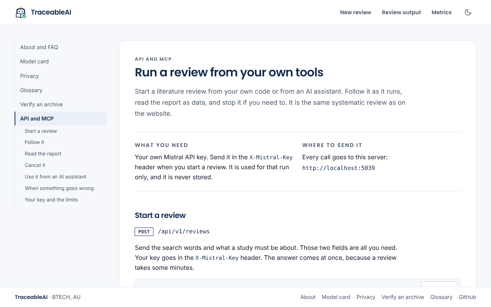

# 9. The API and the MCP server

Other tools can start a systematic review and follow it without the website. This page covers the REST API under `/api/v1`, how it keeps the caller's key out of every file, and the limits that apply to it. The code is in `AuBtechReviewAgent/Api/`.

This page is for people who work on the code. For people who use the API, the site has its own page at [`/docs/api`](https://au-btech-literature-review-agent.dk/docs/api), shown only while the API is on: the first call, following, the report, cancelling, the MCP setup, every error with what to do, and the key's promise. See "The documentation page" below.

## The switch

The API is off in production until Lau turns it on. `Program.cs` reads the switch as `builder.Configuration.GetValue("Api:Enabled", builder.Environment.IsDevelopment())`, so it is on in Development and off everywhere else unless `Api:Enabled` is `true` in the server's configuration. The default lives in code, not in `appsettings.json`. With the switch off, `Program.cs` neither registers the API's services nor maps its routes. `ApiEndpoints.HideReviewApi` then answers 404 for every address under `/api/v1` and `/mcp`, because another route that matches the shape of the path would otherwise answer a POST with 405.

## Starting a review and following it

| Call | Answer |
|---|---|
| `POST /api/v1/reviews` with the caller's key in `X-Mistral-Key` | 202 with the run id, the edit key, the stage and the addresses to follow |
| `GET /api/v1/reviews/{id}` | 200 with the stage, the step of seven, the progress, the counts and, when done, the verdicts and the downloads |
| `GET /api/v1/reviews/{id}/report` | 200 with the finished report as data; 409 while the review is not complete |
| `DELETE /api/v1/reviews/{id}` with the edit key in `X-Edit-Key` | 202 when a queued or running review was asked to stop; see below |
| `GET /openapi/v1.json` | The OpenAPI description of these calls |

The body of a start holds the New review form's fields as JSON. Only `searchWords` and `inclusion` are required, as on the form.

| Field | What it is |
|---|---|
| `objective` | What the review should find out |
| `searchWords` | The search words, the primary query |
| `searchStrings` | Up to four extra search strings; left out, the model proposes them during the run |
| `inclusion`, `exclusion` | The eligibility criteria |
| `yearFrom`, `yearTo` | Publication years, 0 for no limit |
| `databases` | Keys from `SourceCatalog`: `arxiv`, `scopus`, `ieee`, `openalex`, `semanticscholar`, `crossref`; left out, every database the keys can reach |
| `researchQuestions` | Up to four questions, answered one by one in the conclusion |
| `visualSummary`, `visualSummaryNote` | The artifact (`concept-map`, `flowchart`, `table`, `bullets`, `custom` or `none`) and what it should show |
| `maxResultsPerSource` | 1 to 50, default 5 |
| `peerReviewOnly`, `dualScreening`, `citationChaining` | The form's advanced options |
| `acceptFlaggedInput` | `true` to start a run whose fields read like instructions to the model (see below) |

A start goes through the same checks as the form. `ReviewApi.Start` builds the same `ReviewRequest`, runs `ReviewInputGuard.Check` on it, and starts `RunReviewAsync`, which waits for a run slot in `RunCoordinator` like every other run. When a field holds an instruction-like phrase, the form asks once before it starts. The API answers 422 with the phrases instead, and the caller sends the request again with `acceptFlaggedInput: true`; the phrases are then written to the protocol, as with the form. The human screening check is not offered, because nobody is on the page to do it.

The status counts the seven steps the run view shows (`ReviewSteps`): `step` is 0 while the run waits for a slot, 1 to 7 while it works, and 7 when it is done, with `stepName` and `percent` beside it. It reads the live counters while the run is going here and the ledger otherwise. Once the run is complete, `verdicts` holds the tally of the citation checks and `downloads` the archive, the references as BibTeX and RIS, every screened record and the protocol. Anyone with a run's id can read its status, as anyone with its link can open its page. The edit key in the answer to a start is the only one there is, as on the form.

## Cancelling a review

`DELETE /api/v1/reviews/{id}` cancels a review the same way the Cancel button on its page does. `ReviewApi.Cancel` calls `PrismaReviewEngine.CancelRun`, the one way to cancel a run, which checks the edit key again. The key goes in the `X-Edit-Key` header; it is the one that came back with the start. A reason is optional, as `?reason=` in the address. It is cleaned to one line of at most 300 characters and written to the ledger, and without one the ledger says "No reason was given."

A review that waits in line leaves it at once. A running review stops at its next safe point, before its next model call or step, so the answer is 202 and not 200: the run has been asked to stop, and its status shows the stage `Cancelled` when it has. Without an edit key the answer is 401, with the wrong one 403, and for a review that has ended, or is not running on this server, 409 with its stage.

## The report as data

`GET /api/v1/reviews/{id}/report` returns what the Review output page shows, read from the run's files only: `prisma-report.json`, `citation-audit.json` and the ledger. Nothing is written or asked of the model for the API, and text is cleaned of its markers just as the page cleans it (`SpecMatrix.ScrubAnchors`). `ReviewApi.Report.cs` builds it.

| Part | What it holds |
|---|---|
| `title`, `abstract` | As on the page |
| `sections` | Every section in the order of `ReportOutline.Systematic`, with its id, heading, level (2 for a theme under section 4) and text; the included studies and the appendix are tables on the page, so their text is empty and their data is in `references` and `prisma` |
| `citations` | Every checked citation: reference number, section, sentence, verdict, reason, what the check could see, and the quote when it was found word for word (`quoteVerified`), with the source's link |
| `references` | The reference list, numbered as on the page, with the DOI and a web address (only `http` or `https`, `IsWebAddress`) |
| `prisma` | The counts of the PRISMA 2020 flow diagram (`PrismaFlowCounts`) |
| `appVersion`, `protocolFingerprint`, `protocolSha256` | The app version that made the run and the fingerprints of its protocol |

The OpenAPI description at `/openapi/v1.json` is made by `Microsoft.AspNetCore.OpenApi` from the routes themselves, so it cannot drift from them. It covers only the routes under `/api/v1`, and it is mapped behind the same switch.

Every error is a problem detail (RFC 9457, `application/problem+json`) with a title and a sentence in plain English. `ApiProblems.cs` holds all of them.

| Status | When |
|---|---|
| 400 | The body is missing, not JSON, larger than 64 KB, or a field is wrong; `errors` lists each one |
| 401 | There is no usable key in `X-Mistral-Key`, or a cancel has no `X-Edit-Key` |
| 403 | A cancel's edit key does not fit the review |
| 404 | No run with this id, or a run of another kind of review |
| 409 | The report was asked for before the review was complete, or a cancel came after the review had ended |
| 422 | A field reads like an instruction to the model; `flags` lists them |
| 429 | Too many calls or too many reviews started; `Retry-After` says when to try again |
| 503 | The server runs a local model, so a review could not use the caller's key |

## The MCP server

The MCP server lets another assistant run a review as a tool. It speaks the Model Context Protocol over Streamable HTTP at `/mcp`, with the official C# SDK (`ModelContextProtocol.AspNetCore`), behind the same switch as the REST API. It is stateless: every call stands on its own, and nothing from one caller is kept for the next. The code is in `AuBtechReviewAgent/Mcp/`.

The SDK is version 2.x, which speaks two revisions of the protocol at the same address. A client on the newer revision (2026-07-28) sends the protocol version and standard headers with every request and has no handshake. A client on the older one (2025-11-25), such as one built on SDK 1.x, opens with the `initialize` handshake. The server stays stateless for both, so it keeps no session and sends no `Mcp-Session-Id`. The test `Clients_on_the_older_and_the_newer_protocol_both_reach_the_tools` pins each revision in turn and calls the tools through it. The tools use no sampling, elicitation or roots, which a stateless 2.x server cannot ask an older client for.

| Tool | What it does |
|---|---|
| `start_literature_review` | Starts a review with the form's fields and returns the run id and edit key at once |
| `get_review_status` | The stage, the step of seven, the counts and, when done, the verdicts and the downloads |
| `get_review_report` | The title, the abstract, the verdicts, every section, and the flagged citations (partly or not supported) |
| `get_review_file` | `bibtex`, `ris` or `main.tex` as text, or the address of the `archive` |
| `cancel_review` | Cancels a queued or running review with the edit key that the start returned, and an optional reason |

Each tool calls `ReviewApi`, the same methods the REST API calls, so the checks, the limits and the key handling exist once. A problem comes back as a tool error with the same plain-English title and detail. A review takes minutes, so the start tool returns at once and the assistant polls the status tool. MCP answers are never compressed, because a start carries the edit key.

The caller's MCP client sends its own Mistral key in the `X-Mistral-Key` header, as for the API. A client that reads a JSON configuration, such as Claude Code (`.mcp.json`), would add the server like this, with the key taken from the caller's own environment:

```json
{
  "mcpServers": {
    "traceableai": {
      "type": "http",
      "url": "https://au-btech-literature-review-agent.dk/mcp",
      "headers": { "X-Mistral-Key": "${MISTRAL_API_KEY}" }
    }
  }
}
```

### A "/literature-review" command in another tool

Lau's other solution can offer a "/literature-review" command on top of this server. In Claude Code a command is a Markdown file, here `.claude/commands/literature-review.md`, whose text becomes the prompt and whose `$ARGUMENTS` is what the user typed after the command:

```markdown
Run a systematic literature review with the TraceableAI MCP server on: $ARGUMENTS

1. Turn the request into search words, inclusion criteria and, if given, an objective,
   years and up to four research questions. Ask me if the inclusion criteria are unclear.
2. Call start_literature_review. Keep the run id and the edit key.
3. Call get_review_status every 30 seconds until the stage is Complete, Failed or Cancelled.
   Tell me the step (of seven) when it changes.
4. When it is complete, call get_review_report. Give me the title, the abstract, the verdicts,
   and every flagged citation with its sentence, reason and quote.
5. Offer the BibTeX through get_review_file, and the link to the review's page.
6. If I ask you to stop, call cancel_review with the run id and the edit key.
```

The tools treat what the command sends as data, as the form does: the fields pass the input guard, and a field that reads like an instruction to the model is refused until the caller confirms it with `acceptFlaggedInput`.

## The caller's key

Every start brings the caller's own Mistral key. The other keys are optional headers, as in the form's own keys: `X-Elsevier-Key`, `X-Ieee-Key` and `X-Semantic-Scholar-Key`. Each key is cleaned with `SecurityUtility.SanitizeApiKey`, as the form cleans it.

There are no free reviews through the API. The daily free quota is for the web form only, and without a key nothing starts. With a key, the engine's `ResolveKeys` uses it and never falls back to the server's Mistral key. A database key the caller leaves out falls back to the server's, as on the form. When the server runs a local model (`Llm:Provider` is `OpenAICompatible`), the caller's key would not be used at all, so the API refuses to start a review.

The key lives in the run's `ReviewRequest` and in the chat service made from it, for that run only. It is never written anywhere. The protocol is written from the request without its keys, the ledger and `llm-calls.json` hold no request, and log lines carry the run id but not the request. `ApiCallerKeys.ToString` prints no key, so a log line or an exception that names the object cannot leak one. The rate limiter counts calls per key by an HMAC with a secret that exists only in memory (`ApiKeyFingerprint`), the way `RunQuotaService` counts addresses. The test `A_review_runs_to_the_end_with_the_callers_key_and_the_key_is_never_written` runs a whole review through the API with a recognisable fake key. It then searches every file in the run folder, every file in its archive and every captured log line for it, and checks that the model was only ever made with the caller's key.

## Limits

Two limits guard the API and the MCP server. Each call counts once per client address and once per key, at most 120 a minute each, on every address under `/api/v1` and `/mcp` (`ApiEndpoints.AddReviewApi`, a chained global limiter that lets every other address through). It is chained after the site's own limiter (`SiteRateLimits`, [page 10](10-limits-and-abuse.md)), which lets these addresses through to it; a refused call still gets `Retry-After` from the site's handler and the API's problem answer, and every request body is capped at 1 MB before the API's own 64 KB check. Starting a review counts again, per key and per address, at most `Quota:OwnKeyRunsPerHour` an hour, the same number the form allows with an own key. Both use ASP.NET Core's rate limiter, and neither holds a key or an address in plain text. A start then joins the one line every review shares (`RunCoordinator.TryAdmit`, see the operations page): when the caller's address already has its share of reviews running or waiting, the answer is 429 "Too many reviews waiting"; when the whole line is full, it is 503 "The tool is busy" with `Retry-After` set to the rough wait. Nothing is counted and nothing starts in either case.

## The documentation page



`/docs/api` (`Components/Pages/ApiDocs.razor` and its parts `ApiDocsStart`, `ApiDocsFollow`, `ApiDocsAssistant` and `ApiDocsErrors`) sits with the other trust pages in `DocPage`. It follows the switch through `ApiSwitch` (`Web/ApiSwitch.cs`), which `Program.cs` registers from the same `Api:Enabled` value: with the switch off the page answers 404 and the side list leaves it out, and it is never in the sitemap. With the switch on, `ApiSwitch` also gives the OpenAPI description a line of text and an `externalDocs` link to the page.

Every request and answer on the page is in `Web/ApiDocExamples.cs`. `ApiDocsPageTests` sends the example start and cancel to the real API with the fake model, and checks that every example answer has exactly the property names and nesting of the real one. The 401 example is built from `ApiProblems.MissingKey`, and the error table takes its titles from `ApiProblems`, so a changed message shows on the page. The same tests check that the fields table names every property of `StartReviewBody` and the tools table every tool of `ReviewMcpTools`.

Every paragraph, table cell and quote on the page must score 60 or more on the Flesch Reading Ease, the bar of the release notes. `Web/ReadingEase.cs` is the C# twin of `reading_ease` in `tools/ReleaseCheck/release_notes.py`, and a test reads the page and scores each one, leaving out code. The code blocks (`Components/Layout/CodeBlock.razor`) have a large Copy button that works without a live connection: `wwwroot/js/review-output.js` handles every `data-copy` button.

## Security notes

The API adds its addresses and changes none of the rules in `AGENTS.md`. What a caller sends is data: it passes `ReviewInputGuard`, it goes into prompts only through `PromptSafety`, and every model answer is still checked in code. Run ids are GUIDs in the route (`{id:guid}`), so no caller text reaches a path. The log lines the API writes hold only a run id and an exception's type. The answers are sent with `Cache-Control: no-store`, because a start carries the edit key. For the same reason the answer to a start is never compressed (`ResponseCompressionSetup.DoNotCompress`): over HTTPS, compressing a secret next to text the caller chose opens the BREACH attack. A cancel needs the run's edit key, which `RunStore.CanEdit` compares by its hash in constant time; the key is never logged, and a wrong one changes nothing. The calls limit caps how often a key can be guessed, and an edit key is far too long to guess.
